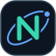
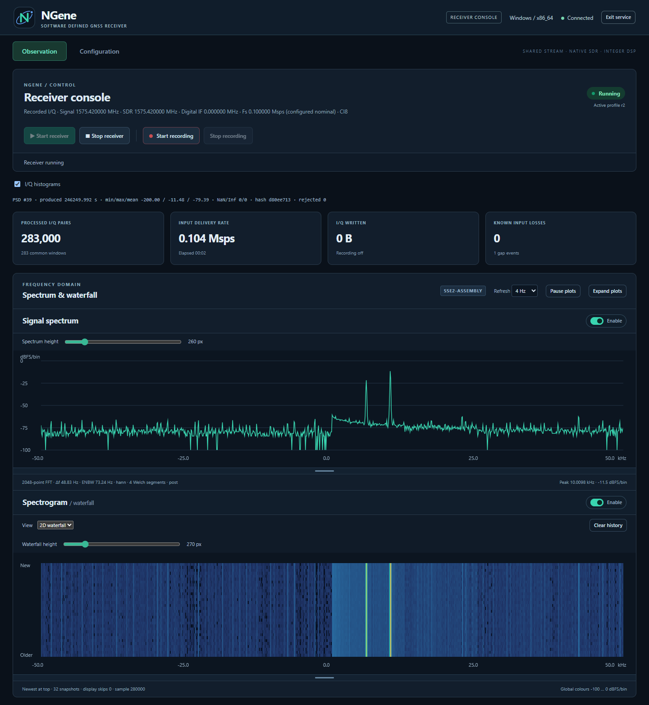

# NGene — Software GNSS Receiver



NGene is a software GNSS receiver project for receiving, inspecting and processing satellite
navigation signals from software defined radios or recorded I/Q samples. This repository
develops the original NGene receiver into a portable C11 application with a shared sample
stream, modular signal processing and a browser based operator console.

The current application provides live I/Q reception, signal conditioning, recording, file
replay and spectrum diagnostics. Satellite acquisition, tracking, navigation message decoding
and position, velocity and time (PVT) computation are not yet integrated into this branch.



*Actual NGene console running a deterministic I/Q replay fixture. This illustration is not
an over-the-air GNSS capture or a position solution.*

## Capabilities

- Native HackRF, RTL-SDR and bladeRF RX0 inputs, plus recorded I/Q file replay.
- Native CI8, CU8 and SC16 Q11 sample storage, preserving the selected frontend precision.
- Optional continuous DC removal before a common stream is delivered to receiver channels.
- Recording before or after conditioning, with segmentation, metadata and gap accounting.
- Spectrum/PSD, 2D and interactive 3D waterfall, I/Q histograms and live receiver counters.
- Runtime diagnostic controls: switching off both spectrum and waterfall stops their shared
  FFT/PSD production. Histograms can remain active independently.
- Internal integer FFT and mathematical functions with compiler selected SSE2 or NEON
  implementations, a scalar reference and an optional pool for parallel channel processing.

The application uses one active input source per service instance. To inspect a file while
another instance receives live data, run a second service on a different port and profile
directory. The [operator manual](https://github.com/mauriziofantino/nav-ngene-evo/wiki) explains the workflow and limits.

## Supported inputs

| Input | Native sample format | Requirements |
| --- | --- | --- |
| HackRF | CI8: signed 8-bit I and Q | Native libhackrf and a working USB driver |
| RTL-SDR | CU8: unsigned 8-bit I and Q | Native librtlsdr and a compatible tuner/USB driver |
| bladeRF RX0 | SC16 Q11, or CI8 when supported | Native libbladeRF and compatible device/FPGA configuration |
| Recorded I/Q | CI8, CU8 or SC16 Q11 | Closed raw file and its stream parameters, preferably a metadata sidecar |

Windows, Linux and macOS build paths are provided. Optimized FFT targets include x86-64,
32-bit x86, ARM64 and ARMv7 with NEON, subject to OS and toolchain support. Building a target
does not establish RF hardware validation on every platform.

## Build and launch

### Windows

Install Git, Visual Studio 2026 with the C/C++ workload and Windows SDK, and CMake 4.2 or
later (the Visual Studio CMake component is supported). From the repository root:

```powershell
powershell -NoProfile -ExecutionPolicy Bypass -File scripts/build-windows.ps1 -MultiSdr
.\build\msvc-x64-multisdr\Release\ngene.exe --web --port 8080
```

The script configures and builds all three native SDR adapters and stages their DLLs.
The first build may download pinned dependencies. USB drivers and device firmware remain
separate setup steps. See [Getting started](https://github.com/mauriziofantino/nav-ngene-evo/wiki/Getting-Started) for replay-only
setup and the first operating session. Additional platform build details are in the
[Windows engineering guide](docs/service/WINDOWS.md).

### Linux and macOS

With CMake 3.26 or later and a C11 toolchain, build a replay-capable receiver:

```sh
cmake -S . -B build -DCMAKE_BUILD_TYPE=Release
cmake --build build --parallel
ctest --test-dir build --output-on-failure
./build/ngene --web --port 8080
```

Enable the required native adapters with `-DNGENE_WITH_HACKRF=ON`,
`-DNGENE_WITH_RTLSDR=ON` and/or `-DNGENE_WITH_BLADERF=ON`; their platform dependencies
must be available. Python, Node.js, FFTW and SoapySDR are not runtime requirements.

## Operate the receiver

Open **http://127.0.0.1:8080** in a browser.

1. Open **Configuration → Input source** and select an SDR or **Recorded I/Q**.
2. Set the sample rate, hardware tuning and signal frequency. For replay, select a closed
   recording; a valid sidecar imports its format and stream parameters.
3. Review **Receiver**, **Recording** and **Diagnostics**, then select
   **Apply & save full profile** while the receiver is stopped.
4. Return to **Observation** and select **Start receiver**. Use **Start recording** when
   samples should also be written to disk.
5. Use the separate spectrum and waterfall **Enable** switches to select diagnostic work.
   **Stop receiver** ends reception; **Exit service** closes the application.

Recording and replay paths refer to the computer running NGene. **Transfer** downloads a
closed file to the browser's computer; retain its metadata and index for later analysis.
The service listens on loopback. A remote browser can use an SSH tunnel to the receiver.

For command line operation:

```sh
ngene --config config/hackrf.ini
ngene --replay "captures/example_000000.cs8"
ngene --config config/replay.ini --replay "captures/file-without-sidecar.cs8"
```

For a file without metadata, set its actual format, sample rate and RF references in the
profile first. Raw I/Q bytes do not encode those parameters.

## Documentation

- [Operator manual / wiki](https://github.com/mauriziofantino/nav-ngene-evo/wiki): setup, GUI, diagnostics, recording and replay.
- [Configuration reference](https://github.com/mauriziofantino/nav-ngene-evo/wiki/Configuration-Reference): keys, units, defaults and limits.
- [Troubleshooting](https://github.com/mauriziofantino/nav-ngene-evo/wiki/Troubleshooting).
- [Engineering and service documentation](docs/service/README.md): architecture, numerical
  contracts, provenance and historical verification records.
- [Wiki maintenance](docs/WIKI-PUBLISHING.md): update the operator manual in its separate
  GitHub Wiki repository.

All maintained documentation is in English. Optional API documentation can be generated
with `-DNGENE_WITH_DOCUMENTATION=ON` and the `ngene_docs` build target when Doxygen is installed.
