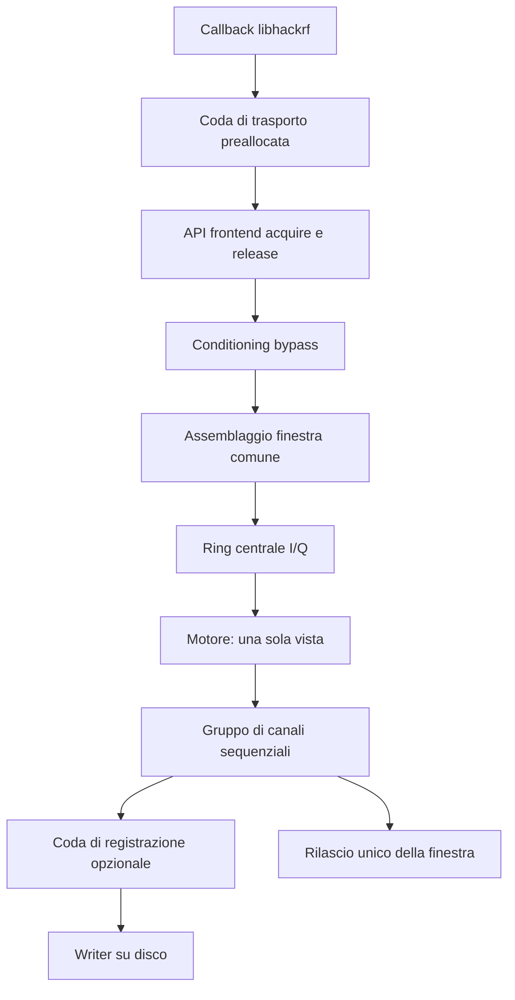
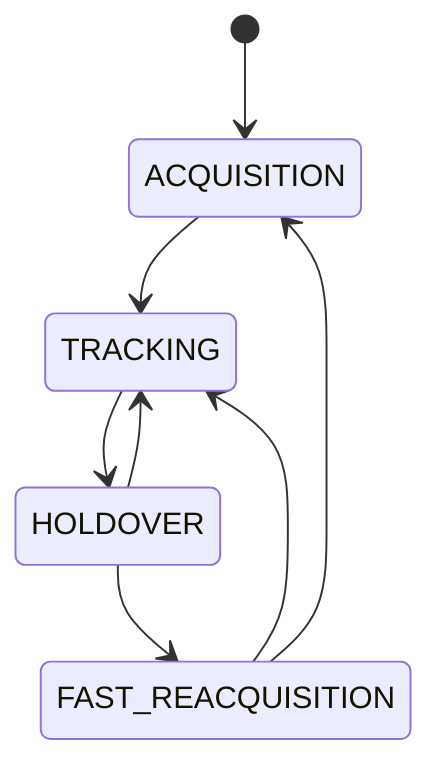

# Architettura del kernel e della console

L’architettura recepisce lo schema e le istruzioni del 28 settembre 2026. Sono superate le proposte di implementazione C++/SoapySDR e di lettori indipendenti per ogni canale.

La coda iniziale appartiene al trasporto del frontend: assorbe i burst USB e mantiene breve la callback. Non è un secondo stream GNSS né introduce cursori per satellite. Nella modalità di sola registrazione il motore salta il gruppo di canali e alimenta direttamente il writer.

Il thread che esegue `NgReceiverRun()` preleva i blocchi del frontend, applica il conditioner, assembla finestre e coordina i canali. Libhackrf ha i propri thread di trasporto; il recorder ha un thread aggiuntivo. Non esiste un thread per satellite.

## Memoria e tempo

- Il frontend possiede i campioni fino a `release()`. La callback USB copia in memoria preallocata prima che libhackrf riutilizzi il transfer.
- Il conditioner produce una vista valida fino alla chiamata successiva e non trattiene quella di ingresso. Il bypass non copia. In questa versione il contratto ammette soltanto CI8 e conservazione di rate, conteggio, indici ed eventi.
- Il motore assembla finestre di `window_samples` coppie; confini USB e confini delle finestre non devono coincidere.
- Il ring è **a blocchi**, con slot contigui riutilizzati circolarmente. Una vista non attraversa fisicamente due slot; il wrap avviene fra finestre. È un ring di segnali complessi, non due ring indipendenti I/Q.
- Una sola lease è attiva per il consumatore del ring. Mentre è attiva, i dati restano immutabili e non sovrascrivibili. Tutti i canali vedono lo stesso puntatore, intervallo ed evento.
- In questo incremento il motore produce e consuma il ring centrale nello stesso thread, una finestra alla volta. La capacità configurabile e l’API del ring preparano l’evoluzione; non si dichiara una pipeline centrale già parallela. La coda USB è invece effettivamente concorrente.
- Le copie correnti sono esplicite: ingresso USB→coda frontend, assemblaggio della finestra, pubblicazione nel ring centrale, eventuale coda del recorder. Non sono copie private dello stream per canale. Ridurle è un’ottimizzazione successiva da misurare.
- Gli indici contano **coppie** I/Q. `sample_rate_hz` è il numero di coppie/s. L’indice assoluto nella coppia `(epoch, first_sample)` non è la posizione fisica nello slot.
- HackRF, nell’interfaccia usata qui, non fornisce un timestamp RF per blocco. L’orario host del file è informativo; non viene presentato come tempo GNSS né come istante esatto dell’antenna.

Quando il frontend perde campioni nella propria coda, continua il conteggio dei campioni ricevuti dalla callback: il salto risulta visibile al motore. La durata di perdite non osservabili dal software non viene inventata. La disconnessione arresta il run con errore; non viene implementato un riavvio automatico che nasconda la discontinuità.

Un gap interrompe la finestra in costruzione. L’eventuale prefisso valido viene consegnato come `NG_BLOCK_PARTIAL`; la prima nuova finestra porta `NG_BLOCK_GAP`. Anche EOF e arresto richiesto possono produrre una finestra parziale: nessuno zero padding. Il modulo GNSS deve decidere come invalidare o completare i propri accumuli. Le epoche e gli indici non possono regredire senza una nuova epoca.

## Interfacce

| Header | Contratto |
|---|---|
| `frontend.h` | Apertura/configurazione, start, acquire/release, stop, statistiche, destroy |
| `conditioning.h` | Trasformazione sincrona a rate costante prima del ring |
| `ring.h` | Pubblicazione bounded, acquire/release unico, close e drain |
| `channel.h` | Stato privato per istanza, stessa finestra per tutti, richiesta di transizione |
| `receiver.h` | Coordinamento, stop, assemblaggio, dispatch e statistiche |
| `recording.h` | Writer asincrono a memoria limitata, segmentazione e chiusura |

Le tabelle di funzioni C consentono l’iniezione di moduli. Le strutture interne dei backend restano private; nessun tipo libhackrf compare negli header NGene pubblici. L’ABI è iniziale e versionabile, non congelata per plugin binari indipendenti. Il contratto attuale dei canali è volutamente piccolo: non definisce ancora tutta la banca correlatori o l’assistenza alla navigazione.

## Stati del canale

È implementata la validazione delle transizioni, non la decisione GNSS che le provoca. Permanere nello stesso stato è sempre consentito. `HOLDOVER` indica propagazione del tracking ad anello aperto; non dead reckoning della posizione. Demodulazione e formazione degli osservabili saranno attività durante il tracking, non stati esclusivi successivi.

I canali non fanno avanzare il ring. Un’integrazione lunga conserva accumulatori/stato propri; un’acquisizione che richiede storia completa dovrà dichiarare un workspace limitato e la finestra richiesta. Lo stato del canale non deve contenere puntatori persistenti a una vista del ring.

## Errori e chiusura

Il default `stop` interrompe su overflow della coda di ingresso. `drop_newest` mantiene i dati precedenti e conta quelli scartati. Una coda del recorder piena arresta sempre il run: non vengono eliminate registrazioni in silenzio. Gli errori dei moduli fermano il gruppo e non vengono trasformati in successo parziale.

Stop e destroy si eseguono fuori dalla callback. Il recorder svuota la propria coda e chiude i file prima di terminare; la chiusura può attendere l’I/O del filesystem. I campioni ancora nella coda del frontend al termine sono contati separatamente. Le statistiche misurano eventi noti al software, non certificano l’assenza di ogni perdita RF/USB.

## Confini di piattaforma e formato

Il solo `src/platform/` contiene Win32/POSIX. Il codice operativo è C11. La memoria dei campioni è allineata naturalmente per CI8; non è ancora un contratto di allineamento AVX/NEON. Le API DSP future dovranno dichiarare allineamento, remainder, scaling e accumuli.

CI8 è la scelta esplicita del **primo percorso HackRF**. Non è un formato universale già imposto a bladeRF, Pluto, filtri, mixer o FFT. La loro integrazione richiederà estendere descrittore e viste con nuovi formati, mantenendo le unità in coppie complesse.

## Controllo e osservazione (v0.2.0)

`apps/main.c` seleziona CLI o Web nello stesso eseguibile. `src/control/` implementa il ciclo di vita senza tipi HTTP; `src/web/` traduce REST/WebSocket in chiamate C; `web/` contiene soltanto presentazione e comandi. Le risorse web sono incorporate in compilazione da CMake. `ngene_core`, `ngene_control` e `ngene_http` sono target di libreria, non processi separati.

Il controller ha un thread manager e al massimo un thread motore. I thread HTTP non eseguono i cicli di ricezione. Il manager serializza start, stop e apertura/chiusura del recorder. Gli hook di `NgReceiverRunEx()` comunicano avvio, progresso e finestre; `NgReceiverRun()` resta il wrapper originale. La callback di finestra copia i dati nella coda del recorder e sottopone i tap pre/post alla diagnostica. Non esegue I/O su disco o rete. Il recorder ha un mutex di lifetime separato; diagnostica e progresso usano try-lock. Il browser legge snapshot fino a 30 Hz senza ricevere raw I/Q.

Lo snapshot JSON è costruito dopo aver copiato lo stato fuori dal mutex. Un browser lento non trattiene una lease del ring. Restano costi di copie e sincronizzazione da misurare: non è una garanzia hard real-time.

Start recording pubblica il nuovo recorder fra finestre complete. Stop recording lo scollega fra finestre, poi attende il drain nel manager mentre il motore continua. Stop receiver chiude anche il recorder; la conferma arriva dopo il join/flush. La richiesta di Stop durante Starting cancella l’avvio o ne attende la chiusura. Errore di scrittura/overflow non viene nascosto come perdita accettabile.

La destinazione scelta nella GUI appartiene al computer del processo NGene. La directory del profilo persistente rimane separata. La lista file riguarda la destinazione attualmente configurata e sopravvive al riavvio perché legge il filesystem. Per tornare a registrazioni di un’altra cartella, selezionarla a ricevitore fermo. Il trasferimento HTTP legge soltanto file di registrazione chiusi; non è un consumatore dello stream live.

Il modulo `src/analysis/` implementa ora l’osservazione spettrale con FFT intera interna, worker dedicato e configurazione runtime. La GUI presenta risultati e waterfall. `docs/ANALYSIS.md` descrive la semantica dei burst e delle statistiche.

## Aggiornamento v0.3

Ordine confermato dall’utente: conditioning condiviso **prima** del ring centrale. Tap di registrazione selezionabile pre/post; nessun secondo ring GNSS. Le code del recorder e i workspace temporanei dell’osservatore hanno scopi e proprietà distinti dal ring che alimenta i canali.

`HOLDOVER → TRACKING` è consentito e verificato: il recupero del segnale può richiudere direttamente la retroazione. La fast reacquisition è un tentativo successivo in caso di mancato recupero, non un passaggio obbligato. HOLDOVER non indica dead reckoning della posizione.

## Aggiornamento 0.4

La precedente anteprima raw I/Q è rimossa dalla telemetria. Il receiver non attende i lock GUI: tap diagnostici e progress usano try-lock; il recorder ha un lock di lifetime separato, condiviso soltanto con il manager. PSD e istogramma hanno workspace e cadenze indipendenti; il ring GNSS resta unico. L’ownership della PSD e i controlli end-to-end sono descritti in [ITERATION_04.md](ITERATION_04.md). Il conditioner opzionale DC mantiene lo stato fra blocchi. Il riferimento digital IF appartiene allo stream ed è disponibile ai canali: nessun mixer è aggiunto al flusso comune.

## Sorgenti indipendenti 0.6

Il frontend FILE implementa la stessa interfaccia acquire/release di HackRF, con memoria posseduta dal suo backend e lease esplicita. Niente frontend sintetico nel prodotto. [REPLAY.md](REPLAY.md) definisce formato, EOF, pacing e loop.

Un server può ospitare due controller: primario e replay parallelo. Ciascuno possiede un motore e uno stream indipendente, con ring, conditioner, diagnostica e recorder propri. Questo non duplica il ring per i canali di uno stream: tutti i satelliti di quel motore continuano a vedere la stessa finestra. Clock e campioni delle sorgenti non vengono mescolati. La GUI seleziona il controller da osservare/comandare; i thread di ricezione non attendono il browser.
