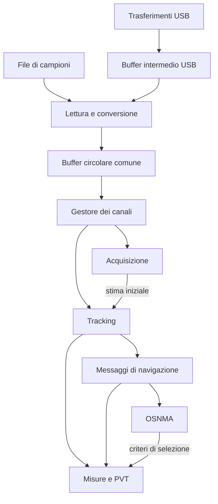
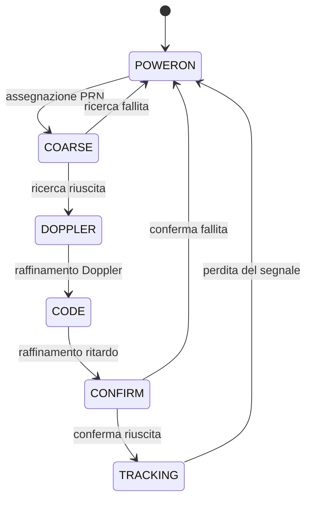

# NGene — manuale di lavoro, inventario e architettura

Analisi, decisioni e registro degli incrementi NGene · Revisione 8, 9 ottobre 2026

**Da consultare prima delle successive modifiche a NGene. La sezione 18 aggiorna build nativa Windows, naming, documentazione e GUI; prevale sulle istruzioni storiche incompatibili. La sezione 17 consolida diagnostica, DC, tuning offset e build nativa Windows; prevale sulle descrizioni storiche precedenti incompatibili. La sezione 16 aggiorna le decisioni correnti e documenta FFT assembly, spettro/waterfall, istogrammi configurabili e registrazione pre/post conditioning. Prevale sulle descrizioni storiche di funzionalità ancora mancanti nelle sezioni 14–15. La sezione 15 aggiunge WebGUI, macOS, controllo unificato, scelta della cartella sul ricevitore e trasferimento al browser. La sezione 14 registra il primo incremento implementato in C e i requisiti di base: NGene come base del progetto, librerie frontend native e avanzamento comune di tutti i canali. Prevale sulle proposte precedenti incompatibili.** Le sezioni 1–10 documentano l’archivio analizzato e le prime proposte. Le sezioni 11–13 registrano i requisiti successivamente precisati dall’utente e lo stato dei task 3–7. La sezione 13 aggiorna in particolare scelta del frontend, modalità FAST/PRECISE e vincoli prestazionali. I requisiti approvati prevalgono sulle proposte precedenti quando incompatibili; le nuove proposte non diventano approvate per il solo fatto di comparire qui. Il riuso del motore e degli algoritmi non impone di conservare la rappresentazione reale a IF o le ottimizzazioni numeriche legate ai vecchi ingressi.

## 1. Esito e perimetro

**Una riorganizzazione è utile, ma il ricevitore possiede già una parte importante del motore di distribuzione dei campioni desiderato:** un buffer circolare comune, una posizione di lettura per canale e una regola di rilascio che tiene conto dell’avanzamento di tutti i canali. La prima evoluzione dovrebbe rendere esplicite queste responsabilità, preservandone il comportamento verificabile.

Le cartelle attuali distinguono già acquisizione, tracking, frontend e PVT. La difficoltà principale è che questi gruppi non costituiscono moduli autonomi: condividono strutture centrali, memoria di lavoro, dettagli del buffer e convenzioni numeriche. Spostare i file migliorerà la leggibilità, ma non risolverà da solo questi accoppiamenti.

Sono stati completati:

1. Inventario dell’archivio, classificazione dei componenti e lettura dei percorsi di compilazione.
2. Ricostruzione statica del percorso dei campioni, della gestione dei canali e dei collegamenti fino al PVT, confrontando i punti pertinenti dei due documenti forniti.

**Durante i task di analisi iniziali nessun sorgente originale è stato modificato.** Non furono eliminati frontend, commenti, nomi, librerie o file, né applicate correzioni di stile, portabilità o conformità ESA. La sezione 14 descrive ora il primo incremento implementato in una struttura separata; l’archivio originale resta conservato e invariato.

L’analisi dei task 1 e 2 non è una compilazione di verifica, una prova con segnali registrati, un benchmark o una validazione su hardware. Distingue il codice presente, quello incluso nel target principale e i percorsi richiamati dal ricevitore; l’effettiva attivazione di molte funzionalità dipende dalla configurazione e dalle macro. La sezione 12 delimita le successive verifiche numeriche isolate, senza estenderne l’esito al ricevitore.

## 2. Materiale analizzato e tracciabilità

| Materiale | Impiego nell’analisi |
|---|---|
| Ultimo archivio sorgente allegato, `ngene(2).tar` | Inventario e ricostruzione del comportamento attuale |
| `report.pdf`, *GPS Software Receiver — Implementation notes*, 10 pagine | Codifica XOR, approssimazioni, generazione tabellare delle portanti e del codice |
| `PhD_Fantino070206.pdf`, *Study of Architectures and Algorithms for Software Galileo Receivers*, 231 pagine | Architettura GNSS, metodi di acquisizione, tracking classico e proposta di tracking esteso |

La copia locale iniziale dell’archivio risultava troncata. È stata recuperata la copia completa dell’allegato prima di completare l’inventario: 28.467.200 byte, SHA-256:

`c15c72e9e715e6a77ee6ccf694adb3e2d939a355b1f6ad3ff4e82121de8e1acb`

È stata verificata l’uguaglianza byte per byte tramite hash dei 708 file regolari estratti esterni alla directory Git principale rispetto all’archivio: nessuna differenza.

I percorsi riportati nel seguito sono relativi alla radice `ngene/` dell’archivio; i nomi di funzione rendono individuabili le evidenze senza dipendere da una futura rinumerazione delle righe. Per la tesi si distinguono pagina stampata e pagina del PDF. Sono state lette le parti pertinenti, non svolta una revisione scientifica integrale della tesi. Le equazioni del report sulla generazione tabellare e la figura 16.2 della tesi sono state controllate anche visivamente.

I documenti riportano rispettivamente gennaio 2008 e maggio 2006: aiutano a ricostruire le origini dei metodi, ma non dimostrano che ogni dettaglio della versione attuale sia identico alla versione descritta allora.

## 3. Task 1 — inventario e organizzazione

### 3.1 Contenuto dell’archivio

L’archivio contiene 708 file regolari fuori dalla directory Git principale. Di questi, 247 sono sotto `build/`. Il conteggio comprende sorgenti, configurazioni, prodotti di compilazione e file accessori: non equivale al numero di sorgenti del ricevitore.

| Cartella o gruppo | File | Responsabilità osservata | Valutazione organizzativa |
|---|---:|---|---|
| `receiver/` | 20 | Avvio, configurazione, stato globale, canali, ciclo principale | Coordinamento e stato degli algoritmi molto intrecciati |
| `frontEnd/` | 14 | Lettura da file/USB, thread USB, buffer e conversioni | Trasporto, formato dei campioni e buffering da distinguere |
| `asmFolder/` | 36 | SIMD, FFT, array, portanti, PRN, conversioni frontend | Mescola funzione matematica, implementazione CPU e adattamento hardware |
| `acquisition/` | 14 | Ricerca grossolana, raffinamenti, conferma, soglie | Raggruppamento funzionale già sensato |
| `tracking/` | 12 | Correlatori, DLL/FLL/PLL, tracking GPS/Galileo | Raggruppamento funzionale sensato, interfacce dipendenti dal ricevitore |
| `utilityGnss/` | 61 | Messaggi, FEC, codici, tempo, C/N₀, correzioni, NeQuick | Contiene diversi sottosistemi che meritano identità propria |
| `pvt/` | 21 | Tempi, pseudorange, smoothing, correzioni, LS/Kalman, controlli | Formazione delle misure e soluzione di navigazione oggi nello stesso gruppo |
| `osnma/` | 27 | Parsing e verifiche di autenticazione, crittografia, strumenti | Funzionalità trasversale a messaggi, canali e selezione PVT |
| `chimera/` | 8 | Funzioni crittografiche e programma di prova | Presenza nel progetto da distinguere dall’integrazione operativa |
| `guiSupport/` | 7 | Protocollo, socket, thread RX/TX, preparazione dati GUI | Interfaccia esterna distinta dal calcolo GNSS |
| `warmStart/` | 6 | Inizializzazione assistita e visibilità satelliti | Servizio di supporto allo scheduling |
| `utility/` | 30 | Log, terminale, matematica, matrici, spettro, compressione | Gruppo eterogeneo da scomporre con criterio |
| `libraries/` | 159 | `libfec`, sorgenti e prodotti della sua compilazione | Dipendenza esterna con propria gestione di build |
| `sampleConfigurationFiles/` | 41 | Configurazioni e dati accessori | Da conservare separati dagli algoritmi |
| `build/` | 247 | Cache e prodotti di compilazione | Non deve diventare parte della struttura sorgente di riferimento |
| File alla radice | 5 | Build, README e riferimento al submodulo | Documentazione e build non completamente allineate |

I conteggi includono file accessori presenti nell’archivio, anche nei gruppi che contengono librerie o strumenti. Fuori da `build/` e `libraries/` sono presenti **105 file `.c`**, compreso codice incorporato di provenienza esterna. Il target CMake principale ne elenca **100**.

I cinque `.c` non elencati nel target CMake sono:

- `receiver/ngeneNavMesg.c`: contiene un altro `main`.
- `receiver/ngeneNavMesgUtility.c`: incluso invece nell’elenco di `Makefile.am`.
- `osnma/testCryptoFunctions/mainTestCrytoFunction.c`.
- `osnma/createPemFIle/createPemFile.c`.
- `chimera/testCryptoFunctions/mainTestChimera.c`.

Questa distinzione evita di interpretare come codice inutilizzato qualsiasi file assente dall’eseguibile principale: alcuni appartengono a programmi ausiliari. Analogamente, i file `.function` in `asmFolder/` sono inclusi testualmente da sorgenti C; non sono scarti da eliminare per la sola estensione.

### 3.2 Dipendenze e provenienza

| Componente | Evidenza | Conseguenza per la futura pulizia |
|---|---|---|
| `libraries/libfec/` | README e licenza inclusi; libreria statica collegata da CMake | Trattarlo come componente esterno, distinguendo sorgenti e prodotti generati |
| `utilityGnss/NeQuick/` | Intestazioni dichiarano derivazione da implementazione di riferimento NeQuick | Non assimilarlo automaticamente al codice originale NGene |
| `osnma/base64.c` | Intestazione con provenienza esterna e riferimento a licenza BSD | La provenienza esterna può trovarsi anche fuori da `libraries/` |
| OpenSSL/libcrypto, libusb, ncurses/tinfo, libreria matematica e pthread | Configurazione e collegamento del target principale | Separare in futuro dipendenze DSP, piattaforma, autenticazione e presentazione |

Questa è una prima classificazione, non un censimento legale completo. Prima dell’eventuale rimozione delle attribuzioni va classificato ogni file interessato: il nome della cartella da solo non determina la provenienza.

Il ricevitore contiene una propria implementazione Viterbi in `utilityGnss/viterbi.c`; il collegamento a `libfec` è osservabile, fra l’altro, nelle chiamate Reed–Solomon di `utilityGnss/reedSolomon.c`. Non sarebbe corretto attribuire indistintamente tutta la decodifica FEC alla libreria esterna.

### 3.3 Compilazione e architetture

La configurazione CMake rileva `x86_64`, `aarch64` e alcune varianti ARM e assegna `ARCH`. **Questo valore non seleziona una diversa implementazione DSP nel target attuale.**

Evidenze principali:

- `CMakeLists.txt`, righe iniziali: rilevamento dell’architettura seguito da flag globali che comprendono comunque `-msse2`, `-mfpmath=sse`, `-march=native` e `-mtune=native`.
- Lo stesso target include sempre i sorgenti SIMD di `asmFolder/`.
- `receiver/ngeneConstants.h` definisce direttamente `COMPILE_64_BIT`; la macro non deriva dal rilevamento CMake.
- Tutte le cartelle degli header sono rese visibili globalmente. È presente anche un percorso `secure/` che non corrisponde a una cartella nell’archivio analizzato.
- `libfec` viene costruita mediante un comando personalizzato `configure`/`make` dentro la sua directory; il suo `CMakeLists.txt` non è integrato mediante `add_subdirectory` dal progetto principale.
- L’installazione forza un percorso nella home e contiene operazioni sulla configurazione della shell. Queste operazioni sono estranee alla sola compilazione e non sono state eseguite.
- `Makefile.am` elenca 101 sorgenti contro i 100 di CMake e presenta differenze di collegamento, fra cui `pci`. Il README descrive prevalentemente il percorso Autotools e contiene riferimenti storici da riconciliare con il codice.

Nell’archivio sono presenti riferimenti ad ARM nei commenti, ma **non è stato individuato un backend completo ARM/NEON dei kernel NGene selezionabile dalla build**. `libfec` comprende implementazioni C portabili e varianti per altre CPU; questo non costituisce il porting delle funzioni di correlazione, portante, PRN e FFT di NGene. In particolare, i file Altivec riguardano PowerPC.

Conclusione: la futura organizzazione deve distinguere **algoritmo GNSS**, **kernel DSP** e **implementazione per CPU**. La selezione della piattaforma deve poi governare sorgenti, opzioni e dipendenze; il solo messaggio di riconoscimento dell’architettura non basta. Non viene dichiarato supporto ARM funzionante.

### 3.4 Ha senso riorganizzare?

Sì. Le separazioni più giustificate dall’analisi sono:

| Responsabilità | Dove si trova oggi | Confine da discutere nella fase successiva |
|---|---|---|
| Avvio e coordinamento | `receiver/` | Applicazione e motore di esecuzione |
| Ingresso dei dati | `frontEnd/`, conversioni in `asmFolder/` | Sorgente, decodifica formato, flusso di campioni |
| Conservazione e lettura condivisa | `frontEnd/circularBuffer.*`, `receiver/channelManager.c` | Buffer e contratto di consumo dei lettori |
| Operazioni numeriche | `asmFolder/`, parti di `utility/` | Interfaccia DSP e implementazioni CPU |
| Algoritmi di ricerca/inseguimento | `acquisition/`, `tracking/` | Algoritmi con stato e memoria di lavoro dichiarati |
| Messaggi e tempo GNSS | `utilityGnss/` | Decodifica, dati di navigazione e riferimenti temporali |
| Formazione delle misure e PVT | `pvt/`, stato dei canali | Osservabili a epoca comune e soluzione di navigazione |
| Autenticazione e analisi aggiuntive | `osnma/`, `chimera/`, funzioni distribuite | Interfacce ai dati e ai controlli del ricevitore |
| GUI e registrazioni | `guiSupport/`, `utility/`, ciclo principale | Presentazione, comandi e uscite |

Questa tabella identifica confini candidati: non è ancora una nuova struttura approvata né implica che ogni riga debba diventare una libreria o un thread.

## 4. Task 2 — dal frontend ai campioni condivisi

### 4.1 Percorso effettivo dei dati



Il diagramma descrive collegamenti funzionali presenti; non rappresenta una pipeline di thread indipendenti.

`TRxFe` rappresenta l’ingresso corrente, da file o USB. `ReadRxFrontEnd` legge byte. `FillInputBuffer` li converte nel formato interno e aggiorna il buffer circolare. Esistono percorsi speciali per alcuni formati: per esempio Stereo Triton usa direttamente `fread` dentro `FillInputBuffer`, mentre il percorso USRP legge parole a 16 bit e le converte. L’interfaccia comune, quindi, è già abbozzata ma non uniforme.

Il buffer interno è un array di `char` usato come successione di campioni reali. Le conversioni dipendono dal frontend, dalla quantizzazione e dalle convenzioni di segno. **Non è un’interfaccia generica per campioni complessi I/Q provenienti da qualsiasi frontend.**

Questo non significa che il ricevitore non calcoli I e Q: `CarrierComplexWipeOff` produce i due rami interni usando le repliche seno/coseno; acquisizione e tracking lavorano poi su quantità in quadratura. La distinzione importante è fra rappresentazione dei campioni d’ingresso e rappresentazione interna dopo la rimozione della portante.

Evidenze: `frontEnd/frontend.c`, `ReadRxFrontEnd`; `frontEnd/circularBuffer.c`, `FillInputBuffer` e `ConvertSamplesIntoNGeneFormat`; `asmFolder/arrays.c`, `CarrierComplexWipeOff`.

### 4.2 Due livelli di buffering nel percorso USB

| Buffer | Proprietà e accessi | Dimensionamento osservato |
|---|---|---|
| Buffer dei trasferimenti USB | Gestito dall’interfaccia libusb | 128 blocchi; blocco predefinito di 8.192 byte |
| Buffer intermedio USB | Thread frontend produce, ciclo del ricevitore legge; mutex e condition variable | 512 blocchi; circa 4 MiB con la dimensione predefinita |
| Buffer circolare del ricevitore | Contiene campioni convertiti; il ciclo principale lo riempie e gestisce le letture dei canali | `INPUT_BUFFER_SIZE = 16` ms, convertiti in numero di campioni usando `fs` |

Le dimensioni USB effettive dipendono dalla dimensione di blocco configurata. Questi buffer servono a separare trasferimento e elaborazione; non sono copie integrali dello stream per ciascun satellite.

Quando il buffer intermedio USB si riempie, il produttore attende spazio. Tale attesa regola il passaggio fra i thread software: non dimostra che il dispositivo fisico possa sospendere indefinitamente il flusso senza perdere campioni. Il percorso di recupero da timeout può riavviare l’USB e reimpostare gli indici; non è stato individuato un contratto esplicito che consegni ai canali un evento di discontinuità con indice e durata del gap.

Evidenze: `frontEnd/frontend.h`, `TUsbFe` e costanti dei buffer; `frontEnd/usbInterface.c`, `CopySamplesIntoUsbIntermediateBuffer` e `ReadUsbInterface`; `frontEnd/frontendThreadFunctions.c`, `UsbFrontEndThreadFunction`.

`frontEnd/megaBuffer.c` contiene un ulteriore buffer per registrazione e compare nel target CMake. Nell’analisi delle chiamate non è stato trovato un collegamento operativo di inizializzazione/aggiornamento al percorso principale. Non è quindi rappresentato come un terzo buffer attivo dello stream.

## 5. Canali, avanzamento e scheduling

### 5.1 Il motore condiviso esiste già

Il ciclo principale in `receiver/ngene.c` svolge, schematicamente, questi passaggi:

1. Calcola il fabbisogno massimo dei canali con `GetMaximumNumberOfSamplesNeeded`.
2. Richiama `FillInputBuffer` se i campioni disponibili non bastano.
3. Scorre i canali e ottiene per ciascuno uno o due tratti contigui del buffer con `GetSamplePointersForChannel`.
4. Esegue `DoChannelManager` sul canale corrente.
5. Calcola con `GetNumberOfUsedSamples` l’avanzamento minimo comune, libera quella porzione del buffer e aggiorna gli offset dei canali.
6. Esegue le attività periodiche: soglie, tempo ricevitore, autenticazione, PVT, visibilità, GUI e registrazioni.

Ogni `TChannel` conserva `bufferOffset`, `blocksize` e `blocksizeNext`. L’offset è relativo alla coda corrente del buffer, mentre `TCircularBuffer.discardedSamples` mantiene il numero cumulativo di campioni rilasciati.

**I canali leggono lo stesso stream senza una copia completa privata dei campioni d’ingresso.** Possono trovarsi a posizioni diverse e richiedere finestre di lunghezza diversa. Condividere i dati non impone che tutti eseguano la stessa operazione sullo stesso blocco a ogni iterazione.

La memoria può essere riutilizzata dopo il rilascio dal buffer. Non esiste un meccanismo generale di prestito con durata esplicita per un algoritmo esterno che conservi quei puntatori oltre il ciclo corrente. Questo è un confine importante per future elaborazioni asincrone.

Il consumo è coordinato dal lettore meno avanzato. La logica concreta comprende limiti di avanzamento per iterazione, stati del canale e casi di acquisizione saltata: non equivale ancora a un servizio generico di buffer con lettori registrabili, politiche di ritardo e gestione dei gap.

Evidenze: `receiver/channelManager.c`, `GetMaximumNumberOfSamplesNeeded`, `GetNumberOfUsedSamples`, `CleanBufferOffsetForAllChannels`, `GetSamplePointersForChannel`, `DoChannelManager`; `frontEnd/circularBuffer.c`, `DeleteFromCircularBuffer`.

### 5.2 Stato del canale e algoritmo

Il percorso nominale ricostruito da `DoChannelManager` è:



Esiste anche `UNUSED_STATE` per canali disabilitati, omesso dal percorso nominale. L’ordine delle voci dell’enumerazione non coincide con l’ordine delle transizioni: nel flusso effettivo il raffinamento Doppler precede quello del codice.

Il canale è una risorsa di elaborazione: contiene identità del satellite/segnale, stato di acquisizione, tracking, parser e informazioni PVT. Il PRN può essere assegnato nuovamente al ritorno in `POWERON_STATE`. Per una futura interfaccia non andrebbero quindi confusi indice del canale, satellite e segnale.

Lo scheduler limita quante acquisizioni possono procedere e adatta questo numero al carico di tracking. Non è un assegnamento fisso di un thread a ogni satellite. Inoltre gli algoritmi possono modificare offset e dimensione del blocco per riallineare la fase del codice: oggi partecipano direttamente alle decisioni di consumo dello stream.

### 5.3 Concorrenza e memoria di lavoro

**I canali vengono elaborati sequenzialmente dal ciclo principale.** Esistono thread per altre responsabilità:

| Contesto | Attività osservata |
|---|---|
| Ciclo principale | Avanzamento dei canali, DSP, parsing richiamato dal tracking, PVT e servizi periodici |
| Thread frontend USB | Eventi e trasferimenti libusb, alimentazione del buffer intermedio |
| Thread GUI RX/TX | Comandi e dati attraverso socket, quando la GUI viene inizializzata |
| Thread verifica TESLA | Verifica OSNMA in un percorso dedicato, coordinato con lo stato del ricevitore |

La comunicazione GUI osservata usa socket. Le indicazioni storiche del README sulle message queue non sono state assunte come descrizione del trasporto corrente dei campioni.

`TNGeneData` possiede array mutabili comuni per codice, portante seno/coseno, sottocodici e memoria di lavoro dell’acquisizione. Alcuni puntatori del tracking, per esempio early/prompt/late, indicano porzioni di questi array. Il canale possiede invece accumulatori e stato persistente, oltre ad alcune allocazioni private dell’acquisizione.

| Dato | Proprietà prevalente | Implicazione |
|---|---|---|
| Campioni d’ingresso | Buffer comune | Viste valide entro la politica di conservazione del buffer |
| Stato di acquisizione/tracking e parser | Canale | Deve sopravvivere fra invocazioni |
| Codici e portanti temporanei | Ricevitore, riutilizzati | Non possono essere scritti contemporaneamente da più canali senza separazione |
| Tabelle PRN, portanti e FFT | Ricevitore, condivise | Condivisione possibile distinguendo dati inizializzati e dati mutabili |
| Messaggi, autenticazione e soluzione PVT | Strutture comuni | Servono regole di pubblicazione e validità temporale |

Quindi il passaggio a canali concorrenti non può consistere semplicemente nell’aggiunta di thread attorno a `DoChannelManager`.

Un punto ulteriore da verificare in una futura analisi di concorrenza è `ngeneXmmsBackup`, memoria globale usata per salvare registri SIMD. `ArrayCopy` la usa anche nel percorso del thread USB, mentre altre funzioni DSP la usano nel ciclo principale. È un rischio di interferenza identificato staticamente, non un guasto riprodotto in questa attività.

## 6. Correlazione, acquisizione e tracking

### 6.1 Collegamento fra implementazione e report numerico

La correlazione è una base comune, ma i diversi stadi non la calcolano tutti nello stesso modo.

| Metodo | Documento | Riscontro nel sorgente | Vincolo da preservare |
|---|---|---|---|
| Moltiplicazione per segni mediante XOR | Report, pp. 1–3 | `ArrayXor`, `ArrayMac`, wipe-off | Codifica `0x00`/`0xff`, segno e compensazione del bias |
| Portante da lookup table e accumulatore di fase | Report, pp. 3–5 | `InitCarrierTable`, `GenerateCarrier` | Quantizzazione della fase, avanzamento e approssimazione entro il blocco |
| Generazione PRN con ripetizioni di lunghezza diversa | Report, pp. 5–10 | `OversampleCode`, `GenerateCode` | Fase intera/frazionaria, rapporto frequenze, padding e vettorizzazione |
| Correlazione per ricerca parallela del ritardo | Tesi, §9.2, pp. 88–89; PDF 116–117 | `PerformCoarseAcquisition`, `InitLocalCodesFft` | Scaling FFT, ordine/convenzione complessa, accumuli e soglie |
| Tracking early/prompt/late | Tesi, cap. 12, pp. 131–141; PDF 159–169 | `PerformAllTrackingCorrelations`, loop DLL/FLL/PLL | Periodi di integrazione, normalizzazione e continuità dello stato |
| Correlatori multipli ed EKF per tracking esteso | Tesi, cap. 16, figura 16.2, p. 167; PDF 195 | Array `multiI`/`multiQ` presenti; loop correnti classici | I correlatori aggiuntivi sono un punto di aggancio, non prova dell’implementazione dell’EKF della tesi |

Il report spiega che lo XOR con la rappresentazione di −1 introduce un termine additivo rispetto alla moltiplicazione aritmetica. Nel tracking si trovano compensazioni come `ArrayMac(...) + blocksize/2`; nell’acquisizione sono presenti anche correzioni sui rami demodulati. Queste convenzioni vanno ricostruite per stadio: non è corretto sostituire ogni XOR con una moltiplicazione mantenendo indiscriminatamente le compensazioni esistenti.

Un dettaglio concreto mostra perché documento e codice devono essere confrontati: l’esempio del report usa blocchi di 64 campioni per la LUT della portante; `carrierTable.h` configura invece 256 righe e **32 campioni per riga**, e il kernel usa incrementi corrispondenti. Il metodo è riconoscibile, ma i parametri non sono identici.

Per un futuro backend C/ARM andrà fissato un contratto numerico comprendente: tipo e segno dei campioni, formato dei codici locali, scaling, saturazioni/troncamenti, allineamento, spazio di padding, convenzione FFT, fase restituita e tolleranza ammessa. Non è ancora stata verificata l’equivalenza numerica fra implementazioni. Nel nuovo percorso I/Q le compensazioni storiche vanno rivalutate rispetto alle operazioni effettivamente adottate: non costituiscono un requisito da copiare automaticamente, né la ricostruzione della vecchia IF è un obiettivo della migrazione (sezione 11).

### 6.2 Acquisizione attuale

`coarseAcquisition.c` genera le repliche della portante, esegue il wipe-off e comprime i campioni; usa poi FFT, prodotto complesso con il codice locale precomputato, trasformazione successiva, energia e accumuli non coerenti per individuare un candidato. La ricerca avanza nelle ipotesi Doppler e nelle finestre previste dalla configurazione.

Entrambe le trasformazioni vengono chiamate tramite `PerformFft`: il significato complessivo deriva anche dalla disposizione del codice locale e dal prodotto complesso. Una futura sostituzione con una libreria FFT deve verificare convenzioni e guadagni dell’intera catena, senza basarsi soltanto sul nome di una funzione o di un array.

Seguono raffinamento Doppler, raffinamento del ritardo e conferma M-su-N. Questi stadi usano anche correlazioni nel dominio del tempo con `ArrayMac`. Le soglie dipendono da parametri di rumore, probabilità di falso allarme e accumuli; costituiscono parte dell’algoritmo, non solo configurazione di contorno.

La disponibilità nella tesi di ricerca seriale, parallela nel ritardo e parallela Doppler non implica che il ricevitore esponga già tre algoritmi intercambiabili. Il percorso principale osservato è quello descritto sopra.

Evidenze: `acquisition/coarseAcquisition.c`, `PerformCoarseAcquisition`; `acquisition/acquisition.c`, `InitLocalCodesFft`, `FindAcquisitionThreshold`, `UpdateCoarseThreshold`; `acquisition/refinement.c`; `acquisition/confirmation.c`.

### 6.3 Tracking attuale e punti di estensione

`PerformGpsTracking` e `PerformGalileoTracking` coordinano generazione della portante, wipe-off, replica del codice e correlazioni. Il percorso Galileo comprende la gestione della sottoportante BOC.

`PerformAllTrackingCorrelations` aggiorna i rami early/prompt/late I/Q; può produrre correlatori aggiuntivi e contiene un percorso condizionale per un discriminatore esteso. Alle cadenze previste si eseguono DLL e FLL/PLL, aggiornamento degli NCO, valutazione del lock e alimentazione dei parser di navigazione. Il normale discriminatore DLL osservato usa una differenza normalizzata delle potenze early/late.

La presenza di correlatori multipli è particolarmente pertinente alla tesi: permette di pensare a un’analisi della forma di correlazione a fianco del tracking. Tuttavia **non è stato individuato nel percorso di tracking esaminato l’EKF di mitigazione multipath della figura 16.2**. Il Kalman presente in `pvt/kalmanFilter.c` appartiene alla soluzione di navigazione e non va confuso con quel metodo.

Un’estensione futura dovrà distinguere chi osserva correlatori e misure da chi modifica discriminatore, loop o NCO. Oggi queste responsabilità sono in gran parte coordinate direttamente dalle funzioni di tracking.

## 7. Demodulazione, tempo, osservabili e PVT

Il tracking accumula anche il contributo prompt destinato alla navigazione. Alle rispettive cadenze richiama i parser GPS, Galileo o EGNOS. I parser aggiornano sincronizzazione, contatori di bit/pagina, tempi e messaggi; il percorso Galileo alimenta anche OSNMA.

La disponibilità di sorgenti di un parser, per esempio F/NAV, non dimostra da sola che ogni modalità di segnale sia operativa con qualunque configurazione frontend. Questo rapporto non certifica l’intera matrice di segnali e formati supportati.

`PvtManager` esegue, in sintesi:

1. Aggiornamento del tempo ricevitore e verifica della cadenza PVT.
2. Selezione dei canali utilizzabili, anche in funzione della politica di autenticazione.
3. Ricostruzione dei tempi di trasmissione e posizione dei satelliti.
4. Applicazione delle selezioni previste, formazione delle pseudorange, carrier smoothing e correzioni.
5. Soluzione ai minimi quadrati oppure filtro di Kalman, controlli e pubblicazione dei risultati.

La selezione fra LS e Kalman comprende anche una fase di inizializzazione mediante soluzioni LS. Non è soltanto una scelta fra due funzioni indipendenti dal resto dello stato.

**Non esiste ancora un confine netto in cui i canali pubblicano soltanto osservabili indipendenti e il PVT le consuma.** `TPvtChannel` conserva un puntatore al canale; `ComputeTransmissionTime` legge direttamente parser, contatori di tracking, fase del codice e `bufferOffset`.

In particolare, sottrae `bufferOffset / fs` per riportare il tempo del canale al riferimento comune. Il risultato PVT usa come riferimento `rx->buf.discardedSamples`. Questo raccordo temporale è essenziale: una futura interfaccia di osservabili dovrà preservarlo esplicitamente con indice del campione, epoca, unità e stato di validità.

Il contatore periodico `rxCounter` deriva dall’avanzamento dei campioni; non è di per sé il tempo GNSS assoluto né l’orologio di sistema. La conversione fra indice di campione, tempo dei messaggi e tempo della soluzione è distribuita fra canali e funzioni PVT.

Evidenze: `tracking/gpsTracking.c`, `PerformGpsTracking`; `tracking/galileoTracking.c`, `PerformGalileoTracking`; `utilityGnss/*MessageParser.c`; `pvt/pvt.c`, `SelectChannelsForPvt`, `ComputeTransmissionTime`, `PvtManager`; `pvt/receiverTime.c`.

OSNMA dimostra inoltre che esistono già elaborazioni trasversali: lo stato di autenticazione può influenzare la selezione dei canali per il PVT. Il sorgente crittografico Chimera è elencato nel target, ma non è stato individuato un percorso operativo completo equivalente nel ciclo principale: presenza, compilazione e integrazione funzionale vanno mantenute distinte.

## 8. Punti registrati per il futuro, senza correzioni

| Tema | Evidenza attuale | Attività successiva appropriata |
|---|---|---|
| Cast dei puntatori e `COMPILE_64_BIT` | Ricorrono nei kernel e nelle conversioni | Valutare tipi standard come `uintptr_t` e dimensioni senza legarle a macro manuali |
| Segno di `char` | I campioni e i codici sono spesso dichiarati `char` | Rendere esplicita la rappresentazione numerica prima del porting |
| Assembly e memoria globale | Kernel x86 e `ngeneXmmsBackup` | Verificare vincoli dell’inline assembly, reentrancy e backend sostitutivi |
| Memoria temporanea condivisa | Array in `TNGeneData`, puntatori del tracking verso tali array | Distinguere stato persistente, tabelle e spazio di lavoro per esecutore |
| Buffer e formati mescolati | Conversioni e casi frontend dentro `FillInputBuffer` | Separare decodifica del formato dalla gestione dello stream |
| Fine file, letture parziali, ritardi e gap | Gestione distribuita tra frontend, buffer e main | Definire una semantica comune prima di cambiare lo scheduler |
| Algoritmi che muovono la posizione di lettura | Raffinamenti e gestione della fase | Dichiarare fabbisogno, campioni consumati e riferimento temporale |
| PVT dipendente dai canali | Puntatori e accesso diretto a parser/offset | Formalizzare l’epoca delle osservabili |
| Doppio sistema di build e artefatti inclusi | CMake/Autotools divergenti, `build/`, oggetti nella libreria | Scegliere una build di riferimento e una distribuzione riproducibile |
| Commenti, naming e attribuzioni | Convenzioni e intestazioni non uniformi, documentazione storica | Revisione dedicata, con classificazione dei file esterni |
| Copertura di verifica | Programmi di prova locali ed esterni, nessuna suite CTest del ricevitore individuata | Definire pochi casi di riferimento significativi per il comportamento da preservare |

La modifica suggerita da Gemini al calcolo dell’allineamento rientra nel primo tema. È sensata come direzione di portabilità, ma resta da applicare e verificare nel contesto dei tipi, delle interfacce e delle assunzioni di allineamento. Non è il focus di questa fase.

Non è stata svolta una verifica sistematica delle regole ESA/BSSC: non viene quindi dichiarata conformità, né fornito un elenco di violazioni normativamente classificato.

## 9. Passo successivo proposto

La prossima attività utile è **definire i confini dei moduli e il loro contratto**, partendo dai meccanismi già presenti. Il risultato da approvare prima degli spostamenti dovrebbe comprendere:

1. Una mappa “file attuale → responsabilità → destinazione o rimozione proposta”, che distingua codice NGene, codice esterno, strumenti e supporto ai frontend dismessi.
2. Il contratto dello stream I/Q nativo: formato, indice assoluto, frequenza di campionamento delle coppie complesse, finestre disponibili, durata delle viste e comportamento su fine file/gap/ritardo; il relativo contratto numerico di prodotti e accumuli.
3. La separazione fra stato del canale, algoritmo selezionato, kernel numerici e memoria temporanea.
4. Due o tre punti di estensione concreti: correlatori aggiuntivi, analisi delle misure, alternativa al tracking; indicazione esplicita di quali possono influire sul controllo.
5. Un ordine di migrazione che consenta di confrontare il comportamento prima e dopo ogni intervento.

La scelta prudente è conservare inizialmente l’esecuzione sequenziale dei canali e rendere esplicite proprietà e interfacce. Questo non preclude il parallelismo; permette di progettarlo dopo aver identificato ciò che può essere condiviso e ciò che deve essere indipendente.

Tre domande serviranno per scegliere le interfacce, senza impedire di completare l’analisi attuale:

- Gli algoritmi aggiuntivi dovranno prima osservare campioni/correlatori, oppure già modificare loop e NCO?
- Il confronto fra algoritmi sullo stesso segnale registrato è una priorità iniziale, anche con più istanze che seguono lo stesso satellite?
- Hai una breve registrazione e una configurazione note per produrre acquisizione, tracking e PVT, da usare come riferimento nelle successive modifiche?

Non occorre ancora decidere un sistema di plugin dinamici o il numero di thread. Le evidenze raccolte suggeriscono di chiarire prima questi contratti.

## 10. Indice delle evidenze principali

| Ambito | File e simboli da consultare |
|---|---|
| Build | `CMakeLists.txt`, `Makefile.am`, `configure.ac`, `libraries/libfec/CMakeLists.txt` |
| Ciclo del ricevitore | `receiver/ngene.c`, `main`, `ManageFrontEndThreadInitialization` |
| Stato globale | `receiver/ngeneDataStructure.h`, `TNGeneData` |
| Identità e stato del canale | `receiver/channelDataStructure.h`, `TChannel`, `TChannelScheduler`, `TChannelState` |
| Scheduling e letture | `receiver/channelManager.c`, `GetNextPrnForAcquisition`, `GetMaximumNumberOfSamplesNeeded`, `GetNumberOfUsedSamples`, `GetSamplePointersForChannel`, `DoChannelManager` |
| Buffer | `frontEnd/circularBuffer.h`, `TCircularBuffer`; `frontEnd/circularBuffer.c`, `FillInputBuffer`, `DeleteFromCircularBuffer` |
| Trasporto USB | `frontEnd/usbInterface.c`, `CopySamplesIntoUsbIntermediateBuffer`, `ReadUsbInterface`; `frontEnd/frontendThreadFunctions.c` |
| Portante e PRN | `asmFolder/carrierTable.c`, `InitCarrierTable`, `GenerateCarrier`; `asmFolder/prnTable.c`, `GenerateCode` |
| Correlazione e FFT | `asmFolder/arrays.c`, `ArrayXor`, `ArrayMac`, `CarrierComplexWipeOff`; `asmFolder/fft.c`, `PerformFft` |
| Acquisizione | `acquisition/coarseAcquisition.c`, `acquisition/refinement.c`, `acquisition/confirmation.c`, `acquisition/acquisition.c` |
| Tracking | `tracking/tracking.c`, `PerformAllTrackingCorrelations`; `tracking/trackingDiscriminatorsLoops.c`; `tracking/gpsTracking.c`; `tracking/galileoTracking.c` |
| Decodifica | `utilityGnss/gpsMessageParser.c`, `utilityGnss/galileoMessageParser.c`, `utilityGnss/egnosMessageParser.c`, `utilityGnss/viterbi.c`, `utilityGnss/reedSolomon.c` |
| Misure e PVT | `pvt/pvt.c`, `ComputeTransmissionTime`, `PvtManager`; `pvt/receiverTime.c`, `pvt/carrierSmoothing.c`, `pvt/leastSquares.c`, `pvt/kalmanFilter.c` |
| Autenticazione | `osnma/osnmaManagement.c`, `osnma/osnmaValidations.c`; selezione autenticata in `pvt/pvt.c` |
| GUI | `guiSupport/commModule.c`, `guiSupport/guiInterfaceFunctions.c`, `guiSupport/threadutils.c` |

## 11. Requisiti per le operazioni future — precisazioni dell’utente

Questa sezione registra decisioni e vincoli emersi dopo l’analisi iniziale. È il riferimento da rileggere all’avvio delle successive attività di organizzazione, modifica degli algoritmi e porting. Nella revisione 1 era stato aggiornato soltanto il manuale; nella revisione 2 sono state aggiunte proposte e verifiche isolate, descritte nella sezione 12. I sorgenti operativi restano invariati.

### 11.1 Ingresso nativo I/Q e abbandono dei frontend storici

| ID | Requisito | Conseguenza per il lavoro futuro |
|---|---|---|
| IQ-01 | NGene dovrà processare nativamente stream complessi I/Q di SDR moderne, come HackRF e bladeRF. | L’interfaccia dei campioni e i kernel devono accettare entrambe le componenti; non ricreare una IF reale come soluzione architetturale. |
| IQ-02 | Il supporto ai vecchi frontend non serve più e dovrà essere rimosso. | Censire per la rimozione driver, convertitori, campi dedicati del buffer, configurazioni, identificativi, opzioni, dipendenze specifiche e riferimenti nella build. Conservare le funzioni generiche ancora necessarie. |
| IQ-03 | Gli algoritmi GNSS devono essere indipendenti dalla scheda utilizzata. | Separare adattatore del dispositivo, decodifica/scaling del formato, buffer comune, motore dei canali e algoritmi. |
| IQ-04 | I/Q è una coppia riferita allo stesso istante. | Esprimere chiaramente frequenza di campionamento, indici e campioni consumati in coppie complesse, distinguendoli da byte e singole componenti. |
| IQ-05 | L’elaborazione deve rimuovere la portante residua mediante operazioni coerenti con l’ingresso complesso. | Rivedere oscillatore e wipe-off, convenzioni di segno, riferimento di frequenza e continuità di fase; non limitarsi a duplicare array o azzerare `fif`. |

Il buffer circolare condiviso e l’avanzamento per canale restano meccanismi riutilizzabili. Il loro formato e le unità di misura devono essere adattati al contratto I/Q. Le registrazioni I/Q costituiscono una sorgente utile per verifiche ripetibili sul medesimo percorso di elaborazione.

La compatibilità con i vecchi formati IF non è un requisito del nuovo motore. Eventuali registrazioni storiche utili al confronto potranno essere trattate separatamente, se necessario, senza imporre al progetto futuro il mantenimento dei vecchi driver.

### 11.2 Precisazione sulle mask SIGE

L’utente ricorda che le mask servivano agli adattamenti dei livelli di ampiezza dei campioni. La precedente risposta dell’assistente aveva associato troppo direttamente le mask osservate al meccanismo storico di ricostruzione della IF: **questa interpretazione non è una conclusione accertata e non va utilizzata come presupposto progettuale**.

Il ricordo dell’utente sui livelli viene registrato come tale, senza trasformarlo in una verifica completa di tutte le istruzioni. Ricostruire ulteriormente questo percorso non è il focus e non è un prerequisito per progettare l’ingresso I/Q nativo. Non dedicare nuove attività al trucco SIGE salvo necessità concreta o richiesta esplicita.

### 11.3 Dinamica numerica, correlazioni e SIMD

L’utente ricorda che il percorso storico usava campioni `char` e, nei casi a cui si riferisce, quantizzazione a ±1: la piccola ampiezza limitava la crescita dei risultati e il rischio pratico di overflow, già considerato nell’implementazione. Questo contesto **non garantisce** sicurezza per tutti i frontend storici, per qualsiasi lunghezza di integrazione o per i nuovi campioni I/Q multibit.

In particolare, il tipo usato per memorizzare i campioni non determina il tipo corretto dei prodotti o degli accumulatori. Le istruzioni SIMD operano su elementi di varie larghezze: occorrerà verificare quelle realmente impiegate e la loro semantica, anziché assumere che ogni operazione avvenga su `char` o saturi automaticamente.

| ID | Vincolo numerico da applicare |
|---|---|
| NUM-01 | Documentare intervallo d’ingresso di I e Q, segno, scaling, valori estremi e formato dei coefficienti locali. La dinamica ammessa deve comprendere l’intero intervallo dichiarato, non soltanto un segnale GNSS debole tipico. |
| NUM-02 | Dimensionare separatamente prodotti, somme intermedie e accumuli finali in funzione del massimo numero di campioni e delle integrazioni coerenti/non coerenti supportate. Ampliare il tipo prima dell’operazione che potrebbe traboccare, non soltanto al momento di assegnare il risultato. |
| NUM-03 | Verificare anche mixer complesso, FFT, calcoli di potenza come I²+Q², soglie e conversioni fra formati: un accumulatore ampio alla fine non recupera un overflow già avvenuto a monte. |
| NUM-04 | Dichiarare esplicitamente le politiche di arrotondamento, riduzione di precisione e saturazione. Evitare overflow silenziosi e non trattare la saturazione come un sostituto del corretto dimensionamento degli accumulatori. |
| NUM-05 | Distinguere clipping dei campioni acquisiti dalla SDR, saturazione introdotta da conversioni interne e overflow aritmetico nei kernel. Prevedere indicatori diagnostici dove utili; non considerarli fenomeni equivalenti. |
| NUM-06 | Stabilire una versione C di riferimento con aritmetica adeguata e confrontare le ottimizzazioni SIMD x86/ARM con il medesimo contratto numerico e tolleranze dichiarate. |

Nella fase di implementazione le verifiche dovranno includere ingressi a fondo scala, estremi negativi, somme tutte dello stesso segno, massime integrazioni ammesse, potenze/accumuli non coerenti e casi prossimi alle soglie di saturazione. Dovranno coprire anche resti dei blocchi SIMD e continuità fra blocchi, oltre a segnali rappresentativi.

Non sono ancora fissati `int16_t`, `int32_t`, `int64_t` o floating point come formato universale. La scelta richiede un bilancio dei range intermedi, della precisione, della memoria e delle prestazioni. L’uso di ±1 per eventuali repliche del codice locale non implica che i campioni ricevuti abbiano la stessa dinamica.

### 11.4 Ordine delle attività e stato delle proposte

Le prossime proposte strutturali dovranno incorporare IQ-01–IQ-05 e NUM-01–NUM-06. L’ordine suggerito è:

1. Mappare responsabilità, file da ricollocare e supporto storico da rimuovere.
2. Definire stream I/Q, proprietà dei buffer, riferimenti temporali e contratto numerico.
3. Realizzare e verificare il percorso C di riferimento su registrazioni I/Q.
4. Integrare gli adattatori per le SDR scelte e verificare continuità dello stream e gestione delle perdite.
5. Introdurre le ottimizzazioni per CPU e misurarne correttezza e prestazioni.

Le destinazioni delle cartelle proposte in conversazione, il formato numerico definitivo e la scelta del primo dispositivo da integrare restano proposte da definire. L’obiettivo I/Q nativo, l’abbandono dei frontend vetusti e la necessità di gestire esplicitamente la dinamica numerica sono invece requisiti espressi dall’utente.

## 12. Registro dei task 3–7 — struttura, contratti e correlazione

### 12.1 Perimetro e documenti di progetto

L’allegato `Pasted markdown(4).md` richiede una proposta concreta prima della migrazione. Sono stati prodotti, separatamente dal ricevitore:

| Documento nel pacchetto `NGene_task_3_7` | Contenuto |
|---|---|
| `PROPOSTA_TASK_3_7.md` | Albero futuro, responsabilità, interfacce, stream I/Q e fasi M0–M7 |
| `MAPPA_FILE.tsv` | Una riga per ciascuno dei 708 file censiti, con azione proposta e prerequisito |
| `include/ngene_stream_proposal.h` | Dichiarazioni C del contratto sorgente/ring/lettore/tempo |
| `include/ngene_dsp_proposal.h` | Dichiarazioni C dei piani e kernel DSP; non ancora un ABI completo |
| `CORRELAZIONE_E_NUMERICA.md` | Derivazione XOR, saturazioni, quattro livelli, prodotti SIMD e range |
| `benchmark/README.md` | Piano di benchmark, protocolli e limiti delle verifiche eseguite |
| `benchmark/` | Modelli C, oracolo Python, risultati numerici e smoke test temporale |

Nessun file operativo è stato ricollocato, cancellato o corretto. Le API sono proposte: i costruttori dettagliati di piani FFT/FIR/replica e la loro serializzazione devono ancora essere definiti. Il banco isolato non è una nuova versione funzionante del ricevitore.

### 12.2 R — requisiti già approvati dall’utente

Questi vincoli si aggiungono a IQ-01–IQ-05 e NUM-01–NUM-06.

| ID | Requisito da conservare nelle attività future |
|---|---|
| DSP-01 | Ogni elaborazione a sample rate deve consentire implementazioni SIMD efficienti su molti campioni; distinguere questo parallelismo dal multithreading dei canali. |
| DSP-02 | Separare algoritmo matematico, API del kernel e backend CPU. Preferire riferimento C/C++ e intrinsics; assembly manuale soltanto per motivi concreti e misurati. |
| DSP-03 | FAST e PRECISE devono esporre la stessa API ad acquisizione/tracking. FAST sfrutta la replica discreta; PRECISE esegue prodotti e accumuli adeguati senza ereditare automaticamente le compensazioni XOR. |
| DSP-04 | Prevedere COMPARE per sviluppo, con stessi ingressi, confronti numerici e prestazionali, effetti su correlatori e discriminatori. Non è un requisito real-time. |
| DSP-05 | Analizzare anche repliche a quattro livelli e decomposizioni binarie pesate, senza assumerle vincenti. |
| VAL-01 | Coprire dati sintetici e replay I/Q, fondoscala, minimi negativi, somme concordi, massime integrazioni, remainder, wrap e saturazioni. |
| MIG-01 | Presentare e far approvare la mappa prima degli spostamenti/rimozioni; non riscrivere indiscriminatamente né cambiare arbitrariamente gli algoritmi GNSS. |
| MIG-02 | Non introdurre multithreading dei canali prima della separazione della memoria temporanea condivisa. |
| MIG-03 | Non selezionare un formato numerico universale né un vincitore XOR/multiply senza range dichiarati e misure pertinenti. |

### 12.3 P — proposte ancora da validare e approvare

- Repository per responsabilità: input, stream, motore, stato canali, algoritmi GNSS, API DSP, backend, osservabili/PVT, autenticazione e output. Dipendenze esterne separate con licenze/provenienza preservate.
- CMake per target, driver opzionali e flag ISA locali; target di cross-compilazione distinto dall’host. Dispatcher e baseline privi delle istruzioni opzionali.
- Posizione campione `(stream_id, epoch_id, index)` in coppie I/Q. Rate razionale, formato e scala immutabili entro un’epoca.
- Ring condiviso con viste read-only di uno/due span e lease; consumo di un prefisso, durata dei puntatori esplicita e nessuna sovrascrittura di viste attive.
- Gap espliciti, nuova epoca per perdita di durata ignota, EOF distinto da errore e nessuno zero padding implicito. Politica real-time limitata in memoria, con perdite dichiarate quando non è possibile rallentare la sorgente.
- Riferimenti temporali con scala, dominio di clock e incertezza; raccordo degli indici campione a osservabili a epoca comune prima del PVT.
- Piani DSP scelti in inizializzazione, scratch privato e tabelle immutabili condivise; modalità numerica separata dalla scelta CPU.
- Proposta iniziale superata dalla sezione 13: FAST esatto era stato indicato come candidato iniziale e la correzione media confinata al laboratorio. L’utente ammette invece FAST XOR con l’approssimazione storica anche per uso operativo, subordinando i miglioramenti al costo e alla qualità GNSS; l’esattezza non è un requisito obbligatorio di FAST.
- COMPARE con cloni dello stato e workspace distinti: separare confronto kernel, catena aperta e replay in anello chiuso.

Le politiche precise di recupero dopo gap, l’intero albero proposto e le firme degli header non sono ancora decisioni approvate. La rimozione dei frontend storici è un requisito; la mappa identifica come attuarla senza eliminare funzioni generiche necessarie.

### 12.4 E — risultati derivati da codice, documenti e verifiche isolate

Il percorso storico va descritto distinguendo almeno replica quantizzata, bias XOR, correzione media, saturazioni e scaling.

Per replica binaria `w`, codificata 0 per +1 e −1 per −1, il prodotto XOR soddisfa `a XOR b(w) = a*w − 1[w<0]`, interpretando il risultato signed in complemento a due. Con somme sufficientemente ampie la correzione esatta della correlazione è il numero effettivo di coefficienti negativi. `N/2` è invece una correzione media: lascia il residuo `sum(w)/2`, o `floor(N/2)−N_minus` quando la divisione è intera. Due XOR portante/codice richiedono di contare i segni del prodotto delle due repliche.

Questa identità significa che **FAST non deve essere necessariamente approssimato**. Non significa che il kernel storico sia già esatto: `ArrayMacAligned` contiene somme saturanti prima a 8 bit e poi a 16 bit, prima della riduzione finale a `int`. L’aggiunta di una compensazione finale non recupera queste saturazioni. Il percorso di acquisizione grossolana applica inoltre una correzione per campione con `ArraySub`, diversa dal `N/2` del tracking; la sottrazione byte ha propri limiti di rappresentabilità.

Per livelli `{−3,−1,+1,+3}` vale `c=b0+2*b1`, con `b0,b1` binari ±1; due correlazioni esatte si ricombinano con pesi 1 e 2. Non tutti i quattro livelli arbitrari ammettono questa forma in soli due termini.

Verifiche effettivamente eseguite:

- 708 file classificati, senza applicare le destinazioni proposte.
- Header proposti verificati sintatticamente con C11 e C++17.
- **4.935 controlli numerici superati**, confrontando piccoli modelli C con un oracolo Python a interi arbitrari e verificando separatamente le identità storiche.
- Un modello del raggruppamento saturante allineato restituisce 2.032 anziché 16.256 per 128 campioni +127 e replica +1; restituisce 262.136 anziché 491.520 per 32.768 campioni +15 e replica +1. I risultati raw precedono la correzione media storica. Sono prove del modello, non esecuzioni dell’assembly originale.
- Smoke test del misuratore temporale sui modelli scalari. Non costituisce una classifica fra backend SIMD.

Non sono stati verificati hardware SDR/ARM, nuovi backend SIMD, ring concorrente, replay RF reali, acquisizione/tracking/PVT del nuovo percorso o conformità ESA. I test di partizione delle somme non sostituiscono i futuri test delle lease e del wrap del ring.

### 12.5 B — ipotesi e scelte che richiedono benchmark

Restano aperti formato di memoria/workspace, AoS/SoA, XOR/sign/bit-plane rispetto a multiply-add/dot-product/float, ampiezza SIMD, dimensione dei blocchi, chunk d’accumulo, fusioni mixer/correlazione, preparazione delle repliche e numero sostenibile di canali/tap. Non è acquisito che FAST sia più veloce di PRECISE o che un vettore più largo riduca il tempo totale.

Il benchmark dovrà misurare cicli per coppia complessa, throughput, tempo CPU, traffico logico e traffico memoria reale ove disponibile, errore/bias, saturazioni e risultati GNSS. I cicli non disponibili restano `NA`; non si stimano dalla frequenza nominale. La misura dei backend singoli è distinta dal costo di COMPARE.

I limiti numerici sono dimostrati prima di ottimizzare. Per replica reale il limite per componente è `N*A*B`; per prodotto complesso generico è `2*N*A*B`. I limiti per lane SIMD, mixer, FFT, potenze e accumuli non coerenti richiedono calcoli separati. Range ridotti rispetto al tipo devono essere garantiti o verificati, non soltanto dichiarati in configurazione.

### 12.6 Prossimo passo e scelte funzionali ancora aperte

Il prossimo passo proposto è la revisione della mappa e del contratto stream/DSP, seguita dal percorso I/Q da file. Le implementazioni SIMD isolate potranno essere misurate dopo aver fissato la semantica di riferimento; non occorre aspettare un ricevitore scalare real-time.

La prima SDR è ora HackRF (sezione 13). Piattaforma CPU, segnali prioritari, massimo numero di canali/tap e durate d’integrazione restano da precisare; il carico storico e l’esempio del banco correlatori sono registrati nella sezione 13. Una registrazione I/Q con metadati è necessaria per il replay reale. Questi elementi non devono essere inventati dal benchmark né bloccano la revisione strutturale appena proposta.


## 13. Requisiti aggiornati — HackRF, modalità e margine CPU

Questa sezione recepisce le precisazioni dell’utente successive ai task 3–7 e prevale sulle proposte incompatibili del pacchetto consegnato. L’aggiornamento riguarda il manuale: il pacchetto precedente resta una fotografia della proposta iniziale e i sorgenti operativi non sono stati modificati.

### 13.1 R — configurazione e modalità operative

| ID | Requisito confermato |
|---|---|
| CFG-01 | HackRF è il primo frontend di riferimento. Mantenere il confine dell’adattatore per consentire successivamente altre SDR. |
| CFG-02 | Frequenza di campionamento, sintonia/banda da ricevere e segnali da elaborare devono essere selezionabili nella configurazione di NGene, entro le capacità del dispositivo e del profilo numerico. Il valore di 16 MHz non è una costante universale del motore. |
| MODE-01 | Due modalità operative selezionabili: FAST basata sullo XOR e PRECISE basata sui prodotti SIMD. Stessa API verso gli algoritmi; modalità numerica e backend CPU sono scelte distinte. |
| MODE-02 | FAST può conservare la strategia approssimata storica; migliorarla se il costo complessivo e la qualità lo giustificano. Non imporre conteggio esatto dei segni o esattezza matematica come prerequisito di FAST. |
| MODE-03 | PRECISE deve essere ottimizzata SIMD e funzionare in tempo reale con ampio margine CPU sui profili hardware/carico supportati. Non è soltanto un riferimento scalare o una modalità offline. |
| PERF-01 | Il ricevitore deve lasciare ampio spazio alla CPU per altre attività. Finire un blocco appena prima della scadenza non soddisfa da solo questo requisito. |
| PERF-02 | I numeri storici indicati dall’utente sono riferimenti e non requisiti prestazionali rigidi. È accettabile un costo maggiore con PRECISE in cambio dei prodotti matematici; migliorare FAST dove conviene. Restano gli obiettivi generali di tempo reale e disponibilità di CPU per altro lavoro. |

COMPARE resta una modalità separata di sviluppo/validazione, senza requisito di uso operativo real-time. Il riferimento C resta un oracolo di verifica e non esaurisce l’implementazione PRECISE.

Conservare la strategia XOR non significa trasferire senza verifica le somme saturanti a 8/16 bit sui nuovi ingressi I/Q multibit: si devono adattare prodotti, accumuli e scaling al dominio ammesso, mantenendo esplicita l’approssimazione. L’eventuale costo di tale adattamento fa parte del benchmark. Nessun cambio automatico PRECISE→FAST né riduzione silenziosa di rate, canali o qualità quando il carico è eccessivo.

### 13.2 D — riferimento prestazionale dichiarato dall’utente

L’utente riferisce che il ricevitore attuale, con XOR, su una macchina non recentissima gestisce **24 canali: 12 GPS e 12 Galileo, con meno del 15% delle risorse della macchina**. Il riferimento è da conservare per un eventuale confronto; non è una soglia di accettazione né una misura eseguita o verificata in questa attività. Anche il precedente esempio di 100 correlazioni a 16 MHz è un riferimento di carico, non un requisito quantitativo imposto al nuovo progetto.

Non sono ancora noti modello CPU, numero di core, frequenza effettiva, modalità di calcolo della percentuale, formato/rate del run, numero di correlatori per canale e attività concorrenti. Il 15% dell’intera macchina non va trattato automaticamente come il 15% di un solo core. Non viene assunto che questo run storico coincida con il banco da 100 correlazioni a 16 MHz, né che 100 correlazioni significhino 100 canali o 100 correlazioni per ciascuno dei 24 canali.

Per la futura comparazione registrare CPU/ISA/core, software di misura, tempo CPU e wall time, utilizzo normalizzato per core e totale macchina, rate, I/Q o IF, canali, tap, integrazioni, presenza di acquisizioni/riacquisizioni, output e diagnostica. Il percorso IF storico e il nuovo percorso complesso I/Q hanno lavoro diverso: confrontare sia costo dei kernel a parità di operazione sia servizio GNSS complessivo, esplicitando le differenze.

### 13.3 P/B — conseguenze per progetto e benchmark

Proposta di separazione dei parametri: sorgente/dispositivo, sample rate, frequenza centrale, larghezza del filtro di ricezione e guadagni; segnali/constellazioni e canali; modalità FAST/PRECISE; selezione backend CPU. Distinguere sintonia RF, banda del filtro, frequenza di campionamento e segnale GNSS: non sono un unico parametro “banda”. Le opzioni vengono validate rispetto alle capacità effettive dell’adattatore. Se il driver quantizza o arrotonda un valore, riportare quello effettivamente applicato nei metadati dello stream; una scelta in configurazione non promette bande RF simultanee non supportate dall’hardware.

Il conteggio esatto dei segni è soltanto una variante candidata. Non introdurre come default una seconda scansione della replica per ogni correlatore: valutare conteggio integrato nella generazione, precalcolo/riuso dove realmente valido, oppure mantenimento della correzione media. I costi di preparazione, memoria e correzione restano inclusi nella misura.

La campagna deve confrontare FAST XOR storico adattato al dominio sicuro, eventuali varianti migliorate e PRECISE SIMD. Per ogni profilo misurare banco completo, pipeline e intero ricevitore: media e distribuzione delle latenze, ritardi accumulati, perdite di campioni, CPU, qualità GNSS e margine con altre attività. Includere acquisizione/riacquisizione, non soltanto tracking a regime. Le misure del kernel da solo non dimostrano il requisito del ricevitore.

A 16 MHz, 1 ms contiene 16.000 campioni; 100 correlazioni richiedono 1,6 milioni di contributi campione–correlatore per blocco. Nel nuovo flusso il campione è una coppia I/Q. Questo bilancio non è una previsione di cicli o una prova di fattibilità su una CPU non specificata.

Eventuali target quantitativi per hardware/profilo potranno essere concordati in seguito; i valori storici non ne fissano automaticamente uno. L’utente accetta esplicitamente un costo maggiore per PRECISE, in cambio della correlazione mediante prodotti. Non trasformare arbitrariamente “ampio margine” in una soglia inventata né promettere lo stesso carico percentuale a qualsiasi sample rate. L’obiettivo approvato è mantenere prestazioni operative efficienti in entrambe le modalità.


### 13.4 P/B — miglioramento dello XOR senza conteggio aggiuntivo: candidato SAD

L’utente chiede di valutare miglioramenti dello XOR, senza vincolare il progetto al consumo CPU storico. Un candidato concreto conserva la matematica del vecchio XOR approssimato ma cambia la riduzione SIMD. È una proposta per componenti signed8 con replica binaria; non impone tale formato al ricevitore.

Per ogni componente `a` in [−128,127], porre `u=a+128` in unsigned8. La conversione equivale a invertire il bit alto della rappresentazione byte e può essere condivisa fra i tap che usano gli stessi campioni. Per la maschera `m=0` se `w=+1` e `m=255` se `w=−1`:

```
abs(u - m) = u XOR m
signed8(bits(a) XOR m) = abs(u - m) - 128
R_xor_raw = sum(abs(u - m)) - 128*N
R_fast_mean = R_xor_raw + N/2
```

Per la correzione storica intera usare `floor(N/2)`; quella floating point ammette il mezzo campione. Si possono conservare tali differenze esplicitamente, senza alterarle di nascosto. Il conteggio dei segni non serve a questo candidato. Con somme non saturanti il residuo della correzione media resta quello già descritto: non è diventato un correlatore esatto.

L’istruzione x86 `VPSADBW`, esposta come `_mm256_sad_epu8`, effettua quattro somme di otto differenze assolute unsigned8; ciascun risultato è esteso con zeri in una lane da 64 bit. Usando direttamente `(u,m)` può fondere la trasformazione XOR e la somma, senza materializzare i risultati byte dello XOR e senza l’albero di somme saturanti storico. Ogni gruppo di otto termini è al massimo 2.040, rappresentabile nel risultato intermedio; gli accumuli successivi richiedono comunque un limite di N dimostrato. Fonte: [LLVM/Clang, AVX2 intrinsics](https://clang.llvm.org/doxygen/avx2intrin_8h.html), `_mm256_sad_epu8`.

Il nome SAD qui non indica una diversa metrica GNSS: l’identità sopra ricostruisce esattamente la somma XOR ideale e poi applica la medesima compensazione approssimata. La coincidenza con il vecchio kernel eseguito vale soltanto dove quest’ultimo non satura.

Possibili vantaggi da misurare: meno istruzioni per la riduzione; conversione condivisa fra tap; accumuli indipendenti per limitare le dipendenze; elaborazione di piccoli gruppi di tap che riusano gli stessi campioni nei registri. Cento accumulatori simultanei non sono automaticamente una buona scelta: pressione sui registri e spill possono annullare il vantaggio.

Limiti e costi da includere nel confronto:

- I e Q devono produrre due somme distinte. Una SAD su byte I/Q interlacciati non le separa: valutare deinterleave o un diverso layout/workspace, includendone il costo.
- Il mixer complesso resta uno stadio da progettare. L’identità non sostituisce una rotazione con seno/coseno generici; se il post-mixer richiede più di 8 bit non si deve requantizzare solo per usare SAD senza dichiarare e misurare l’errore.
- Il riuso dei campioni post-mixer riguarda i tap che condividono la stessa portante; non è automaticamente comune a satelliti con Doppler diversi.
- I coefficienti a quattro livelli decomponibili possono usare due piani SAD pesati; confrontare traffico, preparazione e riduzioni con i prodotti SIMD diretti.
- Su ARM valutare la corrispondente strategia tramite riduzioni con ampliamento; non assumere stessa sequenza di istruzioni o stesso vantaggio di x86.
- Un’eventuale correzione esatta dei segni rimane opzionale, valutata separatamente. Il miglioramento della riduzione non la richiede.

**Verifica eseguita:** 527 controlli scalari dell’identità, di cui tutti i 512 abbinamenti signed8/segno e 15 finestre di lunghezza da 0 a 16.000. Verificata anche la relazione fra risultato SAD, correlazione matematica e residuo della compensazione media. Non è stato implementato o misurato un kernel SAD SIMD, né dimostrato un fattore di accelerazione.


## 14. Primo incremento C — kernel, HackRF e registrazione I/Q

Questa sezione recepisce le istruzioni del 28–29 settembre 2026 e registra il lavoro effettivo. Le ipotesi di implementazione C++/SoapySDR e di lettori indipendenti per canale sono superate dai requisiti seguenti. La parte numerica discussa nelle sezioni 12–13 resta riferimento per gli incrementi DSP, senza diventare funzionalità già implementata.

### 14.1 R — NGene è la base del progetto

L’utente ha ribadito il 29 settembre: anche se il codice originale non è essenziale alla realizzazione del primo percorso di cattura, **NGene è la base del progetto**. I futuri moduli devono partire dalle sue funzioni e dai suoi algoritmi, individuando cosa recuperare, adattare o sostituire con una motivazione. Non si assume una riscrittura integrale del ricevitore.

Gli archivi allegati `ngene.tar` e `ngene(2).tar` sono stati confrontati e risultano identici byte per byte: 28.467.200 byte; SHA-256 `c15c72e9e715e6a77ee6ccf694adb3e2d939a355b1f6ad3ff4e82121de8e1acb`. Sono conservati senza modifiche. Nel primo incremento sono stati consultati nuovamente buffer e gestione canali, oltre all’analisi già presente in questo manuale. Non sono stati copiati algoritmi GNSS o assembly non ancora adattati.

Il progetto contiene `docs/LEGACY_MIGRATION.md`: mappa fra i moduli originali e le responsabilità da migrare. L’assenza di un modulo dal target del primo incremento non significa che sia inutile o debba essere eliminato dall’archivio originale. Per ogni migrazione registrare provenienza, ipotesi numeriche, modifiche, prove e limiti.

### 14.2 R — architettura e confini approvati

| Tema | Requisito da conservare |
|---|---|
| Linguaggio | C per il motore e gli algoritmi, con assembly/intrinsics dove utile. C++ soltanto se necessario per interfacciare librerie esterne; non usato in questo incremento. |
| Piattaforme | Windows e Linux; Intel/AMD e ARM. Rilevare il target di compilazione, distinguendolo dall’host. |
| Frontend | Librerie native: prima HackRF; in seguito bladeRF, Pluto e RTL-SDR. SoapySDR non è la scelta attuale. |
| Ingresso | I/Q nativo, senza ricostruire artificialmente una IF reale. CI8 interlacciato nel primo adattatore HackRF; altri formati saranno espliciti. |
| Conditioning | Blocco separato prima del ring, inizialmente bypass. Filtri e ricampionamento richiederanno un contratto di formato, ritardo e tempo. |
| Consumo | Il motore è il solo consumatore logico del ring; consegna la medesima finestra a tutti i canali, indipendentemente dallo stato. Non assegnare un cursore indipendente a ciascun satellite. |
| Canali | Acquisizione, tracking, holdover ad anello aperto, riacquisizione rapida e ritorno in acquisizione secondo esito e timeout. Demodulazione durante il tracking. |
| Estensione | Interfacce C sostituibili; stato per istanza e workspace dichiarato. Moduli addizionali potranno affiancare o usare i risultati GNSS. |
| DSP | Libreria interna NGene per FFT intera, portanti/repliche e correlazioni singole/multiple. Riferimento C e backend x86/ARM distinti; nessuna FFTW. |
| Registrazione | Possibilità di salvare I/Q su disco, anche come funzione autonoma; metadati, conteggi, gap e overflow espliciti. |
| Navigazione futura | Cache e aggiornamento dei messaggi da segnale/rete, almanacco, posizione precedente e ora per ricerca guidata; osservabili comuni e PVT/PNT. |

Le modalità FAST/PRECISE e i vincoli di margine CPU mantengono il significato della sezione 13. I valori storici non sono soglie obbligatorie; non è richiesta esattezza dei segni per ogni variante FAST.

### 14.3 I — cosa contiene il primo incremento

Il pacchetto `NGene_incremento_1_C_HackRF.zip` contiene il progetto C11, CMake, configurazioni INI, API, test C, documentazione e configurazione CI. La struttura distingue `src/core`, `src/frontend`, `src/conditioning`, `src/stream`, `src/recording`, `src/platform`, `src/config` e il confine futuro `src/dsp`. Gli header pubblici sono sotto `include/ngene`.

È implementato il percorso: callback libhackrf → coda di trasporto preallocata → API frontend → conditioning bypass → assemblaggio → ring centrale complesso → dispatch comune dei canali → rilascio unico. La coda USB è concorrente; nel primo motore pubblicazione e consumo del ring centrale sono nello stesso thread. Questa scelta e le copie correnti sono documentate: non si dichiara una pipeline centrale già parallela o una modalità zero-copy.

Il ring è a blocchi contigui di coppie `int8_t I, Q`, con riuso circolare degli slot. Non sono due ring indipendenti. Le viste hanno durata esplicita, non vengono sovrascritte mentre sono prestate e non possono essere conservate dai canali oltre la callback. Le finestre finali o interrotte da gap sono parziali, senza zeri aggiunti; l’indice conta coppie e include le perdite note.

La configurazione seleziona HackRF o sorgente sintetica, seriale, sample rate, frequenza RF, banda del filtro, guadagni, alimentazione antenna, dimensionamento delle code, finestra, durata e registrazione. Parametri sconosciuti, duplicati o fuori dai limiti implementati sono rifiutati. 16 Msps è un esempio modificabile. Il generatore sintetico serve per verificare la catena senza hardware; non simula segnali GNSS.

Il recorder ha una coda limitata e un thread di scrittura. Produce segmenti raw `.cs8`, indice `.index.csv` e metadati `.meta.ini`, senza sovrascrivere registrazioni esistenti. Il punto di registrazione attuale è dopo il conditioning. La chiusura svuota i blocchi accettati; l’overflow del recorder o un errore I/O arrestano il run. `complete=true` indica chiusura software riuscita, non assenza di gap o garanzia contro una perdita di alimentazione.

Sono presenti contratti e validazione degli stati del canale, con due moduli simulati nei test. La CLI non istanzia acquisizione, tracking, demodulazione o PVT. FFT, correlatori, FAST/PRECISE e backend SIMD/NEON non sono ancora implementati. Il supporto compilabile ARM del core non equivale al porting dell’assembly NGene.

### 14.4 V — verifiche e limiti

- Linux x86-64: compilazione e test C superati; con libhackrf reale 3/3 test, incluso contratto del driver simulato.
- ASan/UBSan: 2/2 test superati. LeakSanitizer non operativo nell’ambiente e disabilitato; non dichiarare una verifica delle perdite di memoria.
- Windows x86-64 e Linux ARM64: core ed eseguibili di test cross-compilati e collegati; non eseguiti sui target. Adattatore HackRF compilato come oggetto per entrambi, senza SDK hardware target collegato.
- Test di ring concorrente, wrap, viste, gap, finestre comuni a due canali, EOF/stop, configurazione, registrazione segmentata e confronto dei byte.
- CLI sintetica: 25.017 coppie registrate in 26 finestre, senza gap.
- Nessuna acquisizione USB reale verificata: libhackrf segnala errore di inizializzazione nell’ambiente. Necessaria la prova con la scheda dell’utente.
- Nessun benchmark prestazionale, validazione GNSS, porting SIMD completo o verifica esaustiva ESA. La CI è predisposta, non eseguita su un repository remoto.

Le istruzioni riproducibili e la matrice completa sono in `README.md` e `docs/VALIDATION.md`. Commenti API Doxygen e stile uniforme sono presenti; nessun autore nei nuovi file NGene. Le attribuzioni dei componenti esterni saranno conservate quando tali componenti verranno trasferiti.

### 14.5 P — ordine dei prossimi incrementi

1. Verifica del percorso HackRF e delle registrazioni sui sistemi reali, con misure di perdite e costo CPU.
2. Ingresso da file per replay ripetibile di I/Q e metadati.
3. Recupero dei mattoncini DSP NGene con semantica numerica e range verificati; poi ottimizzazioni SIMD/NEON, confronto FAST/PRECISE e FFT interna.
4. Migrazione progressiva di acquisizione e tracking NGene alle nuove API, includendo holdover e riacquisizione.
5. Messaggi, assistenza, osservabili e PVT/PNT a partire dai moduli esistenti.

L’ordine dei moduli GNSS e la scelta delle varianti saranno discussi sulla base del codice NGene e dei dataset disponibili. Questo piano non autorizza a eliminare funzionalità originali non ancora esaminate.


## 15. Incremento WebGUI e controllo del ricevitore — 30 settembre 2026

### 15.1 R — requisiti e decisioni correnti

NGene resta la base funzionale e algoritmica. L’incremento modifica il progetto C precedente, senza migrare ancora acquisizione, tracking, correlatori o PVT. Un solo progetto Git-ready raccoglie kernel, GUI, API, test e documenti. Un solo eseguibile offre `ngene --config FILE` per CLI e `ngene --web` per servizio con GUI incorporata; non sono necessari due processi `ngene-server` e CLI attivi contemporaneamente.

OS richiesti: Windows, Linux e **macOS**. Architetture Intel/AMD e ARM, compresi sistemi embedded Linux non Apple, con riconoscimento del target CMake e dipendenze della stessa architettura. L’assenza dei backend SIMD/NEON rimane esplicita: compilare il core ARM non equivale al porting assembly. Il codice del ricevitore e del server resta C11; la GUI usa HTML/CSS/JavaScript. Frontend nativi, prima HackRF, poi bladeRF/Pluto/RTL-SDR; la precedente proposta Soapy rimane superata.

La configurazione del frontend e del percorso campioni si applica a ricevitore fermo. Il browser può cambiare durante il run il ritmo di aggiornamento e la pausa del grafico. Futuri parametri runtime DSP avranno API specifiche: non si trasforma oggi ogni parametro in una modifica live. Il periodogramma sarà un servizio DSP interno riutilizzabile dal ricevitore e osservabile dalla GUI; il grafico corrente mostra soltanto campioni I/Q nel tempo.

**Indicazione aggiuntiva dell’utente del 30 settembre:** dalla GUI devono essere scelti nome e posizione della registrazione. La posizione è sul computer che esegue NGene, anche quando il browser è su un altro PC. È richiesto un modo per trasferire i file al computer della GUI.

### 15.2 I — implementazione

Pacchetto `NGene_incremento_2_WebGUI.zip`, versione progetto 0.2.0. Nuovi confini: `src/control` (lifecycle indipendente da HTTP), `src/web` (API e telemetria), `web` (asset incorporati in build), `third_party` (CivetWeb/cJSON con licenze e attribuzioni). Il kernel conserva frontend/conditioning/ring comune/dispatch/recorder del primo incremento. Gli hook di `NgReceiverRunEx()` aggiungono osservazione e registrazione dinamica; il wrapper `NgReceiverRun()` resta disponibile.

Start/Stop receiver e Start/Stop recording sono comandi distinti. Il manager serializza transizioni fuori dal percorso RF. Il recorder viene collegato/scollegato fra finestre; il drain del writer può continuare mentre il motore riceve. Lo Stop del ricevitore drena e chiude il recorder, senza spegnere la console. Exit service chiude il programma. Ricaricare/chiudere la pagina non arresta la ricezione.

Le API REST validano stato e revisione della configurazione. Il salvataggio avviene tramite INI temporaneo e sostituzione atomica; il profilo è riletto al successivo avvio del servizio. La telemetria WebSocket invia snapshot su richiesta del browser, con frequenza limitata. Nessuna lease del ring è prestata al browser; al massimo 128 coppie contigue sono copiate nell’anteprima, fino a 10 Hz nel controller. L’HTTP non esegue acquisizione o tracking.

La GUI permette di impostare `recording.prefix` come nome base e `recording.directory` come cartella del ricevitore. La cartella finale può essere creata se il genitore esiste. Il percorso effettivo normalizzato è mostrato nella pagina. La directory del profilo (`--output-dir`, default `captures`) resta separata dalla destinazione delle registrazioni. I nomi web aggiungono tempo host, identificativo casuale e indice di segmento per non sovrascrivere sessioni precedenti. La CLI mantiene la semantica del prefisso esatto del primo incremento; `recording.directory` è opzionale e la cartella CLI deve esistere.

**Transfer** scarica un file chiuso tramite il browser, senza eliminare o modificare l’originale. Per conservare la registrazione completa si trasferiscono raw `.cs8`, indice `.index.csv` e metadati `.meta.ini`. La cartella della copia è quella selezionata/gestita dal browser; non viene confusa con il percorso del ricevitore. La lista riguarda la cartella corrente, fino a 200 file. `Closed` significa non più in scrittura, non certificazione di completezza o assenza di gap.

Il listener è locale `127.0.0.1`, con controllo Host/Origin e token per i comandi. Il browser remoto è previsto via tunnel SSH (stessa porta locale/remota), documentato nel README. Non viene implementata in questo incremento un’esposizione LAN pubblica o multiutente. Su Windows i percorsi sono ancora gestiti con API narrow: usare percorsi ASCII; Unicode completo rimane da implementare.

### 15.3 V — verifiche effettive

- Linux x86-64 con libhackrf reale collegata: 4/4 test CTest superati (core, cattura sintetica, controller, contratto HackRF con driver simulato).
- Linux headless con Web escluso: 2/2 test superati.
- Linux ASan/UBSan: 3/3 test superati; LeakSanitizer disabilitato per limiti dell’ambiente.
- Windows x86-64 e Linux ARM64: eseguibile con GUI/server, controller e test cross-compilati e collegati; non eseguiti sui target.
- macOS: adattamento Darwin e CI predisposti, nessuna compilazione o esecuzione Mac verificata.
- Browser Chromium: configurazione e salvataggio da form, cartella e nome personalizzati, telemetria WebSocket, ricarica pagina mantenendo il run, registrazione indipendente, due sessioni, rifiuto input/stati non validi, download dei file confrontato byte per byte, layout desktop/mobile e chiusura pulita del servizio. Screenshot di sessione sintetica inclusi nel progetto.

Non sono verificati qui hardware HackRF reale, tunnel remoto, throughput a 16 Msps, carico CPU, GNSS, SIMD o conformità ESA completa. I dettagli riproducibili sono in `docs/VALIDATION.md` e `docs/WEBGUI.md`.

### 15.4 P — passi successivi

Provare la cattura HackRF sul PC dell’utente e su almeno un target ARM concreto. Definire dataset di replay, misurare code/perdite/CPU e costo dell’osservazione web. Quindi recuperare i blocchi DSP NGene con reference C e backend SIMD/NEON; integrare periodogramma e successivamente acquisizione/tracking secondo i contratti del motore. Navigazione e PVT seguono la mappa di migrazione già concordata. L’incremento GUI non autorizza a sostituire il patrimonio algoritmico NGene con un ricevitore diverso.


## 16. Incremento DSP e osservazione — 1 ottobre 2026

### 16.1 R — decisioni confermate dall’utente

- Mantenere **frontend → signal conditioning unico → ring centrale → stessa porzione I/Q a tutti i canali**. È superata la proposta temporanea di spostare il conditioning dopo il ring. La registrazione deve poter scegliere il segnale pre o post conditioning senza duplicare il ring GNSS.
- HOLDOVER indica tracking ad anello aperto: se il segnale ritorna e la retroazione si richiude, il canale torna direttamente in TRACKING. FAST_REACQUISITION si tenta quando non riesce il recupero; non è una transizione obbligata dopo ogni outage.
- NGene originale resta la base: analizzare e recuperare il disegno della sua FFT interna, mantenendo calcolo intero e butterfly assembly SIMD. Non sostituire la libreria con FFTW. Windows/Linux/macOS, Intel/AMD e ARM restano i target; distinguere predisposizione, compilazione e prove native.
- NGene calcola spettro e istogrammi configurabili. Il browser visualizza spettro, waterfall sottostante e distribuzioni I/Q. Il costo dell’osservazione deve essere limitato per il quasi real-time; non è necessario analizzare ogni campione per aggiornare una GUI.
- GUI dark, con parametri nella vista Configuration e risultati nella vista Observation. I parametri del frontend/percorso campioni restano statici; i parametri di analisi hanno un’API runtime dedicata. Nome e cartella di registrazione restano scelti sulla macchina del ricevitore, con trasferimento dei file chiusi al browser.

### 16.2 I — consegna e provenienza della FFT

Pacchetto `NGene_incremento_3_DSP_WebGUI.zip`, progetto 0.3.0. Un solo albero sorgente Git-ready contiene ricevitore C11, assembly, GUI HTML/CSS/JS, configurazioni, test e documentazione. Lo stesso eseguibile offre CLI e modalità `--web`; non vengono introdotti Python/C++ nel ricevitore né servizi Node necessari all’esecuzione.

Sono stati riesaminati `asmFolder/fft.c`, `fft.h` e `simd.h` nell’archivio originale, SHA256 invariato `c15c72e9e715e6a77ee6ccf694adb3e2d939a355b1f6ad3ff4e82121de8e1acb`. La FFT storica usa radix-2 DIT, bit-reversal, interleaving complesso signed16 e twiddle Q14. È stato mantenuto questo disegno di base, riscrivendo le butterfly in funzioni assembly con ABI esplicita e senza backup XMM globale. `docs/FFT_REVIEW.md` riporta evidenze, scelte, limiti e microbenchmark.

Correzione numerica principale: la saturazione signed16 prima dello shift distruggeva informazione. Il nuovo kernel esegue somma/sottrazione in signed32, divide per due e solo dopo restringe a signed16. La normalizzazione iniziale è fissa `/N`; non si dichiara equivalenza bit per bit con tutte le precedenti modalità gain. L’integrazione nelle catene di acquisizione/tracking richiederà la verifica di guadagni, segni, soglie, repliche e trasformata inversa.

API `include/ngene/dsp/fft.h`: piano immutabile condivisibile, array per chiamata disgiunti, dimensioni 8..16384 power-of-two, ingresso signed16 interleaved con componenti [-16384,16384], forward `exp(-j2πkn/N)`. Nessuna allocazione o virgola mobile in `execute`. C gestisce piano/permutazione/stadi; le butterfly operative sono assembly SSE2 x86-64 oppure NEON AArch64, due butterfly complesse parallele per iterazione e coda singola assembly. Tabelle trigonometriche generate all’inizializzazione. Nessun `-march=native` o requisito AVX.

`src/dsp/x86/fft_sse2.S` copre ABI GNU/Clang Linux, Windows e Mach-O; `fft_sse2.asm` copre MASM Win64, predisposto ma non eseguito con MSVC. `src/dsp/arm/fft_neon.S` copre AArch64 GNU/Clang. CMake sceglie il target effettivo del compilatore, anche in cross-build. I port assembly a 32 bit **non sono implementati**: per quelle build è necessario selezionare esplicitamente `NGENE_FFT_REFERENCE=ON`. Non esiste un fallback scalare nascosto, né dispatch AVX runtime in questo incremento.

Il riferimento C definisce gli arrotondamenti floor e permette il confronto bit per bit. I piani possono essere condivisi fra thread con workspace distinti; il worker di osservazione ne usa uno solo. Il formato Q14 conserva limiti di dinamica/quantizzazione: la velocità non rende automaticamente lo spettro una misura calibrata di segnali GNSS deboli.

### 16.3 I — worker, spettro e istogrammi

`TNgAnalysis` è una libreria C indipendente da HTTP. Il controller preleva burst post-conditioning selezionati; due workspace fissi fino a 262144 coppie ciascuno separano copia e calcolo. Questi workspace sono temporanei per l’osservazione, non un secondo ring che alimenta i canali. Piano, array e workspace sono preallocati; il worker attende su condition variable e calcola fuori dai mutex. Esistono copie e brevi sezioni critiche: nessuna garanzia hard real-time.

Quando l’osservazione è occupata, vengono saltati suoi aggiornamenti, senza scartare per questo campioni ai canali o al recorder. Un gap o cambio epoch scarta un burst incompleto. La CLI di sola cattura non istanzia l’osservatore inutilizzato. La memoria DSP aggiuntiva per istanza è inferiore a 2 MiB, oltre alle code già presenti. Le eventuali perdite del recorder continuano a causare errore del run; non vengono nascoste come aggiornamenti GUI saltati.

Percorso spettro: CI8 ×128 → finestra Q15 → FFT intera → potenze/medie uint64 → conversione finale in dB. Finestre rectangular/Hann/Hamming/Blackman, FFT GUI 256..16384, overlap 0/50/75%, 1..16 medie di potenza e avvio burst a 1..10 Hz. Le medie lavorano sulle potenze lineari; la conversione logaritmica non è dentro le butterfly.

Lo spettro è **dBFS/bin con compensazione del guadagno coerente della finestra**, riferimento tono complesso di raggio 128. Non è dBm né PSD calibrata in dBFS/Hz; non viene applicata ENBW. FFT-shift mostra baseband −Fs/2..Fs/2. Il picco conserva la risoluzione nativa Fs/N; per il trasporto alla GUI si inviano al massimo 1024 massimi di gruppi contigui. Questo conserva i picchi, non l’integrale del rumore.

Ogni riga waterfall è uno snapshot della stessa potenza media: la GUI conserva 64/128/256 righe, segnala sequenze saltate e può sospendere i grafici senza fermare il ricevitore. Non è una STFT continua di tutto lo stream. Il tempo/indice del risultato deriva dal burst realmente osservato; non viene inventato un tempo GNSS.

Istogrammi I e Q separati, calcolati da NGene: 1024..262144 coppie per burst e 16/32/64/128/256 bin sul range signed8 completo. Conteggi uint32, rail −128/+127 riportati separatamente; il rail è un indicatore, non una prova universale di clipping RF. Conteggi/percentuale è una scelta del browser. Spettro e istogramma si possono disabilitare indipendentemente; disattivandoli entrambi non si copiano burst. Gli istogrammi non sono ricavati dalla piccola anteprima temporale e non pretendono di contare ogni campione dell’intero run.

### 16.4 I — configurazione e registrazione

`[analysis]` nel profilo INI contiene `spectrum_enabled`, `histogram_enabled`, `fft_size`, `window`, `overlap_percent`, `averages`, `update_hz`, `histogram_pairs`, `histogram_bins`. Default: spettro/istogrammi abilitati, FFT 2048 Hann, overlap 50%, quattro medie, quattro burst/s, 65536 coppie e 64 bin istogramma. `config/web_synthetic.ini` è un esempio continuo per osservare i grafici senza hardware; il sintetico non simula GNSS.

GET/POST `/api/v1/analysis/config` espone i parametri runtime con token, revisione e validazione. Il cambio invalida burst e risultati precedenti, senza riavviare il frontend. **Apply analysis settings** applica alla sessione e al profilo in memoria; per renderlo persistente si ferma il ricevitore e si usa **Apply & save**. L’export INI include già i nuovi valori runtime. Il messaggio GUI chiarisce questo comportamento. I parametri di visualizzazione restano nel browser.

`[recording] point=pre|post` sceglie il tap, a ricevitore fermo. Il tap pre è prima del conditioner, il post sulle finestre comuni. Indici dei campioni e gap restano tracciati; le righe dell’indice possono avere diversa granularità frontend/finestra. I metadati indicano `recording_point=pre_conditioning|post_conditioning`. Nel prodotto il conditioner è ancora bypass, quindi i valori pre/post coincidono; il test dedicato usa una trasformazione effettiva per verificare la distinzione. Non si registrano contemporaneamente entrambi i tap in questa versione.

### 16.5 V — verifiche e limiti

- Linux x86-64 con SDK libhackrf reale: 6/6 test CTest superati, inclusi FFT, analisi, core, cattura sintetica, controller e driver HackRF simulato. Nessuna cattura USB reale verificata.
- Linux headless e backend C esplicito: rispettivamente 4/4 e 4/4 test superati. ASan/UBSan: 5/5; LeakSanitizer disabilitato per limite dell’ambiente e assembly non strumentato.
- FFT: zero, DC, impulsi, random, dimensioni 8..16384, confronto C/SSE2 esatto, DFT indipendente per dimensioni piccole, tono con segno/guadagno, workspace non allineato SIMD, sentinelle, range/overlap rifiutati e chiamate concorrenti con piano condiviso.
- Worker: tono a 4096 Hz con ampiezza circa −6,02 dBFS, somme istogrammi, gap, cambio runtime e rail. Registrazione: confronto esatto pre/post con conditioner che dimezza i valori.
- Chromium: GUI dark desktop/mobile, viste separate, risultati spettrali reali del sintetico, waterfall, istogrammi, FFT/finestra/bin aggiornati senza cambiare run; nome/cartella, registrazioni indipendenti, metadato pre, download confrontati byte per byte, stop/uscita puliti. Nessun errore JavaScript rilevato. Screenshot in `docs/images/`.
- Windows x86-64 e Linux ARM64: eseguibili completi con server/GUI, assembly e test cross-compilati/collegati. Nessuna esecuzione nativa Windows/ARM del ricevitore.
- NEON: 66.680 butterfly complesse controllate mediante emulazione Unicorn delle istruzioni dell’oggetto AArch64 e riferimento intero indipendente. Non è una prova dell’intera FFT ARM né una misura prestazionale.
- macOS: oggetti assembly x86-64 e ARM64 compilati Mach-O. Applicazione completa non compilata con SDK Mac né eseguita su Mac. MSVC/MASM e Windows ARM64 non verificati localmente; CI predisposta, non eseguita su repository remoto.
- Microbenchmark Release GCC 13.3: SSE2 circa 2,8–3,4 volte più veloce del riferimento C, 5,8–6,4 µs per N=1024, 26,9–29,0 µs per N=4096, 139,9–150,8 µs per N=16384. Sono misure del nuovo kernel nell’ambiente locale, non confronto con il vecchio assembly NGene, non una garanzia CPU/real-time per il ricevitore.

Non dichiarare supporto hardware validato sui tre OS, capacità di canali, cattura a 16 Msps garantita, conformità ESA completa o porting di tutti i correlatori. I risultati riproducibili e i limiti sono in `docs/VALIDATION.md`, `docs/FFT_REVIEW.md` e `docs/ANALYSIS.md`. Le sezioni 14–15 restano uno storico: le loro frasi «FFT/NEON non implementati» descrivono il momento precedente, non lo stato corrente.

### 16.6 P — prossimi passi

Provare HackRF e gli stessi dati registrati sui sistemi nativi, misurando perdite, tempi del worker, code, CPU e I/O. Implementare replay I/Q con metadati per benchmark ripetibili. Confrontare poi la FFT con il vecchio kernel su dataset controllati e definire il contratto numerico richiesto dall’acquisizione: eventuali stadi specializzati, radix-4, batching, AVX2 e block-floating vanno misurati e validati. Migrare progressivamente correlatori e algoritmi NGene alle API condivise, preservando le decisioni FAST/XOR/PRECISE e la gestione degli overflow documentate nelle sezioni precedenti.


## 17. Consolidamento diagnostica, DC e tuning — 2 ottobre 2026

### R — requisiti correnti

Proseguire sul progetto esistente. Un ring GNSS condiviso, conditioning prima del ring, recording pre/post. FFT interna assembly e intera mantenuta; intrinsics preferiti per nuove primitive SIMD. Windows deve usare build nativa MSVC (cross x64→ARM ammessa), Linux/ARM e macOS restano target. Nessun Soapy in questo incremento: frontend nativi come già deciso. GUI dark con Configuration/Observation e controlli min/max/step del frontend.

Diagnostica opzionale: PSD, istogrammi e telemetria non devono attendere la GUI né inviare raw I/Q continuamente. Più flessibilità su overlap, Welch, finestra, rate, temporal averaging/EMA, history e scale; scelta pre/post separata. Bias degli istogrammi e bin DC non vanno nascosti o azzerati artificialmente. Offset tuning deve usare `digital_IF = signal_frequency − hardware_frequency`, senza mixer globale. Acquisition/tracking futuri useranno IF+Doppler nei propri NCO; al PVT andrà il Doppler depurato dall’IF.

### I — implementato nel progetto 0.4

La causa riproducibile delle righe waterfall era l’inserimento GUI di righe ambra per sequenze saltate. Ora si contano i salti e si conserva il frame più recente. Aggiunti sequence_id, timestamp monotonic, min/max/mean, NaN/Inf e hash verificati nel producer, sulla deep copy prima della telemetry e nel browser. Snapshot e history possiedono copie; nessuna evidenza di riuso prematuro emersa nelle prove.

PSD e istogramma hanno burst/cadenze indipendenti e tap pre/post. Statistiche I/Q: mean, std della popolazione, RMS, min/max, clipping/rail e zero count, DC magnitude. NFFT non governa la dimensione dell’istogramma. Producer sospesi quando l’interesse Web scade (due secondi); niente raw I/Q in telemetry. Il motore usa try-lock per diagnostica/progress e lock del recorder separato dai lock GUI. Rimane sincronizzazione per controllo/registrazione; non viene dichiarato hard real-time.

Parametri: FFT discrete 256..16384; overlap intero 0..99%; Welch 1..64 entro 262144 coppie; rate PSD e histogram 0,1..30 Hz separati; cinque finestre; temporal none/mean/ema, 1..16 frame e alpha (0,1]. dBFS/bin oppure dBFS/Hz con ENBW quantizzata. Scale X/Y/colore globale, fit esplicito una tantum, history 32..2048 e rate waterfall separato. Le righe usano gli stessi limiti colore.

DC remover opzionale `dc_iir`: stato Q32 continuo, coefficiente 2^-dc_shift (4..24, default16), uscita CI8 saturata; nessuna media indipendente per blocco. Reset su avvio/gap/epoch, quindi transitori dichiarati. Default bypass; recording pre conserva l’originale. Rimangono quantizzazione CI8 e possibile attenuazione di contenuto utile intorno a zero hardware.

`frontend.center_frequency_hz` è la sintonia hardware storica; `frontend.signal_frequency_hz` è il centro del segnale (0 segue hardware). Esempio hardware1576420000 / segnale1575420000 → IF−1000000 Hz. GUI baseband/signal-centered/RF cambia soltanto gli assi. Stream metadata e recording includono riferimenti; helper NCO/Doppler testati. Acquisition/tracking/PVT non sono ancora integrati: non dichiarare una migrazione GNSS completa. Fs visualizzato è il valore nominale applicato, non misura metrologica dell’oscillatore.

Nuovi intrinsics SSE2/NEON per deinterleaving/sign extension/momenti CI8 e potenza CI16 con accumulo uint64, riferimento C selezionabile. FFT aritmetica invariata; nuovo file di sintassi ARMASM64 equivalente e preset Windows MSVC x64/ARM64. CMake minimo3.26. Nessuna nuova implementazione di correlatori o carrier mixing in questo incremento.

### V — prove e limiti

Linux7/7 CTest; ASan/UBSan6/6 senza LeakSanitizer; reference/headless con char unsigned5/5. Test su signedness, distribuzioni note, pre/post, NFFT/istogramma, ENBW, averaging lineare, DC invariabile ai chunk, tuning e hash. Browser con salti sequenza, frame corrotto rifiutato, display lento, opzione30Hz, producer sospesi, assi, guadagni, recording/transfer e mobile. Cross-build Linux ARM64 riuscita. Nessuna esecuzione nativa MSVC/ARMASM, hardware HackRF o benchmark ARM in questa consegna.

Microbenchmark locale Release su16000coppie: momenti C50,615µs / SSE2 3,751µs (13,49×); potenza C11,153µs / SSE2 5,371µs (2,08×); DC continuo110,141µs. Non equivalgono a CPU totale del receiver o garanzia16MS/s. Dettagli in `docs/ITERATION_04.md`, `docs/VALIDATION.md` e `docs/WINDOWS.md`.

### P — prossimi passi

Provare questa versione con i dati e la HackRF dell’utente, controllando integrità PSD, code, perdite, rate reali e confronto pre/post. Eseguire MSVC nativo x64/ARM64 e SDK HackRF target. Implementare replay e migrare gli algoritmi NGene con il riferimento IF nei NCO, preservando requisiti FAST/PRECISE e overflow. Non usare tuning o DC remover come mascheramento di errori di trasporto/rendering.


## 18. Incremento 0.5 — build nativa, naming e GUI

9 ottobre 2026. L'utente ha validato su Windows MSVC l'incremento precedente e documentato nel recap gli interventi manuali. L'incremento 0.5 elimina il generatore VS2022/v143 hardcoded, include il manifest vcpkg, rileva l'installazione prima di project(), sceglie triplet x64/ARM64 e risolve la catena DLL dopo il link. Il provider HackRF usa SDK installato o costruisce la sola libreria upstream; niente FFTW/hackrf-tools. Opzioni via preset/riga di comando, nessuna modifica ai file CMake. Procedura aggiornata in WINDOWS.md; nuova automazione ancora da eseguire nativamente con MSVC.

Convenzione ESA Rule 41 per funzioni: NgRingDestroy e altri nomi Ng...; private con parole capitalizzate senza underscore. I consumatori C devono migrare/ricompilare; mapping API_RENAMES.csv. Tipi/variabili non sono migrati indiscriminatamente: non dichiarare conformità ESA integrale.

Ogni prototipo/definizione NGene e callback di interfaccia va documentato con Doxygen: operazione, impiego, ownership, lifetime, thread ammessi, parametri/unità, esiti/errori. Commenti inglesi, quattro spazi; librerie esterne escluse e attribuzioni conservate. Verifica strutturale 274 firme di produzione/328 con test, generatore HTML non eseguito localmente.

GUI Configuration per sei argomenti, unica area e footer comune, tema dark. Delete elimina un solo file chiuso dopo conferma nome/cartella sul ricevitore; associati conservati. Backend ricontrolla token/revisione/file attivo e rifiuta traversal, estensioni estranee, symlink/reparse point. Download continua a trasferire senza cancellare gli originali.

Nessun cambio al percorso conditioning/ring, algoritmi FFT/DC, signedness o telemetria PSD. Solo simboli API/assembly, commenti, build, gestione file e layout. Prove/limiti in ITERATION_05.md; Windows ARM64, macOS completo, percorsi Unicode Windows, hardware e audit ESA completo restano aperti.


## 19. Incremento 0.6 — Windows zero-touch, naming completo e replay

9 ottobre 2026. L'utente richiede un clone senza modifiche CMake, aggiornamenti manuali baseline o copie DLL. Manifest con baseline fissato e versioni dei port; bootstrap vcpkg prima di project(), triplet dal generatore, HackRF AUTO/SOURCE con tag/hash. DLL upstream senza ridefinizione ADD_EXPORTS, header import generato per consumer, warning solo third-party, NGene /W4 /WX. Script e CI Visual Studio 18/2026 x64/ARM64, Debug/Release, install/package e prova ricollocazione. Questa nuova procedura NON è ancora stata eseguita nativamente qui: non certificarla come verificata su Windows.

Il naming deve essere coerente nell'intero codice proprio, comprese struct/tag, typedef, variabili, parametri, membri e funzioni. Tipi TNg..., funzioni capitalizzate, variabili/membri lowerCamel, macro maiuscole. Nessuna migrazione struct rimandata: TNgRecorder/statsMutex/writerError/segmentOffset. ABI upstream e OS preservate. Doxygen di prototipi/definizioni e membri; generazione con warning fatal riuscita. Documenti e mapping in CODING_STANDARD.md e IDENTIFIER_RENAMES.csv. Non equiparare il controllo naming a una certificazione semantica di tutte le regole ESA.

Eliminato il synthetic prodotto. FILE replay CI8 interleaved, range, pacing e loop con discontinuità. Sessione replay parallela indipendente dal primario nel medesimo server, controller/ring/clock/recording separati per stream; i canali dello stesso stream condividono il ring. Nessuna miscelazione. GUI dark con selettore sessione, nessuna modifica FFT/DC/tuning globale. File replay chiusi e immutabili, Fs/metadati espliciti; concatenazione segmenti/import metadata futuri.

Verifiche: Linux HackRF SOURCE reale fissato 10/10, ASan/UBSan 9/9 (LeakSanitizer escluso per ambiente), headless 8/8; ARM64 build e QEMU 9/9; browser desktop/mobile con due sessioni contemporanee; AST naming zero violazioni; Doxygen zero warning. Nessuna USB HackRF fisica, esecuzione MSVC/macOS o nuova misura SIMD in questo ambiente. Conservare i benchmark precedenti senza attribuirli a nuove ottimizzazioni. Report ITERATION_06.md; obiettivi GNSS/FAST/PRECISE e riferimenti IF nelle sezioni precedenti restano validi.


## 20. Chiusura del consolidamento 0.6.1 — 9 ottobre 2026

Ripresa la revisione consegnata, senza riscrivere il ricevitore. Corretta selezione pre-project del triplet Windows: architettura esplicita prima dell'host, opzioni piattaforma/SDK separate, default VS ARM64 e compiler target/Developer Prompt con Ninja. Manifest mode/directory aggiornati dal bootstrap anche in presenza di cache obsoleto; feature richieste unite alle preesistenti; triplet esplicito preservato. Header import generato anche per SDK Windows SYSTEM/AUTO, senza modificarne header o target.

Test di configurazione aggiuntivi coprono i casi precedentemente errati e un SDK installato con ADD_EXPORTS forzata. Il fixture simula soltanto il ramo Windows di CMake: NON è una compilazione Windows. Clang-tidy reale su tutto il C proprio, produzione e test, senza violazioni; CI naming corretta per configurare HackRF. PowerShell verificato sintatticamente; lo script ora estrae il vero ZIP CPack prima dello smoke test. Linux SOURCE/AUTO e browser verificati; Doxygen zero warning. MSVC non è installato/accessibile in questo ambiente e non esiste un remote Git/runner al quale inviare la CI: esecuzione nativa Windows resta aperta, non può essere dichiarata riuscita. Report ITERATION_06_COMPLETION.md.

## Ripresa Windows 0.6.2

Il log MSVC della 0.6.1 segnala C4701 sul draft della configurazione HTTP e CMP0207 nel processo separato di staging. La revisione 0.6.2 corregge il flusso, imposta la policy nello script, automatizza anche il CRT Debug/Release con HackRF OFF, e conserva `/W4 /WX`. `scripts/verify-windows.ps1` clona la revisione committata e prova OFF/ON × Debug/Release, install, ZIP rilocato e device enumeration. Non certificare Windows usando Linux, fixture, parsing PowerShell o una CI soltanto definita. L'acceptance rimane aperta fino ai risultati nativi; consultare `WINDOWS_BUILD_062.md`.
