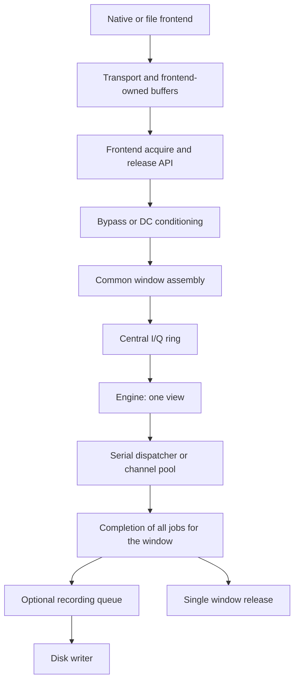
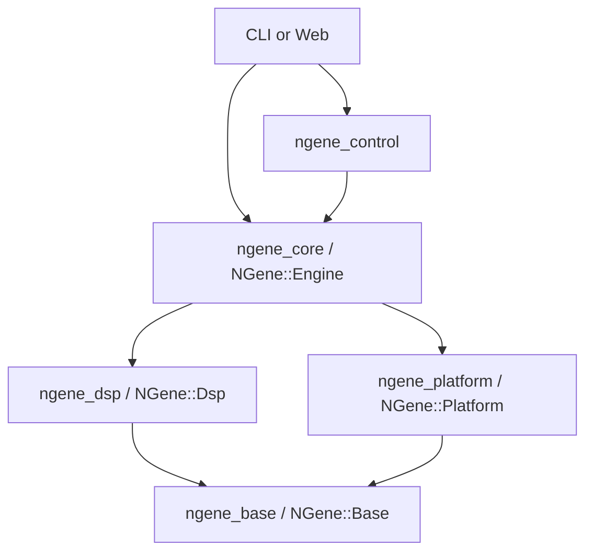
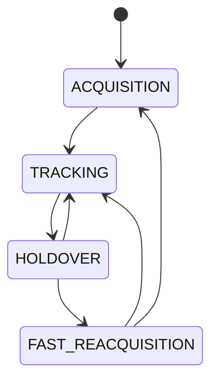

# Kernel and console architecture

The architecture incorporates the diagram and instructions of 28 September 2026. Earlier proposals for C++/SoapySDR implementations and independent readers for every channel are superseded.

The 17 October 2026 revision separates mathematics from the receiver and adds an optional
parallel dispatcher. Frontends, conditioning, recording, and diagnostics are operational;
optional GPS L1 C/A acquisition is now registered through the same channel interface.
Tracking, demodulation and PVT still need integration. The acquisition registration copies
bounded captures from the borrowed common-ring window to one strategy worker; it creates
no independent stream cursor. See [GPS acquisition](GPS_ACQUISITION.md).



The initial queue belongs to frontend transport: it absorbs USB bursts and keeps the callback short. It is not a second GNSS stream and introduces no per-satellite cursors. In record-only mode, the engine skips the channel group and feeds the writer directly.

The thread running `NgReceiverRun()` acquires frontend blocks, applies conditioning, assembles windows, and coordinates channels. Libhackrf has its own transport threads; the recorder has an additional thread. There is no thread per satellite.

## Module and library boundaries

| Responsibility | Sources/API | Boundary |
|---|---|---|
| Engine | `src/core/`, `receiver.h`, `channel.h` | Window order, leases, dispatch, transitions, stop, and shutdown |
| Frontend | `src/frontend/`, `frontend.h` | Sample acquisition and native adapters; no tracking logic |
| Conditioning | `src/conditioning/`, `conditioning.h` | Shared transformation before the ring, with its own temporal state |
| Future GNSS algorithms | Acquisition/tracking behind `TNgChannelOps` | Per-channel state and workspace; no independent ring cursor |
| Mathematics | `src/dsp/`, `include/ngene/dsp/` | Numerical functions and plans; independent of drivers, GUI, and scheduler |
| Observation/recording | `src/analysis/`, `src/recording/` | Bounded queues/workspaces and independent workers |
| Control/presentation | `src/control/`, `src/web/`, `web/` | Commands and snapshots; no GNSS processing in HTTP threads |
| Platform | `src/platform/` | Portable threads, mutexes, conditions, clocks, and filesystem |

CMake dependencies now make mathematics reusable without linking frontends or controllers:



`ngene_base` contains common errors, avoiding a circular DSP→engine dependency.
`ngene_dsp` does not depend on threads or device libraries. The FFT test links DSP and
the test platform directly, without `ngene_core`. Other modules retain C interfaces and
separate directories, although still grouped in the `ngene_core` target.
Further library separation will be useful when they have independent consumers.

## Concurrency and core selection

The implemented policy separates three decisions:

1. **Fixed worker count per run**, explicitly selected by the caller. Threads and result
   scratch are prepared before frontend start; no allocation per window.
2. **Dynamic job assignment**: every available worker takes the next channel for the
   window. An expensive channel is not tied to a specific worker between windows.
3. **Core assignment is left to the operating system**. The receiver imposes no affinity
   or special priorities. Affinity restricts scheduler choices and should be considered
   only after measurement on the target machine; the
   [Windows documentation](https://learn.microsoft.com/en-us/windows/win32/procthread/multiple-processors)
   also generally recommends leaving this choice to the system.

`NgReceiverRun()` and `NgReceiverRunEx()` preserve previous sequential ordering.
`NgReceiverRunScheduled()` accepts `TNgReceiverExecution { workerCount }`: NULL or 1 uses
the serial path; 0 is invalid; the effective count cannot exceed the number of channels.
No pool is created with zero or one channel or in record-only mode. This is an engine API,
not a GUI parameter that starts absent GNSS algorithms.

```c
TNgReceiverExecution execution = {4};
int result = NgReceiverRunScheduled(&config, &frontend, &conditioner,
                                    channels, channelCount, StopRequested, context,
                                    &stats, &execution, &hooks, &error);
```

All jobs receive the same immutable samples, indices, and gaps. The engine retains the
single ring lease until the completion barrier. One channel never processes two windows
simultaneously. Shared mutable contexts require explicit synchronization; a parallel callback
cannot depend on other channels' execution order.

In parallel mode, all jobs for the window finish even when an error occurs. The engine
validates and applies successful transitions after the barrier; the first error in
registration order determines the returned diagnostic. It stops and joins workers before
destroying samples. The serial path retains stop-on-first-error behavior.

Frontend, conditioning, and hooks remain on the coordinator thread; the recorder and diagnostics
retain their own workers. The barrier makes progress depend on the slowest channel:
the pool changes no overflow policy and provides no hard real-time guarantee. No internal
thread is started for each FFT. If live/replay sessions share the machine, the caller must
distribute an overall worker budget between them.

## Mathematical library and target selection

| Family | Public header | Implementation |
|---|---|---|
| Transforms | `ngene/dsp/fft.h` | `src/dsp/fft/` and private kernels in `x86/`, `arm/` |
| I/Q statistics | `ngene/dsp/statistics.h` | `src/dsp/statistics/moments.c` |
| Complex power | `ngene/dsp/power.h` | `src/dsp/power/power.c` |

`ngene/dsp/sample_ops.h` remains the compatible umbrella header. Primitive formulas,
references, and SIMD loops were separated without modification. Correlation, NCO/mixing,
windows, filters, and fixed-point operations will receive their own families when ported
and validated; no empty implementations are added.

Callers always use `NgFftExecute`, `NgIqMoments`, or `NgPowerAccumulate`, without SIMD
types or ISA selection in GNSS algorithms. `TargetArchitecture.cmake` queries target compiler
macros; `FftBackend.cmake`, shared by the receiver and benchmark, selects one kernel and its
local options. There is no host-machine architecture detection or global `-march=native`.

FFT uses SSE2 assembly on x64, SSE2 intrinsics on x86-32, and NEON intrinsics on ARM64/ARMv7.
On x86-32, the SSE2 check during plan creation remains necessary to fall back on CPUs without
that ISA. This safety check does not change the API.
Statistics/power primitives retain SIMD on x64/ARM64 and C on x86-32/ARM32.
`NGENE_FFT_REFERENCE` and `NGENE_SAMPLE_REFERENCE` select compile-time oracles.

Every family documents ranges, scaling, alignment, aliasing, remainders, and overflow in
its headers. FFT plans are immutable and shareable; each call uses disjoint buffers.
Precision and parallelism are separate: additional workers change neither the internal
arithmetic order of an FFT nor its bit-exact contract.

## Proposed structure for upcoming integrations

```text
src/
  core/           engine, windows, states, and dispatcher
  frontend/       transport and file adapters
  conditioning/   shared stages before the ring
  stream/         formats, indices, ring, and leases
  dsp/            mathematics by family and private CPU kernels
  acquisition/    future: search, refinement, confirmation
  tracking/       future: correlators, loops, holdover, and reacquisition
  navigation/     future: decoding and navigation data
  observables/    future: measurements at common epochs
  pvt/            future: navigation solution
  analysis/       asynchronous diagnostics
  recording/      asynchronous recording and metadata
  control/        session lifecycle
  platform/       OS services
  web/            HTTP/WebSocket adapter
```

The channel adapter will receive the window from the engine and invoke acquisition or
tracking according to state. The engine will retain scheduling, time, and transitions;
GNSS modules will retain algorithms, accumulators, and workspace. Migration starts from the
original kernels and algorithms documented in [LEGACY_MIGRATION.md](LEGACY_MIGRATION.md),
with replay tests before connecting observables and PVT.

## Memory and time

- The frontend owns samples until `release()`. The USB callback copies into preallocated memory before libhackrf reuses the transfer.
- The conditioner produces a view valid until its next call and does not retain the input view. Bypass does not copy. Current paths preserve native CI8/CU8/SC16 Q11 format, rate, count, indices, and events. The GNSS channel contract remains CI8 for now.
- The engine assembles windows of `window_samples` pairs; USB boundaries and window boundaries need not coincide.
- The ring is **block based**, with contiguous slots reused circularly. A view does not physically cross two slots; wrapping occurs between windows. This is a complex-signal ring, not two independent I/Q rings.
- Only one consumer ring lease is active. While active, data remain immutable and cannot be overwritten. All channels see the same pointer, interval, and event.
- The engine produces and acquires the central ring in the same thread, one window at a time. The optional dispatcher parallelizes channels over the current window; it neither overlaps successive windows nor introduces multiple logical ring consumers. The USB queue is concurrent and independent.
- Current copies are explicit: USB input→frontend queue, window assembly, publication in the central ring, and optional recorder queue. These are not private stream copies per channel. Reducing them is a later optimization to measure.
- Indices count I/Q **pairs**. `sample_rate_hz` is the number of pairs/s. The absolute index in `(epoch, first_sample)` is not the physical position within a slot.
- HackRF, through the interface used here, supplies no RF timestamp per block. File host time is informative; it is not presented as GNSS time or the precise antenna instant.

When the frontend loses samples in its queue, it continues counting samples received by the callback: the jump becomes visible to the engine. The duration of losses unobservable to software is not invented. Disconnection ends the run with an error; no automatic restart hides the discontinuity.

A gap interrupts the window under construction. Any valid prefix is delivered as `NG_BLOCK_PARTIAL`; the first new window carries `NG_BLOCK_GAP`. EOF and requested stop can also produce partial windows: no zero padding. The GNSS module must decide how to invalidate or complete its accumulations. Epochs and indices cannot regress without a new epoch.

## Interfaces

| Header | Contract |
|---|---|
| `frontend.h` | Open/configure, start, acquire/release, stop, statistics, destroy |
| `conditioning.h` | Synchronous constant-rate transformation before the ring |
| `ring.h` | Bounded publication, single acquire/release, close, and drain |
| `channel.h` | Private per-instance state, same window for all channels, transition request |
| `receiver.h` | Coordination, stop, assembly, dispatch, and statistics |
| `recording.h` | Bounded-memory asynchronous writer, segmentation, and closure |

C function tables support module injection. Backend internal structures remain private; no libhackrf type appears in public NGene headers. The ABI is initial and versionable, not frozen for independent binary plugins. The current channel contract is deliberately small: it does not yet define the complete correlator bank or navigation assistance.

## Channel states



Transition validation is implemented; the GNSS decisions triggering transitions are not. Remaining in the same state is always allowed. `HOLDOVER` means open-loop tracking propagation, not position dead reckoning. Demodulation and observable formation will run during tracking rather than as subsequent exclusive states.

Channels do not advance the ring. Long integrations retain their own accumulators/state; acquisition requiring complete history must declare bounded workspace and the required window. Channel state must not contain persistent pointers to a ring view.

## Errors and shutdown

Default `stop` aborts on input-queue overflow. `drop_newest` preserves previous data and counts discarded samples. A full recorder queue always stops the run: recordings are never silently dropped. Module errors stop the group and are not converted into partial success.

Stop and destroy run outside the callback. The recorder drains its queue and closes files before terminating; shutdown may wait for filesystem I/O. Samples still in the frontend queue at termination are counted separately. Statistics measure events known to software; they do not certify the absence of every RF/USB loss.

## Platform and format boundaries

`src/platform/` isolates Win32/POSIX services used by the engine. Device adapters and CPU kernels retain private dependencies. Operational code is C11. Existing DSP APIs already declare natural alignment, remainders, scaling, and accumulations; future families must do the same.

CI8 belongs to the HackRF path; RTL-SDR uses CU8, and bladeRF preserves CI8 or SC16 Q11. Native format is explicit in descriptors and views, with units in complex pairs. Future filters, mixers, and multibit channels will need their own numerical and timing contracts.

## Control and observation (v0.2.0)

`apps/main.c` selects CLI or Web in the same executable. `src/control/` implements lifecycle without HTTP types; `src/web/` translates REST/WebSocket into C calls; `web/` contains only presentation and commands. CMake embeds Web resources at compile time. `ngene_core`, `ngene_control`, and `ngene_http` are library targets, not separate processes.

The controller has a manager thread and at most one engine thread. HTTP threads do not run reception loops. The manager serializes start, stop, and recorder opening/closing. `NgReceiverRunEx()` hooks communicate startup, progress, and windows; `NgReceiverRun()` remains the original wrapper. The window callback copies data to the recorder queue and submits pre/post taps to diagnostics. It performs no disk or network I/O. The recorder has a separate lifetime mutex; diagnostics and progress use try-lock. The browser reads snapshots up to 30 Hz without receiving raw I/Q.

The JSON snapshot is constructed after copying state out of the mutex. A slow browser does not retain a ring lease. Copying and synchronization costs still require measurement: this is no hard real-time guarantee.

Start recording publishes the new recorder between complete windows. Stop recording detaches it between windows, then the manager waits for drain while the engine continues. Stop receiver also closes the recorder; confirmation arrives after join/flush. A Stop request during Starting cancels startup or waits for shutdown. Write errors/overflow are not hidden as acceptable loss.

The destination selected in the GUI belongs to the computer running the NGene process. The persistent-profile directory remains separate. The file list concerns the currently configured destination and survives restart because it reads the filesystem. To return to recordings in another directory, select it while the receiver is stopped. HTTP transfer reads only closed recording files; it is not a live-stream consumer.

`src/analysis/` now implements spectral observation using the internal integer FFT, a dedicated worker, and runtime configuration. The GUI presents results and the waterfall. [ANALYSIS.md](ANALYSIS.md) describes burst and statistics semantics.

## v0.3 update

User-confirmed order: shared conditioning **before** the central ring. Selectable pre/post recording tap; no second GNSS ring. Recorder queues and observer temporary workspaces have different purposes and ownership from the ring feeding channels.

`HOLDOVER → TRACKING` is allowed and tested: signal recovery can directly close feedback again. Fast reacquisition is a subsequent attempt if recovery fails, not a mandatory transition. HOLDOVER does not mean position dead reckoning.

## 0.4 update

The former raw I/Q preview was removed from telemetry. The receiver does not wait on GUI locks: diagnostic taps and progress use try-lock; the recorder has a separate lifetime lock shared only with the manager. PSD and histogram have independent workspaces and cadences; the GNSS ring remains unique. PSD ownership and end-to-end checks are described in [ITERATION_04.md](ITERATION_04.md). The optional DC conditioner preserves state between blocks. The digital IF reference belongs to the stream and is available to channels: no mixer is added to the common flow.

## Historical independent sources in 0.6 (removed from the current service)

The FILE frontend implements the same acquire/release interface as HackRF, with backend-owned memory and an explicit lease. No synthetic frontend in the product. [REPLAY.md](REPLAY.md) defines format, EOF, pacing, and looping.

An earlier server hosted two controllers: primary and parallel replay. Each owned an engine and independent stream, with its own ring, conditioner, diagnostics, and recorder. This did not duplicate the ring for channels within a stream: all satellites of that engine still saw the same window. Source clocks and samples were not mixed. The former GUI selected which controller to observe/control; reception threads did not wait for the browser.

The current GUI and service have one active source. Independent replay routes are rejected.
Parallel live reception and replay require separate NGene processes, ports and profile
directories. See the [current operator manual](https://github.com/mauriziofantino/nav-ngene-evo/wiki/Recording-and-Replay).

## Tracking library integration  -  2026-11-13

NGene::Tracking now links the reusable DSP layer independently of devices and control.
CLI/service install a shared-window acquisition/tracking composition with private
per-PRN state. See [TRACKING.md](TRACKING.md) for ownership, replacement, telemetry,
bounded slot allocation, the shared tracking worker pool and remaining lock-supervisor limitations. Earlier future-only
tracking descriptions above are superseded for the delivered DLL/FLL/PLL scope.
