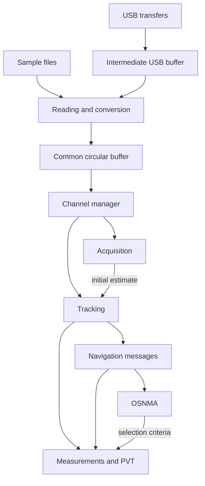
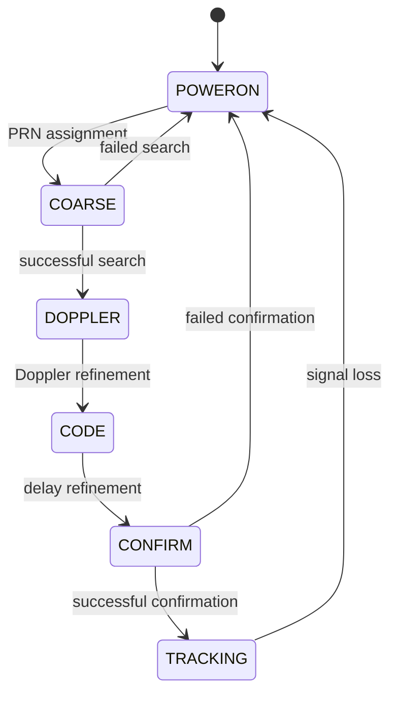

# NGene — working manual, inventory, and architecture

> Historical engineering material. This document preserves the analysis, decisions, and implementation status recorded at each stage; statements about missing or unverified features describe that stage. Current operator instructions are in the [project wiki](https://github.com/mauriziofantino/nav-ngene-evo/wiki/Home).

Analysis, decisions, and NGene increment log · Revision 8, 9 October 2026

**Consult this document before subsequent changes to NGene. Section 18 updates the native Windows build, naming, documentation, and GUI; it takes precedence over incompatible historical instructions. Section 17 consolidates diagnostics, DC removal, offset tuning, and the native Windows build; it takes precedence over incompatible earlier historical descriptions. Section 16 updates the current decisions and documents the assembly FFT, spectrum/waterfall, configurable histograms, and recording before/after conditioning. It takes precedence over historical descriptions of features still missing in sections 14–15. Section 15 adds the WebGUI, macOS, unified control, receiver-side folder selection, and transfer to the browser. Section 14 records the first increment implemented in C and the basic requirements: NGene as the project foundation, native frontend libraries, and common advancement of all channels. It takes precedence over incompatible earlier proposals.** Sections 1–10 document the analyzed archive and initial proposals. Sections 11–13 record requirements subsequently clarified by the user and the status of tasks 3–7. Section 13 specifically updates the frontend choice, FAST/PRECISE modes, and performance constraints. Approved requirements take precedence over incompatible earlier proposals; new proposals do not become approved merely by appearing here. Reusing the engine and algorithms does not require retaining the real-IF representation or the numerical optimizations associated with the old inputs.

## 1. Outcome and scope

**Reorganization is useful, but the receiver already contains an important part of the desired sample-distribution engine:** a common circular buffer, a read position for each channel, and a release rule that accounts for every channel's progress. The first evolution should make these responsibilities explicit while preserving their verifiable behavior.

The existing directories already distinguish acquisition, tracking, frontend, and PVT. The main difficulty is that these groups are not independent modules: they share central structures, workspace, buffer details, and numerical conventions. Moving files will improve readability but will not, by itself, resolve these dependencies.

The following work has been completed:

1. Archive inventory, component classification, and examination of the build paths.
2. Static reconstruction of the sample path, channel management, and connections through to PVT, comparing the relevant parts of the two supplied documents.

**No original source file was modified during the initial analysis tasks.** No frontends, comments, names, libraries, or files were removed, and no style, portability, or ESA-compliance corrections were applied. Section 14 now describes the first increment implemented in a separate structure; the original archive remains preserved and unchanged.

The analysis in tasks 1 and 2 is not a verification build, a recorded-signal test, a benchmark, or hardware validation. It distinguishes code present in the archive, code included in the main target, and paths called by the receiver; actual activation of many features depends on configuration and macros. Section 12 defines the limits of the subsequent isolated numerical checks without extending their results to the receiver.

## 2. Analyzed material and traceability

| Material | Use in the analysis |
|---|---|
| Latest attached source archive, `ngene(2).tar` | Inventory and reconstruction of current behavior |
| `report.pdf`, *GPS Software Receiver — Implementation notes*, 10 pages | XOR encoding, approximations, carrier and code lookup-table generation |
| `PhD_Fantino070206.pdf`, *Study of Architectures and Algorithms for Software Galileo Receivers*, 231 pages | GNSS architecture, acquisition methods, conventional tracking, and proposed extended tracking |

The initial local archive copy was truncated. The complete attachment was recovered before completing the inventory: 28,467,200 bytes, SHA-256:

`c15c72e9e715e6a77ee6ccf694adb3e2d939a355b1f6ad3ff4e82121de8e1acb`

Byte-for-byte equality was checked using hashes for the 708 extracted regular files outside the main Git directory against the archive: no differences.

Paths below are relative to the archive's `ngene/` root; function names identify the evidence independently of future line-number changes. Printed page numbers and PDF page numbers are distinguished for the thesis. Relevant passages were read; a full scientific review of the thesis was not performed. The report's lookup-table generation equations and thesis figure 16.2 were also checked visually.

The documents are dated January 2008 and May 2006, respectively: they help reconstruct the origins of the methods but do not demonstrate that every detail of the current version is identical to the version described at that time.

## 3. Task 1 — inventory and organization

### 3.1 Archive contents

The archive contains 708 regular files outside the main Git directory. Of these, 247 are under `build/`. The count includes sources, configurations, build outputs, and supporting files: it is not the number of receiver source files.

| Directory or group | Files | Observed responsibility | Organizational assessment |
|---|---:|---|---|
| `receiver/` | 20 | Startup, configuration, global state, channels, main loop | Coordination and algorithm state are closely intertwined |
| `frontEnd/` | 14 | File/USB reading, USB thread, buffers, and conversions | Transport, sample format, and buffering need separate responsibilities |
| `asmFolder/` | 36 | SIMD, FFT, arrays, carriers, PRN, frontend conversions | Mixes mathematical functions, CPU implementations, and hardware adaptation |
| `acquisition/` | 14 | Coarse search, refinements, confirmation, thresholds | Functional grouping is already reasonable |
| `tracking/` | 12 | Correlators, DLL/FLL/PLL, GPS/Galileo tracking | Reasonable functional grouping; interfaces depend on the receiver |
| `utilityGnss/` | 61 | Messages, FEC, codes, time, C/N₀, corrections, NeQuick | Contains several subsystems that deserve their own identity |
| `pvt/` | 21 | Timing, pseudoranges, smoothing, corrections, LS/Kalman, checks | Measurement formation and navigation solution are currently in the same group |
| `osnma/` | 27 | Authentication parsing and verification, cryptography, tools | Functionality spanning messages, channels, and PVT selection |
| `chimera/` | 8 | Cryptographic functions and test program | Inclusion in the project must be distinguished from operational integration |
| `guiSupport/` | 7 | Protocol, sockets, RX/TX threads, GUI data preparation | External interface separate from GNSS computation |
| `warmStart/` | 6 | Assisted initialization and satellite visibility | Scheduling support service |
| `utility/` | 30 | Logging, terminal, mathematics, matrices, spectrum, compression | Heterogeneous group requiring careful decomposition |
| `libraries/` | 159 | `libfec`, sources, and its build outputs | External dependency with its own build management |
| `sampleConfigurationFiles/` | 41 | Configurations and supporting data | To be kept separate from algorithms |
| `build/` | 247 | Caches and build outputs | Must not become part of the reference source structure |
| Root files | 5 | Build, README, and submodule reference | Documentation and build are not fully aligned |

The counts include supporting files present in the archive, including groups containing libraries or tools. Outside `build/` and `libraries/`, there are **105 `.c` files**, including embedded code of external origin. The main CMake target lists **100**.

The five `.c` files not listed in the CMake target are:

- `receiver/ngeneNavMesg.c`: contains another `main`.
- `receiver/ngeneNavMesgUtility.c`: included in the `Makefile.am` list instead.
- `osnma/testCryptoFunctions/mainTestCrytoFunction.c`.
- `osnma/createPemFIle/createPemFile.c`.
- `chimera/testCryptoFunctions/mainTestChimera.c`.

This distinction avoids treating every file absent from the main executable as unused code: some belong to auxiliary programs. Similarly, `.function` files in `asmFolder/` are textually included by C sources; their extension alone is not a reason to discard them.

### 3.2 Dependencies and provenance

| Component | Evidence | Consequence for future cleanup |
|---|---|---|
| `libraries/libfec/` | Included README and license; static library linked by CMake | Treat as an external component, distinguishing sources from generated outputs |
| `utilityGnss/NeQuick/` | Headers state derivation from the NeQuick reference implementation | Do not automatically classify it as original NGene code |
| `osnma/base64.c` | Header identifies external provenance and a BSD license | External code can also exist outside `libraries/` |
| OpenSSL/libcrypto, libusb, ncurses/tinfo, math library, and pthread | Configuration and linking of the main target | Separate DSP, platform, authentication, and presentation dependencies in the future |

This is an initial classification, not a complete legal inventory. Before any attribution is removed, each affected file must be classified: the directory name alone does not determine provenance.

The receiver contains its own Viterbi implementation in `utilityGnss/viterbi.c`; use of `libfec` is visible, among other places, in the Reed–Solomon calls in `utilityGnss/reedSolomon.c`. It would be incorrect to attribute all FEC decoding indiscriminately to the external library.

### 3.3 Build and architectures

The CMake configuration detects `x86_64`, `aarch64`, and some ARM variants and assigns `ARCH`. **This value does not select a different DSP implementation in the current target.**

Main evidence:

- Initial lines of `CMakeLists.txt`: architecture detection followed by global flags that nevertheless include `-msse2`, `-mfpmath=sse`, `-march=native`, and `-mtune=native`.
- The same target always includes the SIMD sources from `asmFolder/`.
- `receiver/ngeneConstants.h` directly defines `COMPILE_64_BIT`; the macro does not come from CMake detection.
- All header directories are exposed globally. A `secure/` path also appears but does not correspond to a directory in the analyzed archive.
- `libfec` is built using a custom `configure`/`make` command inside its directory; the main project does not integrate its `CMakeLists.txt` through `add_subdirectory`.
- Installation forces a path inside the home directory and includes shell-configuration operations. These operations extend beyond compilation and were not executed.
- `Makefile.am` lists 101 sources versus CMake's 100 and has linking differences, including `pci`. The README mainly describes the Autotools path and contains historical references that need reconciliation with the code.

The archive contains ARM references in comments, but **no complete ARM/NEON backend for the NGene kernels selectable by the build was identified**. `libfec` includes portable C implementations and variants for other CPUs; this does not constitute a port of NGene's correlation, carrier, PRN, and FFT functions. In particular, the Altivec files concern PowerPC.

Conclusion: the future organization must distinguish **GNSS algorithms**, **DSP kernels**, and **CPU implementations**. Platform selection must then control sources, options, and dependencies; an architecture-detection message alone is insufficient. Working ARM support is not claimed.

### 3.4 Is reorganization justified?

Yes. The separations best supported by the analysis are:

| Responsibility | Current location | Boundary to discuss in the next phase |
|---|---|---|
| Startup and coordination | `receiver/` | Application and execution engine |
| Data input | `frontEnd/`, conversions in `asmFolder/` | Source, format decoding, sample stream |
| Shared retention and reading | `frontEnd/circularBuffer.*`, `receiver/channelManager.c` | Buffer and reader consumption contract |
| Numerical operations | `asmFolder/`, parts of `utility/` | DSP interface and CPU implementations |
| Search/tracking algorithms | `acquisition/`, `tracking/` | Algorithms with declared state and workspace |
| GNSS messages and time | `utilityGnss/` | Decoding, navigation data, and time references |
| Measurement formation and PVT | `pvt/`, channel state | Common-epoch observables and navigation solution |
| Authentication and additional analysis | `osnma/`, `chimera/`, distributed functions | Interfaces to receiver data and control |
| GUI and recordings | `guiSupport/`, `utility/`, main loop | Presentation, commands, and outputs |

This table identifies candidate boundaries: it is not yet an approved new structure, nor does it imply that each row must become a library or thread.

## 4. Task 2 — from the frontend to shared samples

### 4.1 Actual data path



The diagram describes existing functional connections; it does not represent a pipeline of independent threads.

`TRxFe` represents the current input, from a file or USB. `ReadRxFrontEnd` reads bytes. `FillInputBuffer` converts them to the internal format and updates the circular buffer. Special paths exist for some formats: for example, Stereo Triton uses `fread` directly inside `FillInputBuffer`, while the USRP path reads 16-bit words and converts them. A common interface is therefore already outlined but is not uniform.

The internal buffer is a `char` array used as a sequence of real samples. Conversions depend on the frontend, quantization, and sign conventions. **It is not a generic interface for complex I/Q samples from any frontend.**

This does not mean that the receiver does not calculate I and Q: `CarrierComplexWipeOff` produces the two internal branches using sine/cosine replicas; acquisition and tracking then work with quadrature quantities. The important distinction is between the representation of input samples and the internal representation after carrier wipe-off.

Evidence: `frontEnd/frontend.c`, `ReadRxFrontEnd`; `frontEnd/circularBuffer.c`, `FillInputBuffer` and `ConvertSamplesIntoNGeneFormat`; `asmFolder/arrays.c`, `CarrierComplexWipeOff`.

### 4.2 Two buffering levels in the USB path

| Buffer | Ownership and access | Observed sizing |
|---|---|---|
| USB transfer buffer | Managed by the libusb interface | 128 blocks; default block size of 8,192 bytes |
| Intermediate USB buffer | Frontend thread produces, receiver loop reads; mutex and condition variable | 512 blocks; approximately 4 MiB at the default size |
| Receiver circular buffer | Contains converted samples; the main loop fills it and manages channel reads | `INPUT_BUFFER_SIZE = 16` ms, converted to a sample count using `fs` |

Actual USB sizes depend on the configured block size. These buffers separate transfer from processing; they are not complete private stream copies for each satellite.

When the intermediate USB buffer fills, the producer waits for space. This wait regulates handoff between software threads: it does not demonstrate that the physical device can pause its stream indefinitely without losing samples. The timeout-recovery path can restart USB and reset indices; no explicit contract was identified that delivers a discontinuity event with gap index and duration to the channels.

Evidence: `frontEnd/frontend.h`, `TUsbFe` and buffer constants; `frontEnd/usbInterface.c`, `CopySamplesIntoUsbIntermediateBuffer` and `ReadUsbInterface`; `frontEnd/frontendThreadFunctions.c`, `UsbFrontEndThreadFunction`.

`frontEnd/megaBuffer.c` contains an additional recording buffer and appears in the CMake target. Call analysis did not find an operational initialization/update connection to the main path. It is therefore not shown as a third active stream buffer.

## 5. Channels, advancement, and scheduling

### 5.1 The shared engine already exists

The main loop in `receiver/ngene.c` performs the following steps, schematically:

1. Calculates the maximum channel requirement with `GetMaximumNumberOfSamplesNeeded`.
2. Calls `FillInputBuffer` if insufficient samples are available.
3. Iterates over the channels and obtains one or two contiguous buffer spans for each using `GetSamplePointersForChannel`.
4. Executes `DoChannelManager` for the current channel.
5. Calculates the minimum common advancement with `GetNumberOfUsedSamples`, releases that buffer portion, and updates channel offsets.
6. Performs periodic activities: thresholds, receiver time, authentication, PVT, visibility, GUI, and recordings.

Each `TChannel` retains `bufferOffset`, `blocksize`, and `blocksizeNext`. The offset is relative to the current buffer tail, while `TCircularBuffer.discardedSamples` maintains the cumulative number of released samples.

**The channels read the same stream without a complete private copy of the input samples.** They can occupy different positions and request windows of different lengths. Sharing data does not require every channel to perform the same operation on the same block in each iteration.

Memory can be reused after release from the buffer. There is no general borrowing mechanism with an explicit lifetime for an external algorithm that retains those pointers beyond the current cycle. This is an important boundary for future asynchronous processing.

Consumption is coordinated by the least advanced reader. The actual logic includes per-iteration advancement limits, channel states, and skipped-acquisition cases: it is not yet a generic buffer service with registerable readers, lag policies, and gap handling.

Evidence: `receiver/channelManager.c`, `GetMaximumNumberOfSamplesNeeded`, `GetNumberOfUsedSamples`, `CleanBufferOffsetForAllChannels`, `GetSamplePointersForChannel`, `DoChannelManager`; `frontEnd/circularBuffer.c`, `DeleteFromCircularBuffer`.

### 5.2 Channel state and algorithm

The nominal path reconstructed from `DoChannelManager` is:



There is also an `UNUSED_STATE` for disabled channels, omitted from the nominal path. Enumeration order does not match transition order: in the actual flow, Doppler refinement precedes code refinement.

A channel is a processing resource: it contains satellite/signal identity, acquisition state, tracking, parser, and PVT information. The PRN can be reassigned on return to `POWERON_STATE`. A future interface should therefore distinguish channel index, satellite, and signal.

The scheduler limits the number of acquisitions that can proceed and adapts that number to tracking load. It is not a fixed assignment of one thread to each satellite. Algorithms can also change offsets and block sizes to realign code phase: they currently participate directly in stream-consumption decisions.

### 5.3 Concurrency and workspace

**Channels are processed sequentially by the main loop.** Other responsibilities have their own threads:

| Context | Observed activity |
|---|---|
| Main loop | Channel advancement, DSP, parsing called by tracking, PVT, and periodic services |
| USB frontend thread | libusb events and transfers, feeding the intermediate buffer |
| GUI RX/TX threads | Commands and data over sockets, when the GUI is initialized |
| TESLA verification thread | OSNMA verification in a dedicated path, coordinated with receiver state |

The observed GUI communication uses sockets. The README's historical references to message queues were not taken as a description of the current sample transport.

`TNGeneData` owns shared mutable arrays for code, sine/cosine carriers, subcodes, and acquisition workspace. Some tracking pointers, such as early/prompt/late, point into portions of these arrays. The channel instead owns accumulators and persistent state, along with some private acquisition allocations.

| Data | Primary ownership | Implication |
|---|---|---|
| Input samples | Shared buffer | Views are valid within the buffer-retention policy |
| Acquisition/tracking and parser state | Channel | Must survive between calls |
| Temporary codes and carriers | Receiver, reused | Cannot be written concurrently by multiple channels without separation |
| PRN, carrier, and FFT tables | Receiver, shared | Sharing is possible after distinguishing initialized data from mutable data |
| Messages, authentication, and PVT solution | Shared structures | Publication and temporal-validity rules are required |

Moving to concurrent channels therefore cannot consist simply of adding threads around `DoChannelManager`.

A further point to examine in a future concurrency analysis is `ngeneXmmsBackup`, global memory used to save SIMD registers. `ArrayCopy` also uses it in the USB thread path, while other DSP functions use it in the main loop. This is an interference risk identified statically, not a failure reproduced in this activity.

## 6. Correlation, acquisition, and tracking

### 6.1 Connection between the implementation and the numerical report

Correlation is a common foundation, but the various stages do not all calculate it in the same way.

| Method | Document | Source evidence | Constraint to preserve |
|---|---|---|---|
| Sign multiplication using XOR | Report, pp. 1–3 | `ArrayXor`, `ArrayMac`, wipe-off | `0x00`/`0xff` encoding, sign, and bias compensation |
| Carrier from a lookup table and phase accumulator | Report, pp. 3–5 | `InitCarrierTable`, `GenerateCarrier` | Phase quantization, advancement, and approximation within the block |
| PRN generation with variable repetition lengths | Report, pp. 5–10 | `OversampleCode`, `GenerateCode` | Integer/fractional phase, frequency ratio, padding, and vectorization |
| Correlation for parallel code-delay search | Thesis, §9.2, pp. 88–89; PDF 116–117 | `PerformCoarseAcquisition`, `InitLocalCodesFft` | FFT scaling, complex order/convention, accumulations, and thresholds |
| Early/prompt/late tracking | Thesis, chapter 12, pp. 131–141; PDF 159–169 | `PerformAllTrackingCorrelations`, DLL/FLL/PLL loops | Integration periods, normalization, and state continuity |
| Multiple correlators and EKF for extended tracking | Thesis, chapter 16, figure 16.2, p. 167; PDF 195 | `multiI`/`multiQ` arrays present; current loops are conventional | Additional correlators are an extension point, not proof that the thesis EKF is implemented |

The report explains that XOR with the representation of −1 introduces an additive term relative to arithmetic multiplication. Tracking includes compensations such as `ArrayMac(...) + blocksize/2`; acquisition also contains corrections on the demodulated branches. These conventions must be reconstructed for each stage: replacing every XOR with multiplication while indiscriminately retaining existing compensation is incorrect.

A concrete detail illustrates why the document and code must be compared: the report's example uses 64-sample blocks for the carrier LUT; `carrierTable.h` instead configures 256 rows and **32 samples per row**, and the kernel uses corresponding increments. The method is recognizable, but the parameters are not identical.

A future C/ARM backend will require a numerical contract covering sample type and sign, local-code format, scaling, saturation/truncation, alignment, padding space, FFT convention, returned phase, and permitted tolerance. Numerical equivalence between implementations has not yet been verified. In the new I/Q path, historical compensations must be reassessed against the operations actually used: they are not requirements to copy automatically, and reconstructing the old IF is not a migration objective (section 11).

### 6.2 Current acquisition

`coarseAcquisition.c` generates carrier replicas, performs wipe-off, and compresses the samples; it then uses FFT, complex multiplication by the precomputed local code, a subsequent transform, energy, and noncoherent accumulations to identify a candidate. The search progresses through Doppler hypotheses and windows specified by the configuration.

Both transforms are called through `PerformFft`: the overall meaning also depends on local-code layout and the complex product. A future replacement with an FFT library must verify the conventions and gains of the entire chain rather than relying only on a function or array name.

Doppler refinement, delay refinement, and M-of-N confirmation follow. These stages also use time-domain correlations with `ArrayMac`. Thresholds depend on noise parameters, false-alarm probability, and accumulations; they are part of the algorithm, not merely peripheral configuration.

The thesis describes serial search, parallel code-delay search, and parallel Doppler search; this does not imply that the receiver already exposes three interchangeable algorithms. The observed main path is the one described above.

Evidence: `acquisition/coarseAcquisition.c`, `PerformCoarseAcquisition`; `acquisition/acquisition.c`, `InitLocalCodesFft`, `FindAcquisitionThreshold`, `UpdateCoarseThreshold`; `acquisition/refinement.c`; `acquisition/confirmation.c`.

### 6.3 Current tracking and extension points

`PerformGpsTracking` and `PerformGalileoTracking` coordinate carrier generation, wipe-off, code replicas, and correlations. The Galileo path includes BOC subcarrier handling.

`PerformAllTrackingCorrelations` updates the early/prompt/late I/Q branches; it can produce additional correlators and includes a conditional path for an extended discriminator. At the specified cadences, it runs DLL and FLL/PLL, updates NCOs, evaluates lock, and feeds navigation parsers. The observed normal DLL discriminator uses a normalized early/late power difference.

The presence of multiple correlators is particularly relevant to the thesis: it suggests analyzing correlation shape alongside tracking. However, **the multipath-mitigation EKF from figure 16.2 was not identified in the examined tracking path**. The Kalman filter in `pvt/kalmanFilter.c` belongs to the navigation solution and must not be confused with that method.

A future extension must distinguish observers of correlators and measurements from components that modify the discriminator, loops, or NCOs. These responsibilities are currently coordinated largely within the tracking functions themselves.

## 7. Demodulation, time, observables, and PVT

Tracking also accumulates the prompt contribution used for navigation. At their respective cadences, it calls the GPS, Galileo, or EGNOS parsers. The parsers update synchronization, bit/page counters, times, and messages; the Galileo path also feeds OSNMA.

The existence of parser sources, for example F/NAV, does not by itself demonstrate that every signal mode works with any frontend configuration. This report does not certify the entire matrix of supported signals and formats.

`PvtManager` performs, in brief:

1. Receiver-time update and PVT-cadence check.
2. Selection of usable channels, including authentication-policy constraints.
3. Reconstruction of transmission times and satellite positions.
4. Application of the configured selections, pseudorange formation, carrier smoothing, and corrections.
5. Least-squares solution or Kalman filtering, checks, and result publication.

Selection between LS and Kalman also includes an initialization phase using LS solutions. It is not simply a choice between two functions independent of the remaining state.

**There is not yet a clean boundary where channels publish only independent observables and PVT consumes them.** `TPvtChannel` retains a channel pointer; `ComputeTransmissionTime` directly reads parsers, tracking counters, code phase, and `bufferOffset`.

In particular, it subtracts `bufferOffset / fs` to bring channel time to the common reference. The PVT result uses `rx->buf.discardedSamples` as its reference. This time alignment is essential: a future observables interface must preserve it explicitly through sample index, epoch, units, and validity state.

The periodic `rxCounter` derives from sample advancement; it is not, by itself, absolute GNSS time or the system clock. Conversion between sample index, message time, and solution time is distributed across channels and PVT functions.

Evidence: `tracking/gpsTracking.c`, `PerformGpsTracking`; `tracking/galileoTracking.c`, `PerformGalileoTracking`; `utilityGnss/*MessageParser.c`; `pvt/pvt.c`, `SelectChannelsForPvt`, `ComputeTransmissionTime`, `PvtManager`; `pvt/receiverTime.c`.

OSNMA also demonstrates that cross-cutting processing already exists: authentication state can influence channel selection for PVT. The Chimera cryptographic source is listed in the target, but an equivalent complete operational path was not identified in the main loop: presence, compilation, and functional integration must remain distinct.

## 8. Items recorded for future work, without corrections

| Topic | Current evidence | Appropriate subsequent activity |
|---|---|---|
| Pointer casts and `COMPILE_64_BIT` | Repeated in kernels and conversions | Evaluate standard types such as `uintptr_t` and sizes without coupling them to manual macros |
| Signedness of `char` | Samples and codes are often declared as `char` | Make the numerical representation explicit before porting |
| Assembly and global memory | x86 kernels and `ngeneXmmsBackup` | Verify inline-assembly constraints, reentrancy, and replacement backends |
| Shared temporary memory | Arrays in `TNGeneData`, tracking pointers into those arrays | Distinguish persistent state, tables, and per-executor workspace |
| Mixed buffers and formats | Conversions and frontend cases inside `FillInputBuffer` | Separate format decoding from stream management |
| EOF, partial reads, delays, and gaps | Handling distributed across frontend, buffer, and main | Define common semantics before changing the scheduler |
| Algorithms that move the read position | Refinements and phase management | Declare requirements, consumed samples, and time reference |
| PVT dependent on channels | Pointers and direct access to parsers/offsets | Formalize the observables epoch |
| Two build systems and included artifacts | Divergent CMake/Autotools, `build/`, objects in the library | Choose a reference build and reproducible distribution |
| Comments, naming, and attributions | Inconsistent conventions and headers, historical documentation | Dedicated review, including classification of external files |
| Verification coverage | Local and external test programs; no receiver CTest suite identified | Define a few meaningful reference cases for behavior to preserve |

Gemini's suggested alignment-calculation change belongs to the first topic. It is a reasonable portability direction, but still needs application and verification in the context of types, interfaces, and alignment assumptions. It is not the focus of this phase.

ESA/BSSC rules have not been systematically checked: compliance is therefore not claimed, and no normatively classified list of violations is provided.

## 9. Proposed next step

The next useful activity is **defining module boundaries and their contracts**, starting from existing mechanisms. The result to approve before moving files should include:

1. A map from “current file → responsibility → proposed destination or removal,” distinguishing NGene code, external code, tools, and support for retired frontends.
2. The native I/Q stream contract: format, absolute index, sampling rate of complex pairs, available windows, view lifetime, and behavior at EOF/gaps/lag; the associated numerical contract for products and accumulations.
3. Separation of channel state, selected algorithm, numerical kernels, and temporary memory.
4. Two or three concrete extension points: additional correlators, measurement analysis, alternative tracking; an explicit indication of which can affect control.
5. A migration order that allows behavior to be compared before and after each intervention.

The cautious choice is to retain sequential channel execution initially and make ownership and interfaces explicit. This does not preclude parallelism; it allows parallelism to be designed after identifying what may be shared and what must remain independent.

Three questions will help select the interfaces without preventing completion of the current analysis:

- Should additional algorithms initially observe samples/correlators, or should they already modify loops and NCOs?
- Is comparing algorithms on the same recorded signal an initial priority, including multiple instances tracking the same satellite?
- Is there a short recording and known configuration that produce acquisition, tracking, and PVT, to serve as a reference for subsequent changes?

There is no need yet to choose a dynamic plugin system or thread count. The collected evidence suggests clarifying these contracts first.

## 10. Index of main evidence

| Area | Files and symbols to consult |
|---|---|
| Build | `CMakeLists.txt`, `Makefile.am`, `configure.ac`, `libraries/libfec/CMakeLists.txt` |
| Receiver loop | `receiver/ngene.c`, `main`, `ManageFrontEndThreadInitialization` |
| Global state | `receiver/ngeneDataStructure.h`, `TNGeneData` |
| Channel identity and state | `receiver/channelDataStructure.h`, `TChannel`, `TChannelScheduler`, `TChannelState` |
| Scheduling and reads | `receiver/channelManager.c`, `GetNextPrnForAcquisition`, `GetMaximumNumberOfSamplesNeeded`, `GetNumberOfUsedSamples`, `GetSamplePointersForChannel`, `DoChannelManager` |
| Buffer | `frontEnd/circularBuffer.h`, `TCircularBuffer`; `frontEnd/circularBuffer.c`, `FillInputBuffer`, `DeleteFromCircularBuffer` |
| USB transport | `frontEnd/usbInterface.c`, `CopySamplesIntoUsbIntermediateBuffer`, `ReadUsbInterface`; `frontEnd/frontendThreadFunctions.c` |
| Carrier and PRN | `asmFolder/carrierTable.c`, `InitCarrierTable`, `GenerateCarrier`; `asmFolder/prnTable.c`, `GenerateCode` |
| Correlation and FFT | `asmFolder/arrays.c`, `ArrayXor`, `ArrayMac`, `CarrierComplexWipeOff`; `asmFolder/fft.c`, `PerformFft` |
| Acquisition | `acquisition/coarseAcquisition.c`, `acquisition/refinement.c`, `acquisition/confirmation.c`, `acquisition/acquisition.c` |
| Tracking | `tracking/tracking.c`, `PerformAllTrackingCorrelations`; `tracking/trackingDiscriminatorsLoops.c`; `tracking/gpsTracking.c`; `tracking/galileoTracking.c` |
| Decoding | `utilityGnss/gpsMessageParser.c`, `utilityGnss/galileoMessageParser.c`, `utilityGnss/egnosMessageParser.c`, `utilityGnss/viterbi.c`, `utilityGnss/reedSolomon.c` |
| Measurements and PVT | `pvt/pvt.c`, `ComputeTransmissionTime`, `PvtManager`; `pvt/receiverTime.c`, `pvt/carrierSmoothing.c`, `pvt/leastSquares.c`, `pvt/kalmanFilter.c` |
| Authentication | `osnma/osnmaManagement.c`, `osnma/osnmaValidations.c`; authenticated selection in `pvt/pvt.c` |
| GUI | `guiSupport/commModule.c`, `guiSupport/guiInterfaceFunctions.c`, `guiSupport/threadutils.c` |

## 11. Requirements for future work — user clarifications

This section records decisions and constraints that emerged after the initial analysis. It is the reference to reread before subsequent organization, algorithm-change, and porting activities. Revision 1 updated only the manual; revision 2 added proposals and isolated checks, described in section 12. Operational sources remain unchanged.

### 11.1 Native I/Q input and retirement of historical frontends

| ID | Requirement | Consequence for future work |
|---|---|---|
| IQ-01 | NGene must natively process complex I/Q streams from modern SDRs such as HackRF and bladeRF. | The sample interface and kernels must accept both components; do not recreate a real IF as the architectural solution. |
| IQ-02 | Support for old frontends is no longer needed and must be removed. | Inventory drivers, converters, dedicated buffer fields, configurations, identifiers, options, specific dependencies, and build references for removal. Retain generic functions that are still required. |
| IQ-03 | GNSS algorithms must be independent of the board used. | Separate the device adapter, format decoding/scaling, common buffer, channel engine, and algorithms. |
| IQ-04 | I/Q is a pair referring to the same instant. | Clearly express sampling rate, indices, and consumed samples in complex pairs, distinguishing them from bytes and individual components. |
| IQ-05 | Processing must remove the residual carrier using operations consistent with complex input. | Review oscillator and wipe-off, sign conventions, frequency reference, and phase continuity; merely duplicating arrays or setting `fif` to zero is insufficient. |

The shared circular buffer and per-channel advancement remain reusable mechanisms. Their format and units must be adapted to the I/Q contract. I/Q recordings provide a useful source for repeatable verification through the same processing path.

Compatibility with old IF formats is not a requirement of the new engine. Historical recordings useful for comparison may be handled separately if needed, without requiring the future project to retain old drivers.

### 11.2 Clarification about SIGE masks

The user recalls that the masks served to adapt sample amplitude levels. The assistant's earlier response associated the observed masks too directly with the historical IF-reconstruction mechanism: **this interpretation is not an established conclusion and must not be used as a design assumption**.

The user's recollection about levels is recorded as such, without turning it into a complete verification of every instruction. Further reconstruction of this path is not the focus and is not a prerequisite for designing native I/Q input. Do not devote new work to the SIGE trick without a concrete need or an explicit request.

### 11.3 Numerical range, correlations, and SIMD

The user recalls that the historical path used `char` samples and, in the cases referred to, quantization to ±1: the small amplitude limited result growth and the practical overflow risk, already considered in the implementation. This context **does not guarantee** safety for all historical frontends, every integration length, or new multibit I/Q samples.

In particular, the type used to store samples does not determine the correct product or accumulator types. SIMD instructions operate on elements of various widths: the actual instructions and their semantics must be checked rather than assuming that every operation uses `char` or saturates automatically.

| ID | Numerical constraint to apply |
|---|---|
| NUM-01 | Document the input range of I and Q, signedness, scaling, extreme values, and local-coefficient format. The permitted range must cover the entire declared interval, not only a typical weak GNSS signal. |
| NUM-02 | Size products, intermediate sums, and final accumulations separately according to the maximum supported sample count and coherent/noncoherent integrations. Widen the type before the operation that may overflow, not merely when assigning the result. |
| NUM-03 | Also check the complex mixer, FFT, power calculations such as I²+Q², thresholds, and format conversions: a wide final accumulator cannot recover an overflow that has already occurred upstream. |
| NUM-04 | Explicitly state rounding, precision-reduction, and saturation policies. Avoid silent overflow and do not treat saturation as a substitute for correct accumulator sizing. |
| NUM-05 | Distinguish clipping in SDR-acquired samples, saturation introduced by internal conversions, and arithmetic overflow in kernels. Provide diagnostic indicators where useful; do not treat these phenomena as equivalent. |
| NUM-06 | Establish a C reference implementation with suitable arithmetic and compare x86/ARM SIMD optimizations against the same numerical contract and declared tolerances. |

Implementation-stage checks must include full-scale inputs, negative extremes, sums with all terms of the same sign, maximum permitted integrations, power/noncoherent accumulations, and cases near saturation thresholds. They must also cover SIMD block remainders and continuity between blocks, as well as representative signals.

`int16_t`, `int32_t`, `int64_t`, and floating point have not yet been selected as universal formats. The choice requires balancing intermediate ranges, precision, memory, and performance. Using ±1 for possible local-code replicas does not imply that received samples have the same range.

### 11.4 Activity order and proposal status

Subsequent structural proposals must incorporate IQ-01–IQ-05 and NUM-01–NUM-06. The suggested order is:

1. Map responsibilities, files to relocate, and historical support to remove.
2. Define the I/Q stream, buffer ownership, time references, and numerical contract.
3. Implement and verify the C reference path using I/Q recordings.
4. Integrate adapters for the selected SDRs and verify stream continuity and loss handling.
5. Introduce CPU optimizations and measure their correctness and performance.

Directory destinations proposed in the conversation, the final numerical format, and the first device to integrate remain proposals to define. Native I/Q, retirement of obsolete frontends, and explicit numerical-range management are requirements expressed by the user.

## 12. Task 3–7 log — structure, contracts, and correlation

### 12.1 Scope and project documents

The attachment `Pasted markdown(4).md` requests a concrete proposal before migration. The following were produced separately from the receiver:

| Document in the `NGene_task_3_7` package | Contents |
|---|---|
| `PROPOSTA_TASK_3_7.md` | Future tree, responsibilities, interfaces, I/Q stream, and phases M0–M7 |
| `MAPPA_FILE.tsv` | One row for each of the 708 inventoried files, with proposed action and prerequisite |
| `include/ngene_stream_proposal.h` | C declarations of the source/ring/reader/time contract |
| `include/ngene_dsp_proposal.h` | C declarations of DSP plans and kernels; not yet a complete ABI |
| `CORRELAZIONE_E_NUMERICA.md` | XOR derivation, saturation, four levels, SIMD products, and ranges |
| `benchmark/README.md` | Benchmark plan, protocols, and limits of the checks performed |
| `benchmark/` | C models, Python oracle, numerical results, and timing smoke test |

No operational file was relocated, deleted, or corrected. The APIs are proposals: detailed FFT/FIR/replica plan constructors and their serialization still need definition. The isolated test bench is not a new working receiver version.

### 12.2 R — requirements already approved by the user

These constraints supplement IQ-01–IQ-05 and NUM-01–NUM-06.

| ID | Requirement to preserve in future work |
|---|---|
| DSP-01 | All sample-rate processing must permit efficient SIMD implementations over many samples; distinguish this parallelism from channel multithreading. |
| DSP-02 | Separate the mathematical algorithm, kernel API, and CPU backend. Prefer a C/C++ reference and intrinsics; use handwritten assembly only for concrete, measured reasons. |
| DSP-03 | FAST and PRECISE must expose the same API to acquisition/tracking. FAST exploits discrete replicas; PRECISE performs suitable products and accumulations without automatically inheriting XOR compensation. |
| DSP-04 | Provide COMPARE for development, with identical inputs, numerical and performance comparisons, and effects on correlators and discriminators. It has no real-time requirement. |
| DSP-05 | Also analyze four-level replicas and weighted binary decompositions without assuming they will be superior. |
| VAL-01 | Cover synthetic data and I/Q replay, full scale, negative minima, same-sign sums, maximum integrations, remainders, wrap, and saturation. |
| MIG-01 | Present and obtain approval for the map before moves/removals; do not rewrite indiscriminately or arbitrarily change GNSS algorithms. |
| MIG-02 | Do not introduce channel multithreading before separating shared temporary memory. |
| MIG-03 | Do not select a universal numerical format or an XOR/multiply winner without declared ranges and relevant measurements. |

### 12.3 P — proposals still requiring validation and approval

- Repository organized by responsibility: input, stream, engine, channel state, GNSS algorithms, DSP API, backends, observables/PVT, authentication, and output. Separate external dependencies with licenses/provenance preserved.
- Target-based CMake, optional drivers, and local ISA flags; cross-compilation target distinguished from the host. Dispatcher and baseline free of optional instructions.
- Sample position `(stream_id, epoch_id, index)` in I/Q pairs. Rational rate, format, and scale immutable within an epoch.
- Shared ring with read-only one-/two-span views and leases; prefix consumption, explicit pointer lifetime, and no overwriting of active views.
- Explicit gaps, new epoch for losses of unknown duration, EOF distinct from errors, and no implicit zero padding. Memory-bounded real-time policy with declared losses when the source cannot be slowed.
- Time references with scale, clock domain, and uncertainty; alignment of sample indices to common-epoch observables before PVT.
- DSP plans selected at initialization, private scratch, and shared immutable tables; numerical mode separate from CPU selection.
- Initial proposal superseded by section 13: exact FAST was initially identified as a candidate, with mean correction confined to the laboratory. The user instead permits FAST XOR with the historical approximation for operational use as well, making improvements conditional on cost and GNSS quality; exactness is not a mandatory FAST requirement.
- COMPARE with state clones and separate workspaces: distinguish kernel comparison, open-loop chain, and closed-loop replay.

Precise post-gap recovery policies, the entire proposed tree, and header signatures are not yet approved decisions. Removing historical frontends is a requirement; the map identifies how to do so without deleting required generic functions.

### 12.4 E — results derived from code, documents, and isolated checks

The historical path must be described by distinguishing, at a minimum, quantized replicas, XOR bias, mean correction, saturation, and scaling.

For a binary replica `w`, encoded as 0 for +1 and −1 for −1, the XOR product satisfies `a XOR b(w) = a*w − 1[w<0]`, interpreting the result as signed two's complement. With sufficiently wide sums, the exact correlation correction is the actual number of negative coefficients. `N/2` is instead a mean correction: it leaves a residual `sum(w)/2`, or `floor(N/2)−N_minus` with integer division. Two carrier/code XORs require counting the signs of the product of the two replicas.

This identity means that **FAST does not necessarily have to be approximate**. It does not mean that the historical kernel is already exact: `ArrayMacAligned` contains saturating sums first at 8 bits and then at 16 bits, before the final reduction to `int`. Adding a final compensation cannot recover these saturations. The coarse-acquisition path also applies a per-sample correction with `ArraySub`, different from tracking's `N/2`; byte subtraction has its own representability limits.

For levels `{−3,−1,+1,+3}`, `c=b0+2*b1` holds, with binary ±1 `b0,b1`; two exact correlations are recombined with weights 1 and 2. Not every arbitrary four-level set allows this form with only two terms.

Checks actually performed:

- 708 files classified, without applying the proposed destinations.
- Proposed headers syntax-checked with C11 and C++17.
- **4,935 numerical checks passed**, comparing small C models with an arbitrary-precision integer Python oracle and separately verifying historical identities.
- A model of the aligned saturating grouping returns 2,032 instead of 16,256 for 128 samples of +127 and a +1 replica; it returns 262,136 instead of 491,520 for 32,768 samples of +15 and a +1 replica. Raw results precede the historical mean correction. These are model tests, not executions of the original assembly.
- Timing-harness smoke test on scalar models. It does not establish a ranking among SIMD backends.

SDR/ARM hardware, new SIMD backends, a concurrent ring, actual RF replay, acquisition/tracking/PVT in the new path, and ESA compliance were not verified. Sum-partition tests do not replace future ring-lease and wrap tests.

### 12.5 B — hypotheses and choices requiring benchmarks

Open choices include memory/workspace format, AoS/SoA, XOR/sign/bit-plane versus multiply-add/dot-product/float, SIMD width, block size, accumulation chunks, mixer/correlation fusion, replica preparation, and sustainable channel/tap counts. It is not established that FAST is faster than PRECISE or that a wider vector reduces total time.

The benchmark must measure cycles per complex pair, throughput, CPU time, logical traffic and actual memory traffic where available, error/bias, saturation, and GNSS results. Unavailable cycle counts remain `NA`; they are not estimated from nominal clock frequency. Measuring individual backends is distinct from measuring COMPARE overhead.

Numerical bounds are proven before optimization. For a real replica, the bound per component is `N*A*B`; for a generic complex product it is `2*N*A*B`. SIMD-lane, mixer, FFT, power, and noncoherent-accumulation bounds require separate calculations. Ranges smaller than the storage type must be guaranteed or checked, not merely declared in configuration.

### 12.6 Next step and functional choices still open

The proposed next step is reviewing the map and stream/DSP contract, followed by the file-based I/Q path. Isolated SIMD implementations can be measured once the reference semantics are fixed; there is no need to wait for a real-time scalar receiver.

The first SDR is now HackRF (section 13). CPU platform, priority signals, maximum channel/tap counts, and integration durations still need clarification; the historical load and correlator-bank example are recorded in section 13. An I/Q recording with metadata is necessary for actual replay. The benchmark must not invent these elements, and their absence does not block the structural review just proposed.


## 13. Updated requirements — HackRF, modes, and CPU headroom

This section incorporates the user's clarifications after tasks 3–7 and takes precedence over incompatible proposals in the delivered package. The update concerns the manual: the earlier package remains a snapshot of the initial proposal, and operational sources have not been modified.

### 13.1 R — configuration and operating modes

| ID | Confirmed requirement |
|---|---|
| CFG-01 | HackRF is the first reference frontend. Retain the adapter boundary to allow other SDRs later. |
| CFG-02 | Sampling rate, tuning/receive band, and signals to process must be selectable in the NGene configuration within device and numerical-profile capabilities. The value 16 MHz is not a universal engine constant. |
| MODE-01 | Two selectable operating modes: XOR-based FAST and SIMD-product-based PRECISE. Same API to algorithms; numerical mode and CPU backend are separate choices. |
| MODE-02 | FAST may retain the historical approximate strategy; improve it when total cost and quality justify doing so. Do not impose exact sign counting or mathematical exactness as a FAST prerequisite. |
| MODE-03 | PRECISE must be SIMD-optimized and run in real time with ample CPU headroom on supported hardware/load profiles. It is not merely a scalar reference or offline mode. |
| PERF-01 | The receiver must leave substantial CPU capacity for other activities. Finishing a block just before its deadline does not, by itself, meet this requirement. |
| PERF-02 | Historical figures supplied by the user are references, not strict performance requirements. A higher PRECISE cost is acceptable in exchange for mathematical products; improve FAST where worthwhile. The general objectives of real-time operation and CPU availability for other work remain. |

COMPARE remains a separate development/validation mode with no operational real-time requirement. The C reference remains a verification oracle and does not constitute the whole PRECISE implementation.

Retaining the XOR strategy does not mean transferring 8-/16-bit saturating sums to the new multibit I/Q inputs without verification: products, accumulations, and scaling must be adapted to the permitted domain while making the approximation explicit. Any adaptation cost belongs in the benchmark. No automatic PRECISE→FAST switch or silent reduction of rate, channels, or quality is allowed under excessive load.

### 13.2 D — performance reference reported by the user

The user reports that the existing XOR receiver, on a machine that is not particularly recent, handles **24 channels: 12 GPS and 12 Galileo, using less than 15% of the machine's resources**. This reference must be retained for possible comparison; it is neither an acceptance threshold nor a measurement performed or verified in this activity. The earlier example of 100 correlations at 16 MHz is also a load reference, not a quantitative requirement imposed on the new project.

CPU model, core count, effective frequency, percentage-calculation method, run format/rate, correlators per channel, and concurrent activities are not yet known. Fifteen percent of the whole machine must not automatically be treated as fifteen percent of one core. It is not assumed that this historical run matches the 100-correlation bank at 16 MHz, or that 100 correlations means 100 channels or 100 correlations for each of the 24 channels.

For future comparison, record CPU/ISA/cores, measurement software, CPU time and wall time, utilization normalized per core and for the whole machine, rate, I/Q or IF, channels, taps, integrations, acquisition/reacquisition activity, output, and diagnostics. The historical IF path and the new complex I/Q path perform different work: compare both kernel cost for equivalent operations and the overall GNSS service, making the differences explicit.

### 13.3 P/B — consequences for design and benchmarking

Proposed parameter separation: source/device, sample rate, center frequency, receive-filter bandwidth, and gains; signals/constellations and channels; FAST/PRECISE mode; CPU backend selection. Distinguish RF tuning, filter bandwidth, sampling rate, and GNSS signal: they are not a single “band” parameter. Options are validated against actual adapter capabilities. If the driver quantizes or rounds a value, report the value actually applied in stream metadata; a configuration choice does not promise simultaneous RF bands unsupported by the hardware.

Exact sign counting is only one candidate variant. Do not introduce a second replica pass for every correlator as the default: evaluate counting integrated into generation, precomputation/reuse where actually valid, or retaining mean correction. Preparation, memory, and correction costs remain included in measurements.

The campaign must compare historical FAST XOR adapted to a safe domain, possible improved variants, and PRECISE SIMD. For each profile, measure the complete bank, pipeline, and whole receiver: mean and latency distribution, accumulated delays, sample losses, CPU, GNSS quality, and headroom alongside other activities. Include acquisition/reacquisition, not only steady-state tracking. Kernel-only measurements do not demonstrate the receiver requirement.

At 16 MHz, 1 ms contains 16,000 samples; 100 correlations require 1.6 million sample–correlator contributions per block. In the new stream, a sample is an I/Q pair. This accounting is not a cycle prediction or proof of feasibility on an unspecified CPU.

Quantitative targets for specific hardware/profiles may be agreed later; historical values do not automatically set one. The user explicitly accepts higher cost for PRECISE in exchange for product-based correlation. Do not arbitrarily turn “ample headroom” into an invented threshold or promise the same percentage load at any sample rate. The approved objective is efficient operational performance in both modes.


### 13.4 P/B — improving XOR without extra counting: the SAD candidate

The user asks to evaluate XOR improvements without constraining the project to historical CPU usage. One concrete candidate retains the mathematics of the old approximate XOR but changes the SIMD reduction. It is a proposal for signed8 components with a binary replica; it does not impose that format on the receiver.

For each component `a` in [−128,127], let `u=a+128` in unsigned8. The conversion is equivalent to flipping the high bit of the byte representation and can be shared among taps using the same samples. For the mask `m=0` when `w=+1` and `m=255` when `w=−1`:

```
abs(u - m) = u XOR m
signed8(bits(a) XOR m) = abs(u - m) - 128
R_xor_raw = sum(abs(u - m)) - 128*N
R_fast_mean = R_xor_raw + N/2
```

Use `floor(N/2)` for the historical integer correction; the floating-point version permits the half-sample term. These differences can be retained explicitly rather than silently altered. This candidate does not require sign counting. With nonsaturating sums, the mean-correction residual remains as described earlier: it has not become an exact correlator.

The x86 `VPSADBW` instruction, exposed as `_mm256_sad_epu8`, performs four sums of eight unsigned8 absolute differences; each result is zero-extended into a 64-bit lane. Using `(u,m)` directly can fuse XOR transformation and summation without materializing XOR byte results or using the historical saturating-sum tree. Each group of eight terms is at most 2,040, representable in the intermediate result; subsequent accumulations still require a proven bound on N. Source: [LLVM/Clang, AVX2 intrinsics](https://clang.llvm.org/doxygen/avx2intrin_8h.html), `_mm256_sad_epu8`.

The name SAD here does not identify a different GNSS metric: the identity above exactly reconstructs the ideal XOR sum and then applies the same approximate compensation. It matches execution of the old kernel only where that kernel does not saturate.

Potential benefits to measure: fewer reduction instructions; conversion shared among taps; independent accumulations to reduce dependencies; processing small groups of taps that reuse the same samples in registers. One hundred simultaneous accumulators are not automatically a good choice: register pressure and spills can erase the advantage.

Limits and costs to include in the comparison:

- I and Q must produce two distinct sums. SAD on interleaved I/Q bytes does not separate them: evaluate deinterleaving or a different layout/workspace, including its cost.
- The complex mixer remains a stage to design. The identity does not replace rotation by general sine/cosine values; if the post-mixer result requires more than 8 bits, do not requantize solely to use SAD without declaring and measuring the error.
- Reuse of post-mixer samples concerns taps sharing the same carrier; it does not automatically apply across satellites with different Doppler shifts.
- Decomposable four-level coefficients can use two weighted SAD planes; compare traffic, preparation, and reductions against direct SIMD products.
- On ARM, evaluate a corresponding strategy using widening reductions; do not assume the same instruction sequence or the same advantage as x86.
- Any exact sign correction remains optional and is evaluated separately. Improving the reduction does not require it.

**Check performed:** 527 scalar identity checks, including all 512 signed8/sign combinations and 15 windows with lengths from 0 to 16,000. The relationship between the SAD result, mathematical correlation, and mean-compensation residual was also verified. No SIMD SAD kernel was implemented or measured, and no speedup factor was demonstrated.


## 14. First C increment — kernel, HackRF, and I/Q recording

This section incorporates the instructions of 28–29 September 2026 and records the work actually performed. The implementation hypotheses involving C++/SoapySDR and independent per-channel readers are superseded by the requirements below. The numerical discussion in sections 12–13 remains a reference for DSP increments without becoming already implemented functionality.

### 14.1 R — NGene is the project foundation

The user reiterated on 29 September: although the original code is not essential to implementing the first capture path, **NGene is the project foundation**. Future modules must start from its functions and algorithms, identifying what to recover, adapt, or replace with a reason. A complete receiver rewrite is not assumed.

The attached archives `ngene.tar` and `ngene(2).tar` were compared and are byte-for-byte identical: 28,467,200 bytes; SHA-256 `c15c72e9e715e6a77ee6ccf694adb3e2d939a355b1f6ad3ff4e82121de8e1acb`. They are preserved without modification. During the first increment, buffer and channel management were consulted again alongside the analysis already in this manual. GNSS algorithms or assembly not yet adapted were not copied.

The project contains `docs/LEGACY_MIGRATION.md`: a map between the original modules and responsibilities to migrate. A module's absence from the first-increment target does not mean it is useless or should be deleted from the original archive. For every migration, record provenance, numerical assumptions, changes, tests, and limits.

### 14.2 R — approved architecture and boundaries

| Topic | Requirement to preserve |
|---|---|
| Language | C for the engine and algorithms, with assembly/intrinsics where useful. C++ only when needed to interface external libraries; not used in this increment. |
| Platforms | Windows and Linux; Intel/AMD and ARM. Detect the compilation target, distinguishing it from the host. |
| Frontends | Native libraries: HackRF first; bladeRF, Pluto, and RTL-SDR later. SoapySDR is not the current choice. |
| Input | Native I/Q, without artificially reconstructing a real IF. Interleaved CI8 in the first HackRF adapter; other formats will be explicit. |
| Conditioning | Separate block before the ring, initially bypassed. Filters and resampling will require a format, delay, and timing contract. |
| Consumption | The engine is the ring's sole logical consumer; it delivers the same window to all channels regardless of state. Do not assign an independent cursor to each satellite. |
| Channels | Acquisition, tracking, open-loop holdover, fast reacquisition, and return to acquisition according to outcome and timeout. Demodulation during tracking. |
| Extension | Replaceable C interfaces; per-instance state and declared workspace. Additional modules may run alongside GNSS or use its results. |
| DSP | Internal NGene library for integer FFT, carriers/replicas, and single/multiple correlations. Separate C reference and x86/ARM backends; no FFTW. |
| Recording | Ability to save I/Q to disk, including as a standalone function; explicit metadata, counts, gaps, and overflows. |
| Future navigation | Message caching and updating from signals/network, almanac, previous position, and time for assisted search; common observables and PVT/PNT. |

FAST/PRECISE modes and CPU-headroom constraints retain the meaning given in section 13. Historical values are not mandatory thresholds; exact sign handling is not required for every FAST variant.

### 14.3 I — contents of the first increment

The `NGene_incremento_1_C_HackRF.zip` package contains the C11 project, CMake, INI configurations, APIs, C tests, documentation, and CI configuration. The structure distinguishes `src/core`, `src/frontend`, `src/conditioning`, `src/stream`, `src/recording`, `src/platform`, `src/config`, and the future `src/dsp` boundary. Public headers are under `include/ngene`.

The implemented path is: libhackrf callback → preallocated transport queue → frontend API → bypass conditioning → assembly → central complex ring → common channel dispatch → single release. The USB queue is concurrent; in the first engine, publication and consumption of the central ring occur in the same thread. This choice and the current copies are documented: an already parallel central pipeline or zero-copy mode is not claimed.

The ring contains contiguous blocks of `int8_t I, Q` pairs, with circular slot reuse. It is not two independent rings. Views have an explicit lifetime, are not overwritten while leased, and cannot be retained by channels beyond the callback. Final windows and windows interrupted by gaps are partial, without added zeros; the index counts pairs and includes known losses.

Configuration selects HackRF or a synthetic source, serial number, sample rate, RF frequency, filter bandwidth, gains, antenna power, queue sizing, window, duration, and recording. Unknown, duplicate, or out-of-implemented-range parameters are rejected. The value 16 Msps is an editable example. The synthetic generator verifies the chain without hardware; it does not simulate GNSS signals.

The recorder has a bounded queue and writer thread. It produces raw `.cs8` segments, an `.index.csv` index, and `.meta.ini` metadata without overwriting existing recordings. The current recording point is after conditioning. Shutdown drains accepted blocks; recorder overflow or an I/O error stops the run. `complete=true` indicates successful software closure, not absence of gaps or a guarantee against power loss.

Channel-state contracts and validation are present, with two simulated modules in tests. The CLI does not instantiate acquisition, tracking, demodulation, or PVT. FFT, correlators, FAST/PRECISE, and SIMD/NEON backends are not yet implemented. A core that can compile for ARM does not amount to a port of NGene assembly.

### 14.4 V — checks and limits

- Linux x86-64: C build and tests passed; 3/3 tests with real libhackrf, including the simulated-driver contract.
- ASan/UBSan: 2/2 tests passed. LeakSanitizer was unavailable in the environment and disabled; do not claim memory-leak verification.
- Windows x86-64 and Linux ARM64: core and test executables cross-compiled and linked; not executed on the targets. The HackRF adapter was compiled as an object for both, without linking a target hardware SDK.
- Tests cover concurrent ring operation, wrap, views, gaps, windows shared by two channels, EOF/stop, configuration, segmented recording, and byte comparison.
- Synthetic CLI: 25,017 pairs recorded in 26 windows, without gaps.
- No actual USB capture verified: libhackrf reports an initialization error in the environment. Testing with the user's board is required.
- No performance benchmark, GNSS validation, complete SIMD port, or exhaustive ESA check. CI is prepared, not executed on a remote repository.

Reproducible instructions and the complete matrix are in `README.md` and `docs/VALIDATION.md`. Doxygen API comments and consistent style are present; new NGene files have no author fields. External-component attributions will be preserved when those components are transferred.

### 14.5 P — order of subsequent increments

1. Verify the HackRF path and recordings on actual systems, measuring losses and CPU cost.
2. File input for repeatable replay of I/Q and metadata.
3. Recover NGene DSP building blocks with verified numerical semantics and ranges; then SIMD/NEON optimizations, FAST/PRECISE comparison, and internal FFT.
4. Progressively migrate NGene acquisition and tracking to the new APIs, including holdover and reacquisition.
5. Messages, assistance, observables, and PVT/PNT based on existing modules.

The order of GNSS modules and the choice of variants will be discussed using NGene code and available datasets. This plan does not authorize deletion of original functionality not yet examined.


## 15. WebGUI and receiver-control increment — 30 September 2026

### 15.1 R — current requirements and decisions

NGene remains the functional and algorithmic foundation. The increment changes the preceding C project without yet migrating acquisition, tracking, correlators, or PVT. One Git-ready project collects the kernel, GUI, APIs, tests, and documents. A single executable provides `ngene --config FILE` for the CLI and `ngene --web` for the service with an embedded GUI; simultaneous `ngene-server` and CLI processes are not required.

Required operating systems: Windows, Linux, and **macOS**. Intel/AMD and ARM architectures, including non-Apple embedded Linux systems, with CMake target detection and same-architecture dependencies. The absence of SIMD/NEON backends remains explicit: compiling the ARM core does not constitute an assembly port. Receiver and server code remain C11; the GUI uses HTML/CSS/JavaScript. Native frontends, HackRF first, then bladeRF/Pluto/RTL-SDR; the earlier Soapy proposal remains superseded.

Frontend and sample-path configuration is applied while the receiver is stopped. During a run, the browser can change plot update cadence and pause. Future runtime DSP parameters will have specific APIs: not every parameter becomes live-editable today. The periodogram will be a reusable internal DSP service observable through the GUI; the current plot shows only time-domain I/Q samples.

**Additional user instruction of 30 September:** the recording name and location must be selectable from the GUI. The location is on the computer running NGene, even when the browser runs on another PC. A way to transfer files to the GUI computer is required.

### 15.2 I — implementation

Package `NGene_incremento_2_WebGUI.zip`, project version 0.2.0. New boundaries: `src/control` (HTTP-independent lifecycle), `src/web` (APIs and telemetry), `web` (assets embedded at build time), `third_party` (CivetWeb/cJSON with licenses and attributions). The kernel retains the first increment's frontend/conditioning/common ring/dispatch/recorder. Hooks in `NgReceiverRunEx()` add observation and dynamic recording; the `NgReceiverRun()` wrapper remains available.

Start/Stop receiver and Start/Stop recording are separate commands. The manager serializes transitions outside the RF path. The recorder is attached/detached between windows; draining the writer may continue while the engine receives. Stopping the receiver drains and closes the recorder without shutting down the console. Exit service closes the program. Reloading/closing the page does not stop reception.

REST APIs validate state and configuration revision. Saving uses a temporary INI file and atomic replacement; the profile is reread at the next service startup. WebSocket telemetry sends snapshots at browser request with a limited frequency. No ring lease is lent to the browser; at most 128 contiguous pairs are copied into the preview, up to 10 Hz in the controller. HTTP does not perform acquisition or tracking.

The GUI allows `recording.prefix` to be set as the base name and `recording.directory` as the receiver-side folder. The final folder can be created if its parent exists. The effective normalized path is shown on the page. The profile directory (`--output-dir`, default `captures`) remains separate from the recording destination. Web names add host time, a random identifier, and a segment index to avoid overwriting previous sessions. The CLI retains the first increment's exact-prefix semantics; `recording.directory` is optional, and the CLI folder must exist.

**Transfer** downloads a closed file through the browser without deleting or modifying the original. To preserve the complete recording, transfer the raw `.cs8`, `.index.csv` index, and `.meta.ini` metadata. The copy's folder is selected/managed by the browser and is not confused with the receiver path. The list covers the current folder, up to 200 files. `Closed` means no longer being written, not certification of completeness or absence of gaps.

The listener is local, `127.0.0.1`, with Host/Origin checks and a token for commands. Remote browser access is intended through an SSH tunnel using the same local/remote port, documented in the README. Public LAN or multiuser exposure is not implemented in this increment. Windows paths still use narrow APIs: use ASCII paths; full Unicode remains unimplemented.

### 15.3 V — checks actually performed

- Linux x86-64 linked with real libhackrf: 4/4 CTest tests passed (core, synthetic capture, controller, HackRF contract with simulated driver).
- Headless Linux with Web excluded: 2/2 tests passed.
- Linux ASan/UBSan: 3/3 tests passed; LeakSanitizer disabled because of environmental limits.
- Windows x86-64 and Linux ARM64: GUI/server executable, controller, and tests cross-compiled and linked; not executed on the targets.
- macOS: Darwin adaptation and CI prepared; no Mac build or execution verified.
- Chromium browser: form configuration and saving, custom folder and name, WebSocket telemetry, page reload preserving the run, independent recording, two sessions, rejection of invalid input/states, byte-for-byte file-download comparison, desktop/mobile layout, and clean service shutdown. Screenshots of a synthetic session included in the project.

Actual HackRF hardware, remote tunneling, throughput at 16 Msps, CPU load, GNSS, SIMD, and full ESA compliance are not verified here. Reproducible details are in `docs/VALIDATION.md` and `docs/WEBGUI.md`.

### 15.4 P — next steps

Test HackRF capture on the user's PC and at least one actual ARM target. Define replay datasets and measure queues/losses/CPU and web-observation cost. Then recover NGene DSP blocks with a C reference and SIMD/NEON backends; integrate the periodogram and subsequently acquisition/tracking according to engine contracts. Navigation and PVT follow the migration map already agreed. The GUI increment does not authorize replacing NGene's algorithmic assets with a different receiver.


## 16. DSP and observation increment — 1 October 2026

### 16.1 R — decisions confirmed by the user

- Retain **frontend → single signal-conditioning stage → central ring → same I/Q portion to all channels**. The temporary proposal to move conditioning after the ring is superseded. Recording must support selecting the signal before or after conditioning without duplicating the GNSS ring.
- HOLDOVER means open-loop tracking: if the signal returns and feedback closes again, the channel returns directly to TRACKING. FAST_REACQUISITION is attempted when recovery fails; it is not a mandatory transition after every outage.
- Original NGene remains the foundation: analyze and recover the design of its internal FFT, retaining integer computation and assembly SIMD butterflies. Do not replace the library with FFTW. Windows/Linux/macOS, Intel/AMD, and ARM remain targets; distinguish preparation, compilation, and native testing.
- NGene calculates configurable spectra and histograms. The browser displays the spectrum, the waterfall below it, and I/Q distributions. Observation cost must be bounded for near-real-time operation; updating a GUI does not require analyzing every sample.
- Dark GUI with parameters in the Configuration view and results in Observation. Frontend/sample-path parameters remain static; analysis parameters have a dedicated runtime API. Recording name and folder remain selected on the receiver machine, with transfer of closed files to the browser.

### 16.2 I — delivery and FFT provenance

Package `NGene_incremento_3_DSP_WebGUI.zip`, project 0.3.0. One Git-ready source tree contains the C11 receiver, assembly, HTML/CSS/JS GUI, configurations, tests, and documentation. The same executable provides CLI and `--web` modes; no Python/C++ is introduced into the receiver, and no Node services are required for execution.

`asmFolder/fft.c`, `fft.h`, and `simd.h` in the original archive were reexamined, with unchanged SHA256 `c15c72e9e715e6a77ee6ccf694adb3e2d939a355b1f6ad3ff4e82121de8e1acb`. The historical FFT uses radix-2 DIT, bit reversal, signed16 complex interleaving, and Q14 twiddles. This basic design was retained while rewriting butterflies as assembly functions with an explicit ABI and without global XMM backup. `docs/FFT_REVIEW.md` records evidence, choices, limits, and microbenchmarks.

Main numerical correction: signed16 saturation before shifting destroyed information. The new kernel performs addition/subtraction in signed32, divides by two, and only then narrows to signed16. Initial normalization is fixed at `/N`; bit-for-bit equivalence with all previous gain modes is not claimed. Integration into acquisition/tracking chains will require verifying gains, signs, thresholds, replicas, and inverse transformation.

API `include/ngene/dsp/fft.h`: shareable immutable plan, disjoint per-call arrays, power-of-two sizes 8..16384, interleaved signed16 input with components in [-16384,16384], forward `exp(-j2πkn/N)`. No allocation or floating-point work in `execute`. C handles the plan/permutation/stages; operational butterflies use x86-64 SSE2 or AArch64 NEON assembly, two parallel complex butterflies per iteration and a single-butterfly assembly tail. Trigonometric tables are generated at initialization. No `-march=native` or AVX requirement.

`src/dsp/x86/fft_sse2.S` covers GNU/Clang ABIs on Linux, Windows, and Mach-O; `fft_sse2.asm` covers MASM Win64, prepared but not executed with MSVC. `src/dsp/arm/fft_neon.S` covers AArch64 GNU/Clang. CMake selects the compiler's actual target, including cross-builds. The 32-bit assembly ports **are not implemented**: those builds must explicitly select `NGENE_FFT_REFERENCE=ON`. This increment has no hidden scalar fallback or runtime AVX dispatch.

The C reference defines floor rounding and permits bit-for-bit comparison. Plans can be shared between threads with separate workspaces; the observation worker uses only one. Q14 retains dynamic-range/quantization limits: speed does not automatically make the spectrum a calibrated measurement of weak GNSS signals.

### 16.3 I — worker, spectrum, and histograms

`TNgAnalysis` is an HTTP-independent C library. The controller captures selected post-conditioning bursts; two fixed workspaces of up to 262144 pairs each separate copying from computation. These workspaces are temporary observation storage, not a second ring feeding channels. Plan, arrays, and workspaces are preallocated; the worker waits on a condition variable and computes outside mutexes. Copies and short critical sections exist: there is no hard real-time guarantee.

When observation is busy, its updates are skipped without discarding samples for channels or the recorder. A gap or epoch change discards an incomplete burst. The capture-only CLI does not instantiate an unused observer. Additional per-instance DSP memory is below 2 MiB, besides existing queues. Any recorder losses still cause a run error; they are not hidden as skipped GUI updates.

Spectrum path: CI8 ×128 → Q15 window → integer FFT → uint64 powers/averages → final dB conversion. Rectangular/Hann/Hamming/Blackman windows, GUI FFT sizes 256..16384, overlap 0/50/75%, 1..16 power averages, and burst starts at 1..10 Hz. Averages operate on linear power; logarithmic conversion is not inside the butterflies.

The spectrum is **dBFS/bin with window coherent-gain compensation**, referenced to a complex tone of radius 128. It is not dBm or calibrated PSD in dBFS/Hz; ENBW is not applied. FFT shift shows baseband −Fs/2..Fs/2. The peak retains native Fs/N resolution; transport to the GUI sends at most 1024 maxima of contiguous groups. This preserves peaks, not integrated noise power.

Each waterfall row is a snapshot of the same averaged power: the GUI retains 64/128/256 rows, reports skipped sequences, and can pause plots without stopping the receiver. It is not a continuous STFT of the entire stream. Result time/index comes from the burst actually observed; no GNSS time is invented.

Separate I and Q histograms are computed by NGene: 1024..262144 pairs per burst and 16/32/64/128/256 bins over the full signed8 range. Counts use uint32; rails −128/+127 are reported separately; a rail is an indicator, not universal proof of RF clipping. Counts/percentage is a browser choice. Spectrum and histogram can be disabled independently; disabling both prevents burst copying. Histograms are not derived from the small time-domain preview and do not claim to count every sample of the complete run.

### 16.4 I — configuration and recording

`[analysis]` in the INI profile contains `spectrum_enabled`, `histogram_enabled`, `fft_size`, `window`, `overlap_percent`, `averages`, `update_hz`, `histogram_pairs`, and `histogram_bins`. Defaults: spectrum/histograms enabled, FFT 2048 Hann, 50% overlap, four averages, four bursts/s, 65536 pairs, and 64 histogram bins. `config/web_synthetic.ini` is a continuous example for observing plots without hardware; the synthetic source does not simulate GNSS.

GET/POST `/api/v1/analysis/config` exposes runtime parameters with token, revision, and validation. A change invalidates previous bursts and results without restarting the frontend. **Apply analysis settings** applies changes to the session and in-memory profile; for persistence, stop the receiver and use **Apply & save**. INI export already includes the new runtime values. The GUI message explains this behavior. Display parameters remain in the browser.

`[recording] point=pre|post` selects the tap while the receiver is stopped. The pre tap is before the conditioner; the post tap observes the common windows. Sample indices and gaps remain tracked; index rows may have different frontend/window granularity. Metadata states `recording_point=pre_conditioning|post_conditioning`. The product conditioner is still bypassed, so pre/post values match; the dedicated test uses an actual transformation to verify the distinction. This version does not record both taps simultaneously.

### 16.5 V — checks and limits

- Linux x86-64 with the real libhackrf SDK: 6/6 CTest tests passed, including FFT, analysis, core, synthetic capture, controller, and simulated HackRF driver. No actual USB capture verified.
- Headless Linux and explicit C backend: 4/4 and 4/4 tests passed, respectively. ASan/UBSan: 5/5; LeakSanitizer disabled because of an environmental limit, and assembly not instrumented.
- FFT: zero, DC, impulses, random data, sizes 8..16384, exact C/SSE2 comparison, independent DFT for small sizes, tone sign/gain, workspace without SIMD alignment, sentinels, rejected range/overlap cases, and concurrent calls with a shared plan.
- Worker: 4096 Hz tone with amplitude approximately −6.02 dBFS, histogram sums, gaps, runtime changes, and rails. Recording: exact pre/post comparison with a conditioner halving values.
- Chromium: dark desktop/mobile GUI, separate views, actual spectral results from the synthetic source, waterfall, histograms, FFT/window/bin updates without changing the run; name/folder, independent recordings, pre metadata, byte-for-byte download comparisons, clean stop/exit. No JavaScript errors detected. Screenshots in `docs/images/`.
- Windows x86-64 and Linux ARM64: complete executables with server/GUI, assembly, and tests cross-compiled/linked. No native Windows/ARM receiver execution.
- NEON: 66,680 complex butterflies checked using Unicorn emulation of instructions in the AArch64 object and an independent integer reference. This is neither a complete ARM FFT test nor a performance measurement.
- macOS: x86-64 and ARM64 assembly objects compiled as Mach-O. The complete application was not built with a Mac SDK or executed on a Mac. MSVC/MASM and Windows ARM64 not verified locally; CI prepared, not executed on a remote repository.
- Release GCC 13.3 microbenchmark: SSE2 approximately 2.8–3.4 times faster than the C reference, 5.8–6.4 µs for N=1024, 26.9–29.0 µs for N=4096, 139.9–150.8 µs for N=16384. These are measurements of the new kernel in the local environment, not a comparison with the old NGene assembly or a receiver CPU/real-time guarantee.

Do not claim validated hardware support on all three operating systems, channel capacity, guaranteed capture at 16 Msps, full ESA compliance, or a port of all correlators. Reproducible results and limits are in `docs/VALIDATION.md`, `docs/FFT_REVIEW.md`, and `docs/ANALYSIS.md`. Sections 14–15 remain historical: their statements that “FFT/NEON are not implemented” describe the earlier stage, not the current status.

### 16.6 P — next steps

Test HackRF and the same recorded data on native systems, measuring losses, worker timings, queues, CPU, and I/O. Implement I/Q replay with metadata for repeatable benchmarks. Then compare the FFT against the old kernel on controlled datasets and define the numerical contract required by acquisition: any specialized stages, radix-4, batching, AVX2, and block floating point must be measured and validated. Progressively migrate NGene correlators and algorithms to the shared APIs, preserving the FAST/XOR/PRECISE decisions and overflow handling documented in earlier sections.


## 17. Diagnostics, DC removal, and tuning consolidation — 2 October 2026

### R — current requirements

Continue working on the existing project. One shared GNSS ring, conditioning before the ring, pre/post recording. Retain the internal integer assembly FFT; prefer intrinsics for new SIMD primitives. Windows must use native MSVC builds (x64→ARM cross-compilation allowed); Linux/ARM and macOS remain targets. No Soapy in this increment: native frontends as already decided. Dark GUI with Configuration/Observation and frontend min/max/step controls.

Optional diagnostics: PSD, histograms, and telemetry must not wait for the GUI or continuously send raw I/Q. More flexibility for overlap, Welch, window, rate, temporal averaging/EMA, history, and scales; separate pre/post selection. Histogram bias and the DC bin must not be hidden or artificially zeroed. Offset tuning must use `digital_IF = signal_frequency − hardware_frequency` without a global mixer. Future acquisition/tracking will use IF+Doppler in their own NCOs; PVT will receive Doppler with IF removed.

### I — implemented in project 0.4

The reproducible cause of waterfall lines was GUI insertion of amber rows for skipped sequences. Skips are now counted and the most recent frame is retained. Added sequence_id, monotonic timestamp, min/max/mean, NaN/Inf, and hashes checked at the producer, on the deep copy before telemetry, and in the browser. Snapshots and history own copies; no evidence of premature reuse emerged in tests.

PSD and histogram have independent bursts/cadences and pre/post taps. I/Q statistics: mean, population standard deviation, RMS, min/max, clipping/rails and zero count, DC magnitude. NFFT does not control histogram size. Producers are suspended when Web interest expires (two seconds); no raw I/Q in telemetry. The engine uses try-lock for diagnostics/progress, with the recorder lock separate from GUI locks. Control/recording synchronization remains; hard real-time operation is not claimed.

Parameters: discrete FFT sizes 256..16384; integer overlap 0..99%; Welch 1..64 within 262144 pairs; separate PSD and histogram rates of 0.1..30 Hz; five windows; temporal none/mean/ema, 1..16 frames, and alpha (0,1]. dBFS/bin or dBFS/Hz with quantized ENBW. Global X/Y/color scales, explicit one-time fit, history 32..2048, and separate waterfall rate. Rows use the same color limits.

Optional `dc_iir` DC remover: continuous Q32 state, coefficient 2^-dc_shift (4..24, default 16), saturated CI8 output; no independent per-block mean. Reset on startup/gap/epoch, with declared transients. Default bypass; pre recording preserves the original. CI8 quantization and possible attenuation of useful content near hardware zero remain.

`frontend.center_frequency_hz` is historical hardware tuning; `frontend.signal_frequency_hz` is the signal center (0 follows hardware). Example: hardware 1576420000 / signal 1575420000 → IF −1000000 Hz. GUI baseband/signal-centered/RF changes only axes. Stream metadata and recordings include references; NCO/Doppler helpers tested. Acquisition/tracking/PVT are not yet integrated: do not claim complete GNSS migration. Displayed Fs is the nominal applied value, not a metrological oscillator measurement.

New SSE2/NEON intrinsics for CI8 deinterleaving/sign extension/moments and CI16 power with uint64 accumulation; selectable C reference. FFT arithmetic unchanged; new equivalent ARMASM64 syntax file and Windows MSVC x64/ARM64 presets. Minimum CMake 3.26. No new correlator or carrier-mixing implementation in this increment.

### V — tests and limits

Linux 7/7 CTest; ASan/UBSan 6/6 without LeakSanitizer; reference/headless with unsigned char 5/5. Tests cover signedness, known distributions, pre/post, NFFT/histogram, ENBW, linear averaging, chunk-invariant DC, tuning, and hashes. Browser tests cover sequence skips, rejected corrupted frame, slow display, 30 Hz option, suspended producers, axes, gains, recording/transfer, and mobile. Linux ARM64 cross-build succeeded. No native MSVC/ARMASM execution, HackRF hardware, or ARM benchmark in this delivery.

Local Release microbenchmark on 16000 pairs: moments C 50.615 µs / SSE2 3.751 µs (13.49×); power C 11.153 µs / SSE2 5.371 µs (2.08×); continuous DC 110.141 µs. These are not total receiver CPU figures or a 16 MS/s guarantee. Details in `docs/ITERATION_04.md`, `docs/VALIDATION.md`, and `docs/WINDOWS.md`.

### P — next steps

Test this version with the user's data and HackRF, checking PSD integrity, queues, losses, actual rates, and pre/post comparison. Run native MSVC x64/ARM64 with the target HackRF SDK. Implement replay and migrate NGene algorithms with the IF reference in NCOs, preserving FAST/PRECISE and overflow requirements. Do not use tuning or the DC remover to conceal transport/rendering errors.


## 18. Increment 0.5 — native build, naming, and GUI

9 October 2026. The user validated the preceding increment on Windows MSVC and documented manual interventions in the recap. Increment 0.5 removes the hardcoded VS2022/v143 generator, includes the vcpkg manifest, detects the installation before project(), selects the x64/ARM64 triplet, and resolves the DLL chain after linking. The HackRF provider uses an installed SDK or builds only the upstream library; no FFTW/hackrf-tools. Options are set through presets/the command line without editing CMake files. Procedure updated in WINDOWS.md; the new automation still needs native MSVC execution.

ESA Rule 41 function convention: NgRingDestroy and other Ng... names; private names use capitalized words without underscores. C consumers must migrate/recompile; mapping in API_RENAMES.csv. Types/variables are not migrated indiscriminately: do not claim full ESA compliance.

Every NGene prototype/definition and interface callback must have Doxygen documentation: operation, use, ownership, lifetime, permitted threads, parameters/units, outcomes/errors. English comments, four spaces; external libraries excluded and attributions preserved. Structural check of 274 production signatures/328 including tests; HTML generator not run locally.

GUI Configuration has six topics, one content area, and a shared footer, with a dark theme. Delete removes a single closed file after confirmation of its name/folder on the receiver; associated files are retained. The backend rechecks token/revision/active file and rejects traversal, unrelated extensions, and symlinks/reparse points. Download continues transferring without deleting originals.

No change to the conditioning/ring path, FFT/DC algorithms, signedness, or PSD telemetry. Only API/assembly symbols, comments, build, file management, and layout. Tests/limits in ITERATION_05.md; Windows ARM64, complete macOS, Windows Unicode paths, hardware, and full ESA audit remain open.


## 19. Increment 0.6 — zero-touch Windows, complete naming, and replay

9 October 2026. The user requires a clone without CMake edits, manual baseline updates, or DLL copies. Manifest with a fixed baseline and port versions; vcpkg bootstrap before project(), triplet derived from the generator, HackRF AUTO/SOURCE with tag/hash. Upstream DLL without ADD_EXPORTS redefinition, generated import header for consumers, warnings restricted to third-party code, NGene /W4 /WX. Scripts and CI for Visual Studio 18/2026 x64/ARM64, Debug/Release, install/package, and relocation test. This new procedure has NOT yet been executed natively here: do not certify it as verified on Windows.

Naming must be consistent throughout all first-party code, including structs/tags, typedefs, variables, parameters, members, and functions. TNg... types, capitalized functions, lowerCamel variables/members, uppercase macros. No deferred struct migration: TNgRecorder/statsMutex/writerError/segmentOffset. Upstream and OS ABIs preserved. Doxygen for prototypes/definitions and members; generation with fatal warnings succeeded. Documents and mappings in CODING_STANDARD.md and IDENTIFIER_RENAMES.csv. Do not equate a naming check with semantic certification against every ESA rule.

Removed the product's synthetic source. FILE replay uses interleaved CI8, range, pacing, and looping with discontinuities. A parallel replay session is independent of the primary session within the same server, with separate controller/ring/clock/recording per stream; channels within the same stream share the ring. No mixing. Dark GUI with session selector, no global FFT/DC/tuning changes. Replay files closed and immutable, explicit Fs/metadata; segment concatenation/metadata import are future work.

Checks: Linux with real, pinned HackRF SOURCE 10/10, ASan/UBSan 9/9 (LeakSanitizer excluded because of the environment), headless 8/8; ARM64 build and QEMU 9/9; desktop/mobile browser with two simultaneous sessions; AST naming with zero violations; Doxygen with zero warnings. No physical HackRF USB, MSVC/macOS execution, or new SIMD measurement in this environment. Preserve previous benchmarks without attributing them to new optimizations. Report ITERATION_06.md; GNSS/FAST/PRECISE objectives and IF references in earlier sections remain valid.


## 20. Consolidation 0.6.1 completion — 9 October 2026

Resumed the delivered review without rewriting the receiver. Corrected Windows triplet selection before project(): explicit architecture before host architecture, separate platform/SDK options, VS ARM64 defaults, and compiler target/Developer Prompt with Ninja. Bootstrap updates manifest mode/directory even with a stale cache; requested features are merged with existing ones; explicit triplets are preserved. Import header also generated for Windows SYSTEM/AUTO SDKs without modifying their headers or targets.

Additional configuration tests cover the previously incorrect cases and an installed SDK with ADD_EXPORTS forced. The fixture simulates only CMake's Windows branch: it is NOT a Windows build. Actual clang-tidy on all first-party C, production and tests, with no violations; naming CI corrected to configure HackRF. PowerShell syntax checked; the script now extracts the actual CPack ZIP before the smoke test. Linux SOURCE/AUTO and browser verified; Doxygen with zero warnings. MSVC is not installed/accessible in this environment, and no Git remote/runner exists to receive CI: native Windows execution remains open and cannot be declared successful. Report ITERATION_06_COMPLETION.md.

## Windows 0.6.2 follow-up

The 0.6.1 MSVC log reports C4701 on the HTTP configuration draft and CMP0207 in the separate staging process. Revision 0.6.2 corrects the flow, sets the policy in the script, also automates Debug/Release CRT handling with HackRF OFF, and retains `/W4 /WX`. `scripts/verify-windows.ps1` clones the committed revision and tests OFF/ON × Debug/Release, install, relocated ZIP, and device enumeration. Do not certify Windows using Linux, fixtures, PowerShell parsing, or CI that has merely been defined. Acceptance remains open until native results are available; consult `WINDOWS_BUILD_062.md`.


## Windows developer entry and path-length regression

- PowerShell/VS Code development entry: scripts/build-windows.ps1; defaults x64,
  HackRF ON, Release. Build and Test always configure first, use the committed
  presets and retain logs. scripts/windows-tools.ps1 owns common tool discovery
  and generated-project warning checks. No persistent PATH change or personal
  CMake/SDK path is required. VS Code tasks work without CMake Tools installed.
- Ctrl+Shift+B invokes the default MSVC build task; Test and Package are in Run Task.
  Normal development builds accept uncommitted work. scripts/verify-windows.ps1
  still requires a clean committed source and performs a separate fresh clone.
- Keep vendor MSVC /W0 PRIVATE and receiver /W4 /WX; do not reintroduce /w.
- Compiler-probe fixtures belong under a short unique temporary root created by
  cmake/TestScratch.cmake, not under a nested checkout/build-contract folder.
  The supplied native log showed FTK1011 at 261–269-character .tlog paths.
  Do not force compiler success, skip these tests or disable FileTracker.
- Current native acceptance is OPEN. The latest supplied Windows excerpt has
  three successful builds with 0 warnings/errors and functional tests passing,
  but build_dependency_contract failed before install/package verification.
  Linux host/fixture tests do not certify native MSVC or the VS Code UI.

## 20. Replay and profiles 0.6.3

Identified GUI error: the writer emitted `replay.path=`, and the parser rejected every empty value even when the frontend was HackRF or a replay draft without a file was being saved. Now only optional replay path, serial number, and directory fields allow empty values; mandatory numeric/Boolean parameters remain strict. The writer and GUI omit an empty replay path. Reading accepts previously saved profiles with these empty fields. Starting file input without a path is rejected before state changes.

Each raw file has a schema-2 sidecar, finalized by the writer, with signed CI8 format, nominal Fs, hardware/signal RF, digital IF, bandwidth, and conditioning/capture point. Validated import and schema-1 compatibility. Receiver-side file picker, folder/drive navigation, and filtering before the 500-file limit. Replay from the list uses the independent controller; no implicit startup or live-session change. Import uses bypass to avoid double DC removal. HTTP lifecycle commands and cancellation control share a mutex that does not involve real-time producers.

Do not automatically reconstruct gaps/epochs from raw alone; the index is retained, while concatenation and time-aware replay of the index remain future work. Do not claim a measured HackRF rate. Do not modify FFT, SIMD, ring, or global tuning to address profile/selection problems. Tests and limits for this revision are in ITERATION_063.md; native MSVC and hardware validation still need execution.

The GUI test also reproduced a disconnect caused by polling too soon after a delayed send: measure pacing from receipt of the response as well. On session changes, disable all handlers of the previous socket; do not allow a late snapshot into the new stream's history. The browser regression includes an 80 ms delayed send.
