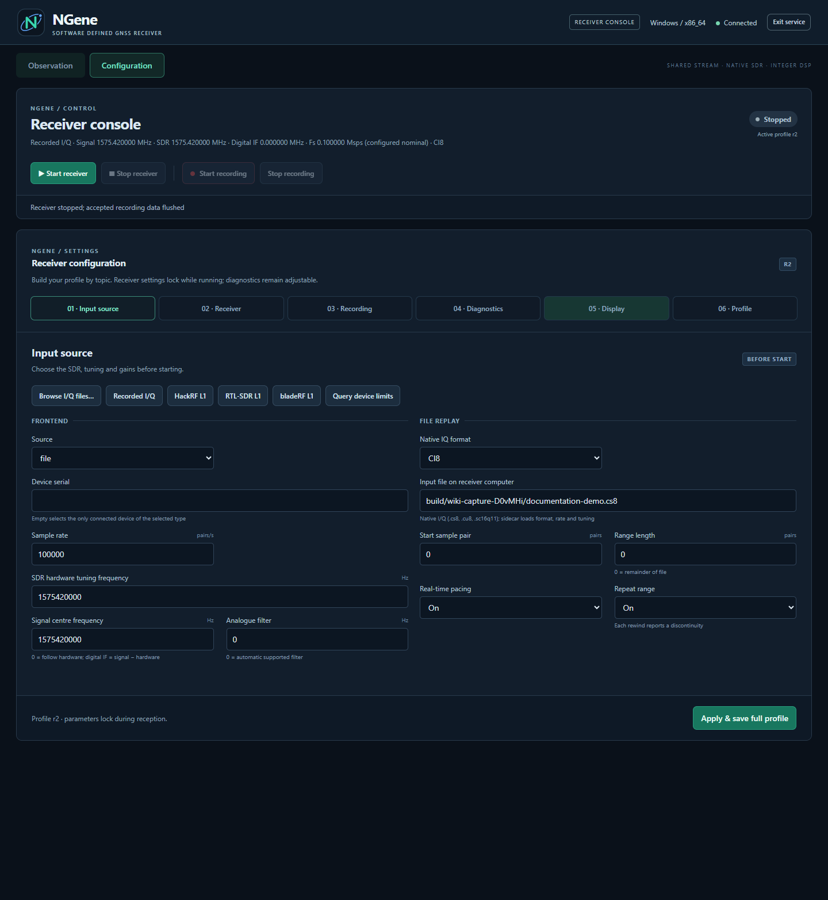
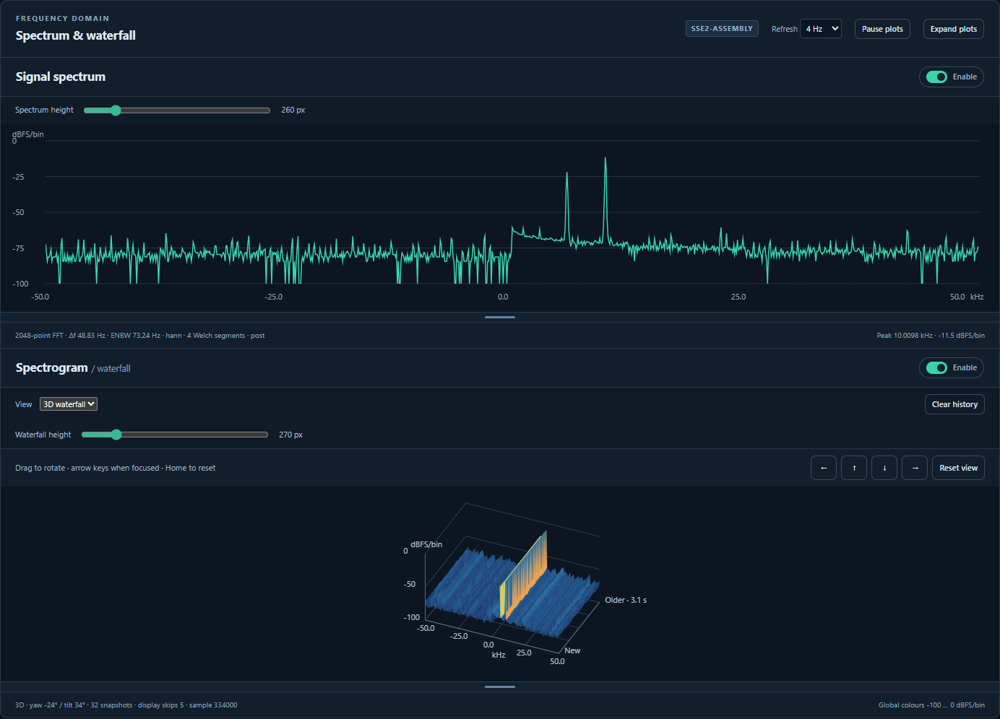

# GUI guide

The local receiver console has two views: **Observation** for live diagnostics and **Configuration** for the receiver profile. The browser sends commands and draws results; sample acquisition, FFT computation, and recording run in the NGene process.

## Receiver and recording controls

| Control | Effect |
| --- | --- |
| Start receiver | Opens the selected source and starts the engine using the applied profile |
| Stop receiver | Stops sample input and completes receiver cleanup, including closing an active recording |
| Start recording | Starts a new capture while the receiver keeps running |
| Stop recording | Stops accepting new capture windows, drains the writer queue, and closes the recording; sample reception continues |
| Exit service | After confirmation, stops the receiver, finishes recording, and closes the local service |

Start is unavailable while a profile has unapplied edits, when the receiver state prevents it, or when a file source has no input path. A command can take time to complete; observe the state badge and status message before issuing the next action.

## Configure a receiver

*Actual NGene configuration view used for the deterministic I/Q replay demonstration. No RF capture or navigation fix is implied.*

| Tab | Use |
| --- | --- |
| Input source | Select file, HackRF, RTL-SDR, or bladeRF; set tuning, precision, rate, device controls, or replay range |
| Receiver | Set duration, timeout, conditioning, common-window size, and buffer policy |
| Recording | Set capture point, recording on start, receiver-side destination, filename, queue, and rotation |
| Diagnostics | Change FFT, averaging, histogram, and observation-source parameters |
| Display | Set axes, colour limits, waterfall history and rate, and histogram presentation |
| Profile | Import, export, validate, or inspect the complete INI profile |

Receiver and recording profile settings are edited while stopped. **Apply & save full profile** validates and persists the complete profile on the receiver computer. **Validate** checks a draft without applying it. Source presets prepare a draft; they do not start receiving samples.

**Query device limits** queries the selected native device while stopped. It loads discrete RTL-SDR gain choices or bladeRF ranges and gain steps for the selected device and tuning. Applying a profile does not guarantee a connected device will accept every setting; hardware startup reports any rejection.

**Apply analysis settings** changes diagnostics during a run. These changes stay in the current session. To retain them across launches, stop the receiver and save the full profile. The same rule applies to runtime spectrum Enable changes.

**Import INI** reads a profile from the browser computer into a draft. **Export INI** downloads the current draft through the browser. **Use edited INI** loads the advanced editor into the form; validate and apply afterward. Importing or exporting is separate from starting the receiver.

## Read Observation

The top counters show processed complex I/Q pairs, common processing windows, observed input delivery rate, written bytes, and known input losses. Rates and sample counts describe the stream; they are not GNSS observables.

**Stream health** reports queue usage, recording backlog, applied RF filtering, ring high-water mark, and queued pairs discarded at stop. **Input integrity** distinguishes software overflow and transport errors from hardware continuity information. An unsupported hardware loss measurement is not proof that the RF stream had no losses.

The **Recording session** card shows the current or last capture name and receiver-side destination. **Capture files & transfer** lists data and associated metadata/index files. **Refresh files** updates the listing; **Transfer** downloads a closed file to the browser computer. **Replay** prepares a stopped receiver for file selection. **Delete** removes only the selected file after confirmation, keeping its related files.

The **Browser event log** records console messages. Clearing it clears the browser display; it does not reset sample counters or remove capture files.

## Plot controls and CPU use

The spectrum and waterfall each have an **Enable** checkbox. Disabling a plot collapses its image. The first enabled spectrum/waterfall switches the runtime spectrum computation on, even when the profile originally set it off. Disabling the last one switches it off. Both displays share one PSD producer, so enabling both does not request two separate FFT calculations.

**I/Q histograms** controls histogram visibility and demand independently. If the diagnostic configuration has `histogram_enabled=false`, showing the histogram alone does not override that setting; enable it in **Diagnostics**.

**Pause plots** suspends this browser's diagnostic demand, including histograms. **Resume plots** renews it. Reception and recording continue. The Configuration view and a hidden browser tab also withdraw this browser's diagnostic demand. Other connected consumers can keep the corresponding diagnostic producer active. Disabling spectrum computation itself is a session setting and affects all consumers of that receiver.

The **Refresh** menu controls how often the browser requests status. It is separate from the server's spectrum/histogram rate limits and the waterfall's row rate limit. Lowering browser refresh alone does not change FFT size or Welch segment count.

Use **Expand plots** to enlarge the plot area and Escape to leave the expanded view. Each plot has a height slider and a resize handle (180–720 pixels). These are browser presentation controls.

## Waterfall interaction

*Actual 3D waterfall drawn from the deterministic replay fixture. The display shows I/Q spectral history, not satellite tracking results.*

Select **2D waterfall** or **3D waterfall** using **View**. In 2D, the newest observation is at the top. In the default 3D view, it is at the front. Drag the 3D plot or use the rotation buttons to change its orientation. With the plot focused, arrow keys rotate it; Home, **Reset view**, or a double click restores the default camera. **Clear history** removes displayed waterfall history without deleting I/Q files or stopping the receiver.

Display settings apply a common colour range to every history row. The frequency reference changes labels only; it does not retune hardware or mix the samples. See [Signal diagnostics](Signal-Diagnostics.md) for units and interpretation, and [Configuration reference](Configuration-Reference.md) for calculation parameters.
