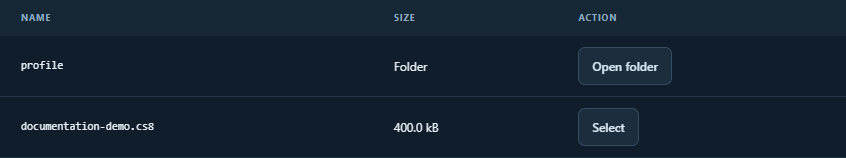

# Getting started

NGene can inspect an existing I/Q recording without SDR hardware. A live receiver requires the selected device's native library, operating-system driver, antenna, and suitable RF input.

## Build the application

Use CMake 3.26 or newer, a C11 compiler, and the platform's normal build tools. Run commands from the repository root. The browser assets are embedded in the executable during the build.

For a replay-only build on Windows with Visual Studio's C/C++ build tools installed:

```powershell
cmake --preset windows-msvc-x64
cmake --build --preset windows-msvc-x64
.\build\msvc-x64\Release\ngene.exe --version
```

For Linux or macOS:

```sh
cmake -S . -B build/release -DCMAKE_BUILD_TYPE=Release
cmake --build build/release --parallel
./build/release/ngene --version
```

The default build includes file replay and the web console. Native SDR support is optional. Use the `windows-msvc-x64-multisdr`, `linux-multisdr`, or `macos-multisdr` preset to request all three device adapters; the corresponding SDKs and their dependencies must be available. Windows presets can resolve dependencies through the configured vcpkg integration. The `--version` output reports which native adapters were compiled in and the selected FFT backend. An adapter listed as available does not establish that a device is connected.

## Open the console

Windows:

```powershell
.\build\msvc-x64\Release\ngene.exe --web --output-dir captures
```

Linux or macOS:

```sh
./build/release/ngene --web --output-dir captures
```

Open **http://127.0.0.1:8080** in a browser on the receiver computer. The service binds to the loopback interface. It starts with the receiver stopped, so you can review the input and settings before acquisition of samples begins.

`--output-dir` selects the directory containing the saved GUI profile (`receiver.ini`) and the default capture destination. If a saved profile exists, a launch without `--config` loads it. An explicit `--config` supplies the startup profile instead.

## Replay an existing recording

1. Open **Configuration → Input source → Browse I/Q files…**.
2. Browse storage on the computer running NGene and select a raw I/Q file.
3. Review the preview and click **Use selected file**. A valid NGene sidecar supplies format, sample rate, tuning, and other capture information. Without metadata, enter the correct format, rate, and RF reference yourself.
4. Review **Real-time pacing**, **Repeat range**, **Start sample pair**, and **Range length**. The default pacing uses the configured complex sample rate.
5. Click **Apply & save full profile** and then **Start receiver**.
6. Return to **Observation** to inspect the stream and plots. Stop playback with **Stop receiver**; without repeat, it also stops at the end of the selected range.



*Actual file picker used for the deterministic replay demonstration. Files belong to the receiver computer, not to the browser's upload directory.*

The application does not generate GNSS test signals as an operator function. The screenshots in this manual use an explicitly prepared deterministic I/Q test fixture.

## Use an SDR

Connect the device, then check discovery:

```sh
ngene --list-devices
```

Use the full executable path from your build when `ngene` is not on `PATH`.

In **Configuration → Input source**, choose **HackRF L1**, **RTL-SDR L1**, or **bladeRF L1** as a starting profile. Select the serial number if necessary, choose a sample rate supported by the device, and click **Query device limits**. Review tuning, bandwidth, and gains before applying the profile and starting the receiver. The L1 presets set a nominal RF centre of **1,575,420,000 Hz**; they do not perform satellite acquisition or tracking.

The presets leave antenna power and bias-tee settings off. Enable the relevant setting only when your connected antenna or RF accessory requires that power and is compatible with the device.

## Command-line operation

```sh
ngene --help
ngene --version
ngene --list-devices
ngene --config config/hackrf.ini
ngene --replay captures/example_000000.cs8
ngene --config config/replay.ini --replay captures/example_000000.cs8
ngene --web --config config/bladerf.ini --port 8081 --output-dir captures
```

Replace example filenames with existing files. `--replay` reads capture metadata when present. Without a usable sidecar it requires an explicit `--config` with the correct stream parameters. CLI operation starts the receiver directly and prints counters on completion. Use Ctrl+C to request a normal stop. For interactive plots, run with `--web`.

Supported options are `--web`, `--config FILE`, `--replay FILE`, `--port N` (1024–65535), and `--output-dir DIR`. The informational commands `--help`, `--version`, and `--list-devices` are used by themselves. Without arguments, CLI mode uses `config/hackrf.ini`; its example profile runs for 10 seconds.
