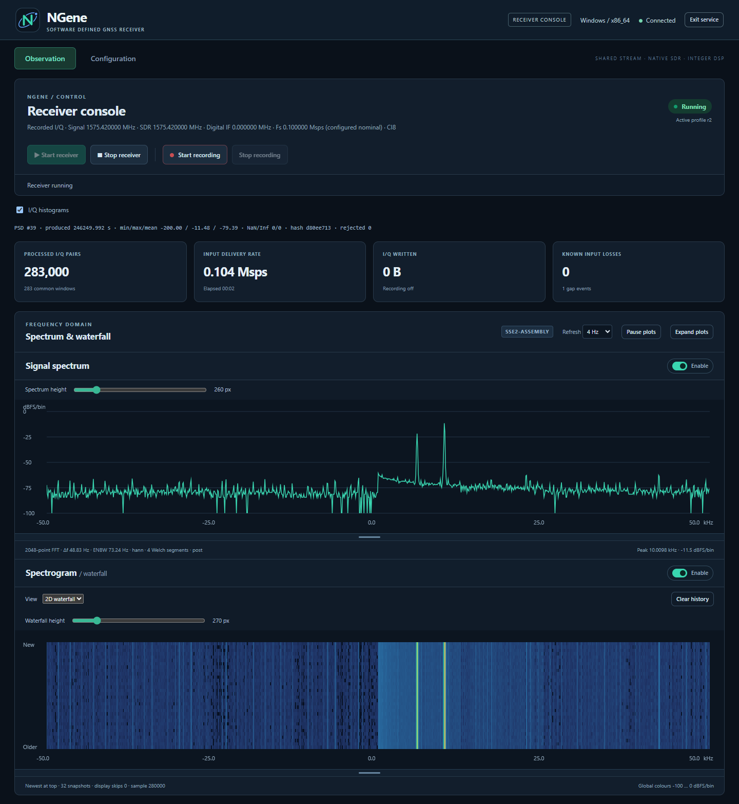

# NGene operator manual

NGene is a software defined GNSS receiver project written in C11. It takes complex I/Q samples from an SDR or a recording and passes them through a shared receiver engine. This manual covers the working application: input selection, signal conditioning, spectrum and waterfall inspection, I/Q statistics, recording, and replay.

**The current application does not yet integrate satellite acquisition, tracking, navigation message decoding, or a position, velocity, and time (PVT) solution.** A visible spectrum or a running sample counter is not evidence of satellite lock or a navigation fix.

*Actual NGene GUI running a deterministic I/Q replay test fixture. This is a software demonstration, not an RF capture or a GNSS fix.*

## What you can operate

| Function | Available behavior |
| --- | --- |
| Live input | Native HackRF, RTL-SDR, and bladeRF adapters when enabled in the build |
| Recorded input | Read-only replay of interleaved CI8, CU8, or little-endian SC16 Q11 samples |
| Conditioning | Bypass or a continuous I/Q DC estimator and remover |
| Diagnostics | Integer FFT spectrum, 2D and 3D waterfall, independent I/Q histograms and statistics |
| Capture | Asynchronous native-format recording, segment rotation, metadata, and a sample index |
| Control | Command-line operation and a local browser console |

The browser console controls one receiver with one active source. Switching between an SDR and a file requires stopping that receiver and applying the new profile. A separate NGene process on another port can replay an existing closed recording independently.

## Read the manual

- [Getting started](Getting-Started.md): build, launch, and select the first input.
- [GUI guide](GUI-Guide.md): receiver controls, configuration, displays, and storage.
- [Configuration reference](Configuration-Reference.md): every supported INI key, its default, units, and validation limits.
- [Signal diagnostics](Signal-Diagnostics.md): interpret the plots and control CPU use.
- [Recording and replay](Recording-and-Replay.md): capture files, metadata, ranges, and pacing.
- [Troubleshooting](Troubleshooting.md): common startup, stream, display, and storage problems.

These pages are maintained as GitHub Wiki-compatible Markdown in the project repository. The operating instructions describe the current code, rather than the capabilities of earlier NGene distributions.
